# smart-home-cards

**Home Assistant Lovelace cards: beautiful, complete, one file. / Card Lovelace belle e complete per Home Assistant, in un solo file.**

[](https://github.com/hacs/default)
[](https://github.com/Simonz82/smart-home-cards/releases/latest)
[](LICENSE)
[](https://github.com/Simonz82/smart-home-cards/actions/workflows/validate.yml)

[](https://my.home-assistant.io/redirect/hacs_repository/?owner=Simonz82&repository=smart-home-cards&category=plugin)

**[🇬🇧 English](#english) · [🇮🇹 Italiano](#italiano)**

> English first because the project is used worldwide (HACS, Dutch and English users); the Italian version below is complete and identical in content. / Inglese per primo perché il progetto è usato in tutto il mondo; la versione italiana qui sotto è completa e identica nei contenuti.

---

<a id="english"></a>
## 🇬🇧 English

### What is it?
Beautiful, complete Lovelace cards for Home Assistant. One JavaScript file, 18 cards, a built-in visual editor (no YAML needed), a settings pop-up and a statistics pop-up on every card. Works on desktop and phone.

Tap a card to open its guide.

<table>
  <tr>
    <td align="center" valign="top" colspan="2"><a href="https://github.com/Simonz82/smart-home-cards/blob/main/docs/elettrodomestici.md"></a><br><b><a href="https://github.com/Simonz82/smart-home-cards/blob/main/docs/elettrodomestici.md">🧺 Washing machine</a></b></td>
    <td align="center" valign="top" colspan="2"><a href="https://github.com/Simonz82/smart-home-cards/blob/main/docs/elettrodomestici.md"></a><br><b><a href="https://github.com/Simonz82/smart-home-cards/blob/main/docs/elettrodomestici.md">🧺 Dryer</a></b></td>
    <td align="center" valign="top" colspan="2"><a href="https://github.com/Simonz82/smart-home-cards/blob/main/docs/elettrodomestici.md"></a><br><b><a href="https://github.com/Simonz82/smart-home-cards/blob/main/docs/elettrodomestici.md">🍽️ Dishwasher</a></b></td>
  </tr>
  <tr>
    <td align="center" valign="top" colspan="2"><a href="https://github.com/Simonz82/smart-home-cards/blob/main/docs/elettrodomestici.md"></a><br><b><a href="https://github.com/Simonz82/smart-home-cards/blob/main/docs/elettrodomestici.md">🍗 Oven</a></b></td>
    <td align="center" valign="top" colspan="2"><a href="https://github.com/Simonz82/smart-home-cards/blob/main/docs/frigo-tablet.md">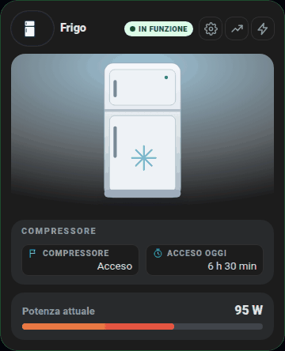</a><br><b><a href="https://github.com/Simonz82/smart-home-cards/blob/main/docs/frigo-tablet.md">🧊 Fridge</a></b></td>
    <td align="center" valign="top" colspan="2"><a href="https://github.com/Simonz82/smart-home-cards/blob/main/docs/elettrodomestici.md#-friggitrice-microonde-piastra-e-piano-a-induzione">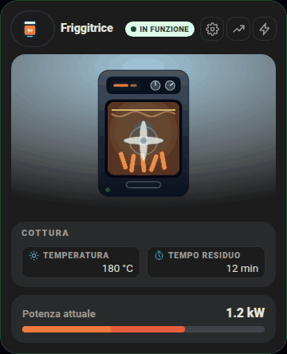</a><br><b><a href="https://github.com/Simonz82/smart-home-cards/blob/main/docs/elettrodomestici.md#-friggitrice-microonde-piastra-e-piano-a-induzione">🍟 Air fryer</a></b></td>
  </tr>
  <tr>
    <td align="center" valign="top" colspan="2"><a href="https://github.com/Simonz82/smart-home-cards/blob/main/docs/elettrodomestici.md#-friggitrice-microonde-piastra-e-piano-a-induzione">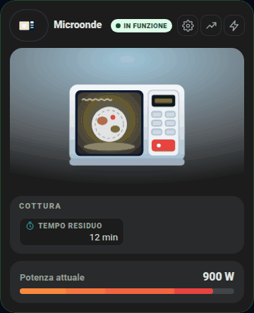</a><br><b><a href="https://github.com/Simonz82/smart-home-cards/blob/main/docs/elettrodomestici.md#-friggitrice-microonde-piastra-e-piano-a-induzione">📡 Microwave</a></b></td>
    <td align="center" valign="top" colspan="2"><a href="https://github.com/Simonz82/smart-home-cards/blob/main/docs/elettrodomestici.md#-friggitrice-microonde-piastra-e-piano-a-induzione">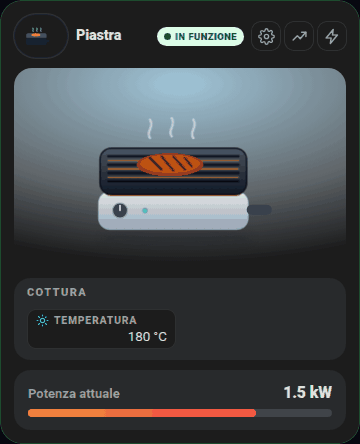</a><br><b><a href="https://github.com/Simonz82/smart-home-cards/blob/main/docs/elettrodomestici.md#-friggitrice-microonde-piastra-e-piano-a-induzione">🥩 Griddle</a></b></td>
    <td align="center" valign="top" colspan="2"><a href="https://github.com/Simonz82/smart-home-cards/blob/main/docs/elettrodomestici.md#-friggitrice-microonde-piastra-e-piano-a-induzione">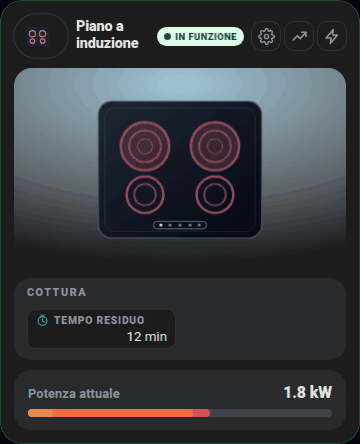</a><br><b><a href="https://github.com/Simonz82/smart-home-cards/blob/main/docs/elettrodomestici.md#-friggitrice-microonde-piastra-e-piano-a-induzione">🍳 Induction hob</a></b></td>
  </tr>
  <tr>
    <td align="center" valign="top" colspan="2"><a href="https://github.com/Simonz82/smart-home-cards/blob/main/docs/elettrodomestici.md#-nuovi-disegni-animati-1200">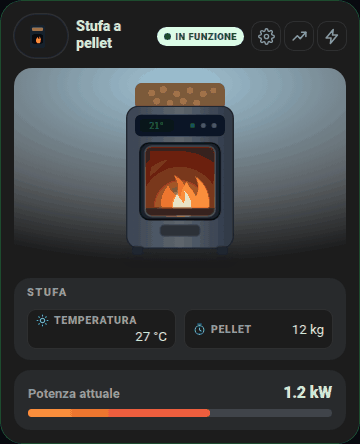</a><br><b><a href="https://github.com/Simonz82/smart-home-cards/blob/main/docs/elettrodomestici.md#-nuovi-disegni-animati-1200">🔥 Pellet stove</a></b></td>
    <td align="center" valign="top" colspan="2"><a href="https://github.com/Simonz82/smart-home-cards/blob/main/docs/elettrodomestici.md#-nuovi-disegni-animati-1200">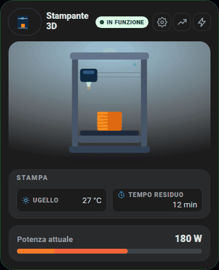</a><br><b><a href="https://github.com/Simonz82/smart-home-cards/blob/main/docs/elettrodomestici.md#-nuovi-disegni-animati-1200">🖨️ 3D printer</a></b></td>
    <td align="center" valign="top" colspan="2"><a href="https://github.com/Simonz82/smart-home-cards/blob/main/docs/elettrodomestici.md#-nuovi-disegni-animati-1200">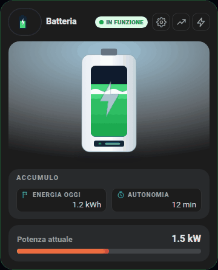</a><br><b><a href="https://github.com/Simonz82/smart-home-cards/blob/main/docs/elettrodomestici.md#-nuovi-disegni-animati-1200">🔋 Battery</a></b></td>
  </tr>
  <tr>
    <td align="center" valign="top" colspan="2"><a href="https://github.com/Simonz82/smart-home-cards/blob/main/docs/elettrodomestici.md#-nuovi-disegni-animati-1200">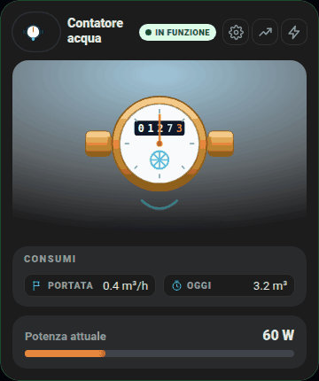</a><br><b><a href="https://github.com/Simonz82/smart-home-cards/blob/main/docs/elettrodomestici.md#-nuovi-disegni-animati-1200">💧 Water meter</a></b></td>
    <td align="center" valign="top" colspan="2"><a href="https://github.com/Simonz82/smart-home-cards/blob/main/docs/elettrodomestici.md#-nuovi-disegni-animati-1200">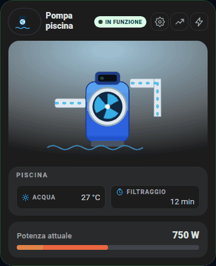</a><br><b><a href="https://github.com/Simonz82/smart-home-cards/blob/main/docs/elettrodomestici.md#-nuovi-disegni-animati-1200">🏊 Pool pump</a></b></td>
    <td align="center" valign="top" colspan="2"><a href="https://github.com/Simonz82/smart-home-cards/blob/main/docs/elettrodomestici.md#-nuovi-disegni-animati-1200">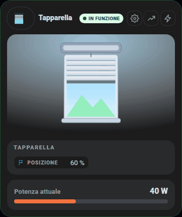</a><br><b><a href="https://github.com/Simonz82/smart-home-cards/blob/main/docs/elettrodomestici.md#-nuovi-disegni-animati-1200">🪟 Roller blind</a></b></td>
  </tr>
  <tr>
    <td align="center" valign="top" colspan="2"><a href="https://github.com/Simonz82/smart-home-cards/blob/main/docs/elettrodomestici.md#-nuovi-disegni-animati-1200">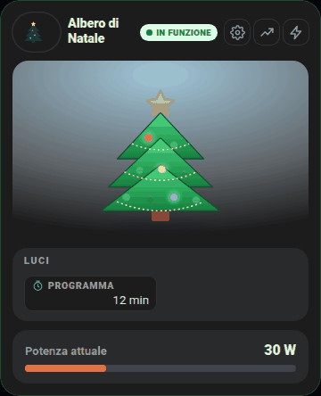</a><br><b><a href="https://github.com/Simonz82/smart-home-cards/blob/main/docs/elettrodomestici.md#-nuovi-disegni-animati-1200">🎄 Christmas tree</a></b></td>
    <td align="center" valign="top" colspan="2"><a href="https://github.com/Simonz82/smart-home-cards/blob/main/docs/elettrodomestici.md#-nuovi-disegni-animati-1200">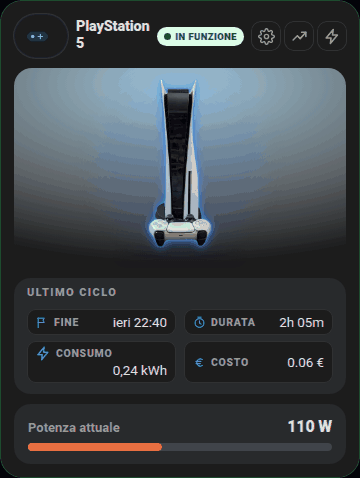</a><br><b><a href="https://github.com/Simonz82/smart-home-cards/blob/main/docs/elettrodomestici.md#-nuovi-disegni-animati-1200">🎮 Game console</a></b></td>
    <td align="center" valign="top" colspan="2"><a href="https://github.com/Simonz82/smart-home-cards/blob/main/docs/frigo-tablet.md">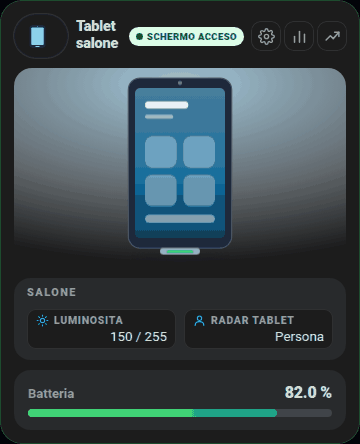</a><br><b><a href="https://github.com/Simonz82/smart-home-cards/blob/main/docs/frigo-tablet.md">📱 Wall tablet</a></b></td>
  </tr>
  <tr>
    <td align="center" valign="top" colspan="2"><a href="https://github.com/Simonz82/smart-home-cards/blob/main/docs/energia.md">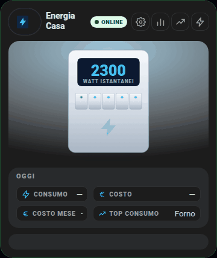</a><br><b><a href="https://github.com/Simonz82/smart-home-cards/blob/main/docs/energia.md">⚡ Home Energy</a></b></td>
    <td align="center" valign="top" colspan="2"><a href="https://github.com/Simonz82/smart-home-cards/blob/main/docs/clima.md"></a><br><b><a href="https://github.com/Simonz82/smart-home-cards/blob/main/docs/clima.md">❄️ Air conditioner</a></b></td>
    <td align="center" valign="top" colspan="2"><a href="https://github.com/Simonz82/smart-home-cards/blob/main/docs/stufetta.md"></a><br><b><a href="https://github.com/Simonz82/smart-home-cards/blob/main/docs/stufetta.md">🔥 Heater</a></b></td>
  </tr>
  <tr>
    <td align="center" valign="top" colspan="2"><a href="https://github.com/Simonz82/smart-home-cards/blob/main/docs/ventilatore.md"></a><br><b><a href="https://github.com/Simonz82/smart-home-cards/blob/main/docs/ventilatore.md">🌀 Fan</a></b></td>
    <td align="center" valign="top" colspan="2"><a href="https://github.com/Simonz82/smart-home-cards/blob/main/docs/caldaia.md"></a><br><b><a href="https://github.com/Simonz82/smart-home-cards/blob/main/docs/caldaia.md">🔥 Boiler and radiators</a></b></td>
    <td align="center" valign="top" colspan="2"><a href="https://github.com/Simonz82/smart-home-cards/blob/main/docs/scaldacqua.md">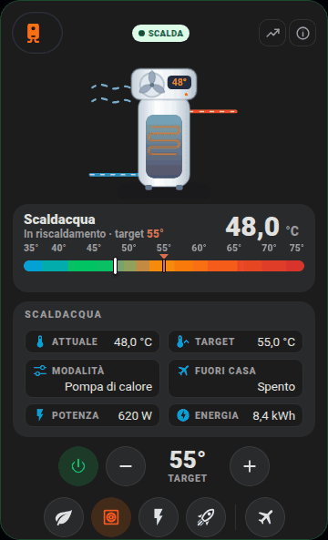</a><br><b><a href="https://github.com/Simonz82/smart-home-cards/blob/main/docs/scaldacqua.md">🚿 Water heater</a></b></td>
  </tr>
  <tr>
    <td align="center" valign="top" colspan="2"><a href="https://github.com/Simonz82/smart-home-cards/blob/main/docs/fritzbox.md">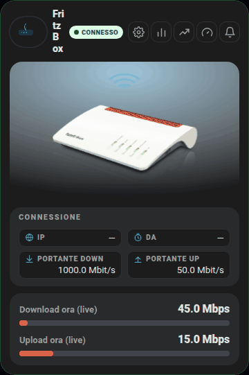</a><br><b><a href="https://github.com/Simonz82/smart-home-cards/blob/main/docs/fritzbox.md">📶 FRITZ!Box</a></b></td>
    <td align="center" valign="top" colspan="2"><a href="https://github.com/Simonz82/smart-home-cards/blob/main/docs/zigbee.md"></a><br><b><a href="https://github.com/Simonz82/smart-home-cards/blob/main/docs/zigbee.md">📡 Zigbee network</a></b></td>
    <td align="center" valign="top" colspan="2"><a href="https://github.com/Simonz82/smart-home-cards/blob/main/docs/homeassistant-server.md">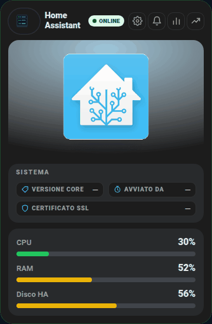</a><br><b><a href="https://github.com/Simonz82/smart-home-cards/blob/main/docs/homeassistant-server.md">🖥️ Home Assistant server</a></b></td>
  </tr>
  <tr>
    <td align="center" valign="top" colspan="2"><a href="https://github.com/Simonz82/smart-home-cards/blob/main/docs/nas-synology.md">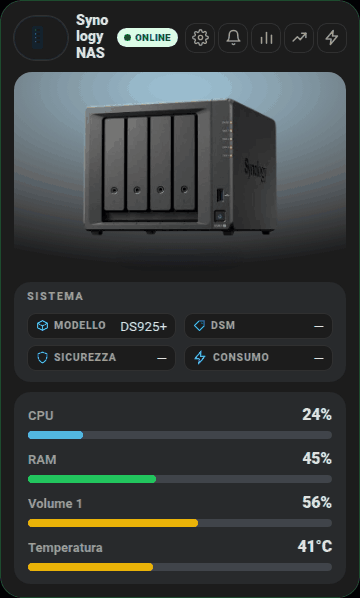</a><br><b><a href="https://github.com/Simonz82/smart-home-cards/blob/main/docs/nas-synology.md">💾 Synology NAS</a></b></td>
    <td align="center" valign="top" colspan="2"><a href="https://github.com/Simonz82/smart-home-cards/blob/main/docs/proxmox.md">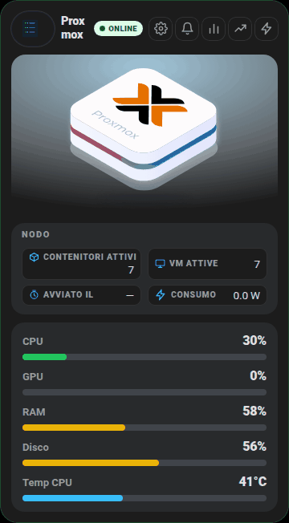</a><br><b><a href="https://github.com/Simonz82/smart-home-cards/blob/main/docs/proxmox.md">🖧 Proxmox</a></b></td>
    <td align="center" valign="top" colspan="2"><a href="https://github.com/Simonz82/smart-home-cards/blob/main/docs/ups.md">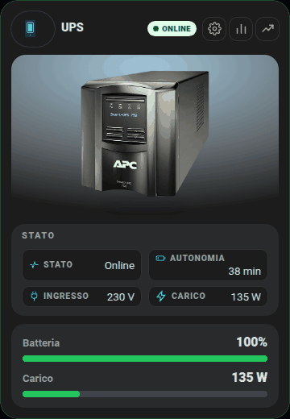</a><br><b><a href="https://github.com/Simonz82/smart-home-cards/blob/main/docs/ups.md">🔋 UPS</a></b></td>
  </tr>
  <tr>
    <td align="center" valign="top" colspan="2"><a href="https://github.com/Simonz82/smart-home-cards/blob/main/docs/differenziata.md">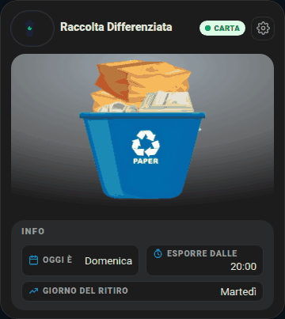</a><br><b><a href="https://github.com/Simonz82/smart-home-cards/blob/main/docs/differenziata.md">♻️ Waste collection</a></b></td>
    <td align="center" valign="top" colspan="2"><a href="https://github.com/Simonz82/smart-home-cards/blob/main/docs/centro-notifiche.md">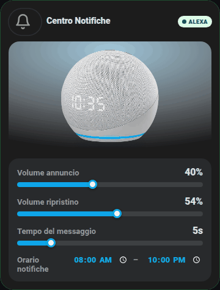</a><br><b><a href="https://github.com/Simonz82/smart-home-cards/blob/main/docs/centro-notifiche.md">🔔 Notification center</a></b></td>
    <td align="center" valign="top" colspan="2"><a href="https://github.com/Simonz82/smart-home-cards/blob/main/docs/alexa.md">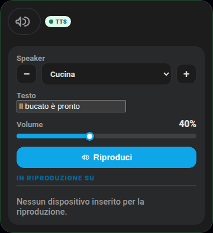</a><br><b><a href="https://github.com/Simonz82/smart-home-cards/blob/main/docs/alexa.md">🔊 Alexa text announce</a></b></td>
  </tr>
  <tr>
    <td colspan="1"></td>
    <td align="center" valign="top" colspan="2"><a href="https://github.com/Simonz82/smart-home-cards/blob/main/docs/alexa.md">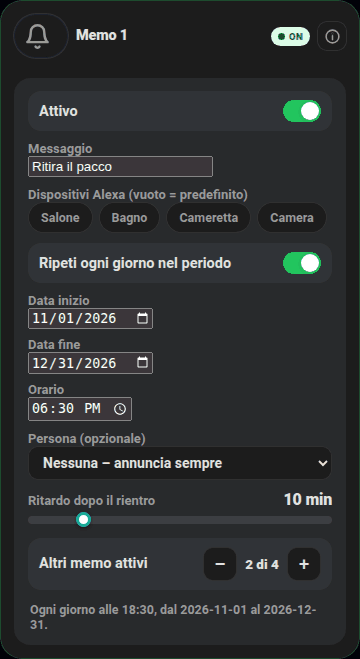</a><br><b><a href="https://github.com/Simonz82/smart-home-cards/blob/main/docs/alexa.md">🔊 Alexa memo</a></b></td>
    <td align="center" valign="top" colspan="2"><a href="https://github.com/Simonz82/smart-home-cards/blob/main/docs/alexa.md">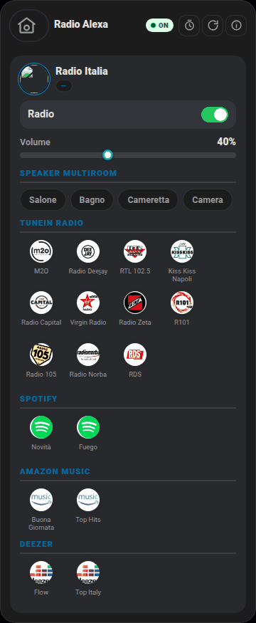</a><br><b><a href="https://github.com/Simonz82/smart-home-cards/blob/main/docs/alexa.md">📻 Alexa web radio</a></b></td>
    <td colspan="1"></td>
  </tr>
  <tr>
    <td align="center" valign="top" colspan="2"><a href="https://github.com/Simonz82/smart-home-cards/blob/main/docs/elettrodomestici.md"></a><br><b><a href="https://github.com/Simonz82/smart-home-cards/blob/main/docs/elettrodomestici.md">📺 TV</a></b></td>
    <td align="center" valign="top" colspan="2"><a href="https://github.com/Simonz82/smart-home-cards/blob/main/docs/tv.md">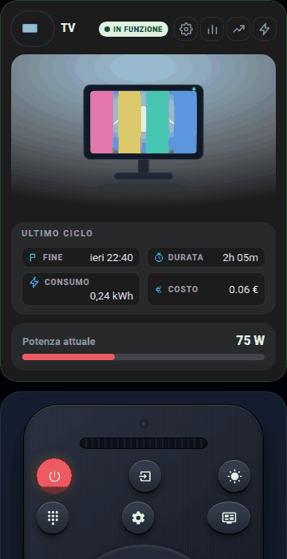</a><br><b><a href="https://github.com/Simonz82/smart-home-cards/blob/main/docs/tv.md">📺 TV + Samsung remote</a></b></td>
    <td align="center" valign="top" colspan="2"><a href="https://github.com/Simonz82/smart-home-cards/blob/main/docs/tv.md">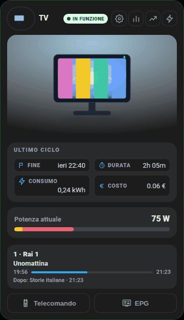</a><br><b><a href="https://github.com/Simonz82/smart-home-cards/blob/main/docs/tv.md">📺 TV + TV guide (EPG)</a></b></td>
  </tr>
</table>

<sub>All previews are animated and show the cards switched on, with sample data.</sub>

**What's new?** See the [CHANGELOG](CHANGELOG.md) and the [releases](https://github.com/Simonz82/smart-home-cards/releases).

### Install
**With the Marketplace (recommended).** From Home Assistant 2026.11 HACS is the built-in **Marketplace** (before that, it is the HACS menu).
1. Press the **Open in Marketplace (HACS)** button above, or open **Settings > Marketplace** and search for **Smart Home Cards**.
2. Press **Download**. Updates then arrive by themselves.
3. Reload the browser page (Ctrl+F5).

**By hand.**
1. Download [`smart-home-cards.js`](smart-home-cards.js) and copy it to `/config/www/`.
2. Go to **Settings > Dashboards > (three dots) > Resources > Add resource**. URL `/local/smart-home-cards.js`, type **JavaScript module**.
3. Reload the browser page (Ctrl+F5).

Full step-by-step guide: [docs/installazione.md](https://github.com/Simonz82/smart-home-cards/blob/main/docs/installazione.md) (Italian).

### First card
Open a dashboard, press **Edit > Add card**, search for the card by name and fill in the fields. Or, in YAML:

```yaml
type: custom:shc-appliance-clone-card
name: Washing machine
artwork: washer
power_entity: sensor.washing_machine_power   # your own power sensor, in watts
threshold_run: 5                             # above this = "running"
```

Replace the entity with yours. Every card has a guide with all options, examples and ready-made packages.

### Guides, one per card
- [Appliances (washer, dryer, dishwasher, oven, TV, fridge and more)](https://github.com/Simonz82/smart-home-cards/blob/main/docs/elettrodomestici.md)
- [Home Energy](https://github.com/Simonz82/smart-home-cards/blob/main/docs/energia.md)
- [Air conditioner](https://github.com/Simonz82/smart-home-cards/blob/main/docs/clima.md)
- [Heater](https://github.com/Simonz82/smart-home-cards/blob/main/docs/stufetta.md)
- [Fan](https://github.com/Simonz82/smart-home-cards/blob/main/docs/ventilatore.md)
- [Boiler and radiators](https://github.com/Simonz82/smart-home-cards/blob/main/docs/caldaia.md)
- [Water heater](https://github.com/Simonz82/smart-home-cards/blob/main/docs/scaldacqua.md)
- [FRITZ!Box](https://github.com/Simonz82/smart-home-cards/blob/main/docs/fritzbox.md)
- [Zigbee network](https://github.com/Simonz82/smart-home-cards/blob/main/docs/zigbee.md)
- [Home Assistant server](https://github.com/Simonz82/smart-home-cards/blob/main/docs/homeassistant-server.md)
- [Synology NAS](https://github.com/Simonz82/smart-home-cards/blob/main/docs/nas-synology.md)
- [Proxmox](https://github.com/Simonz82/smart-home-cards/blob/main/docs/proxmox.md)
- [UPS](https://github.com/Simonz82/smart-home-cards/blob/main/docs/ups.md)
- [Waste collection](https://github.com/Simonz82/smart-home-cards/blob/main/docs/differenziata.md)
- [Notification center](https://github.com/Simonz82/smart-home-cards/blob/main/docs/centro-notifiche.md)
- [Alexa (text, memo, web radio)](https://github.com/Simonz82/smart-home-cards/blob/main/docs/alexa.md)

Also: [layouts](https://github.com/Simonz82/smart-home-cards/blob/main/docs/layout.md), [charts](https://github.com/Simonz82/smart-home-cards/blob/main/docs/grafici.md), [custom notifications](https://github.com/Simonz82/smart-home-cards/blob/main/docs/notifiche-personalizzate.md), [TV guide and remote](https://github.com/Simonz82/smart-home-cards/blob/main/docs/tv.md).

### Languages
All cards and their editors follow the language of Home Assistant: **Italian, English, Dutch** (thanks to @hartliefHA). Any other language shows English. Nothing to configure. Want to add a language? See [docs/lingue.md](https://github.com/Simonz82/smart-home-cards/blob/main/docs/lingue.md).

### FAQ and common problems
- **The card shows "Custom element doesn't exist".** The resource is missing. Add `/local/smart-home-cards.js` (manual) or check that the download finished (Marketplace). Then reload.
- **I installed or updated it but nothing changes.** Clear the browser cache or press **Ctrl+F5**. On the phone app: Settings > Companion app > Troubleshooting > Reset frontend cache.
- **Product photos (router, NAS, UPS) are empty.** Copy the [`foto-pkg/`](foto-pkg) folder to `/config/www/foto-pkg/` (see the install guide).
- **The card is empty or shows dashes.** Check that the entities you wrote exist and have a value.
- **Settings pop-up says "No settings configured".** Normal: add `settings_sections` from the card guide.

### Support
- Found a bug or want a feature? Open an [Issue](https://github.com/Simonz82/smart-home-cards/issues/new/choose).
- Questions or ideas? Use the [Discussions](https://github.com/Simonz82/smart-home-cards/discussions).
- Pull requests are welcome.

### License
[MIT](LICENSE): free to use, change and share. The console photos keep their own licenses (some CC BY-SA / CC BY): see [CREDITS.md](CREDITS.md).

---

<a id="italiano"></a>
## 🇮🇹 Italiano

### Che cos'è?
Card Lovelace belle e complete per Home Assistant. Un solo file JavaScript, 18 card, editor visuale integrato (niente YAML obbligatorio), popup Impostazioni e Statistiche su ogni card. Funziona su PC e cellulare.

Tocca una card per aprire la sua guida.

<table>
  <tr>
    <td align="center" valign="top" colspan="2"><a href="https://github.com/Simonz82/smart-home-cards/blob/main/docs/elettrodomestici.md"></a><br><b><a href="https://github.com/Simonz82/smart-home-cards/blob/main/docs/elettrodomestici.md">🧺 Lavatrice</a></b></td>
    <td align="center" valign="top" colspan="2"><a href="https://github.com/Simonz82/smart-home-cards/blob/main/docs/elettrodomestici.md"></a><br><b><a href="https://github.com/Simonz82/smart-home-cards/blob/main/docs/elettrodomestici.md">🧺 Asciugatrice</a></b></td>
    <td align="center" valign="top" colspan="2"><a href="https://github.com/Simonz82/smart-home-cards/blob/main/docs/elettrodomestici.md"></a><br><b><a href="https://github.com/Simonz82/smart-home-cards/blob/main/docs/elettrodomestici.md">🍽️ Lavastoviglie</a></b></td>
  </tr>
  <tr>
    <td align="center" valign="top" colspan="2"><a href="https://github.com/Simonz82/smart-home-cards/blob/main/docs/elettrodomestici.md"></a><br><b><a href="https://github.com/Simonz82/smart-home-cards/blob/main/docs/elettrodomestici.md">🍗 Forno</a></b></td>
    <td align="center" valign="top" colspan="2"><a href="https://github.com/Simonz82/smart-home-cards/blob/main/docs/frigo-tablet.md"></a><br><b><a href="https://github.com/Simonz82/smart-home-cards/blob/main/docs/frigo-tablet.md">🧊 Frigo</a></b></td>
    <td align="center" valign="top" colspan="2"><a href="https://github.com/Simonz82/smart-home-cards/blob/main/docs/elettrodomestici.md#-friggitrice-microonde-piastra-e-piano-a-induzione"></a><br><b><a href="https://github.com/Simonz82/smart-home-cards/blob/main/docs/elettrodomestici.md#-friggitrice-microonde-piastra-e-piano-a-induzione">🍟 Friggitrice ad aria</a></b></td>
  </tr>
  <tr>
    <td align="center" valign="top" colspan="2"><a href="https://github.com/Simonz82/smart-home-cards/blob/main/docs/elettrodomestici.md#-friggitrice-microonde-piastra-e-piano-a-induzione"></a><br><b><a href="https://github.com/Simonz82/smart-home-cards/blob/main/docs/elettrodomestici.md#-friggitrice-microonde-piastra-e-piano-a-induzione">📡 Microonde</a></b></td>
    <td align="center" valign="top" colspan="2"><a href="https://github.com/Simonz82/smart-home-cards/blob/main/docs/elettrodomestici.md#-friggitrice-microonde-piastra-e-piano-a-induzione"></a><br><b><a href="https://github.com/Simonz82/smart-home-cards/blob/main/docs/elettrodomestici.md#-friggitrice-microonde-piastra-e-piano-a-induzione">🥩 Piastra</a></b></td>
    <td align="center" valign="top" colspan="2"><a href="https://github.com/Simonz82/smart-home-cards/blob/main/docs/elettrodomestici.md#-friggitrice-microonde-piastra-e-piano-a-induzione"></a><br><b><a href="https://github.com/Simonz82/smart-home-cards/blob/main/docs/elettrodomestici.md#-friggitrice-microonde-piastra-e-piano-a-induzione">🍳 Piano a induzione</a></b></td>
  </tr>
  <tr>
    <td align="center" valign="top" colspan="2"><a href="https://github.com/Simonz82/smart-home-cards/blob/main/docs/elettrodomestici.md#-nuovi-disegni-animati-1200"></a><br><b><a href="https://github.com/Simonz82/smart-home-cards/blob/main/docs/elettrodomestici.md#-nuovi-disegni-animati-1200">🔥 Stufa a pellet</a></b></td>
    <td align="center" valign="top" colspan="2"><a href="https://github.com/Simonz82/smart-home-cards/blob/main/docs/elettrodomestici.md#-nuovi-disegni-animati-1200"></a><br><b><a href="https://github.com/Simonz82/smart-home-cards/blob/main/docs/elettrodomestici.md#-nuovi-disegni-animati-1200">🖨️ Stampante 3D</a></b></td>
    <td align="center" valign="top" colspan="2"><a href="https://github.com/Simonz82/smart-home-cards/blob/main/docs/elettrodomestici.md#-nuovi-disegni-animati-1200"></a><br><b><a href="https://github.com/Simonz82/smart-home-cards/blob/main/docs/elettrodomestici.md#-nuovi-disegni-animati-1200">🔋 Batteria</a></b></td>
  </tr>
  <tr>
    <td align="center" valign="top" colspan="2"><a href="https://github.com/Simonz82/smart-home-cards/blob/main/docs/elettrodomestici.md#-nuovi-disegni-animati-1200"></a><br><b><a href="https://github.com/Simonz82/smart-home-cards/blob/main/docs/elettrodomestici.md#-nuovi-disegni-animati-1200">💧 Contatore acqua</a></b></td>
    <td align="center" valign="top" colspan="2"><a href="https://github.com/Simonz82/smart-home-cards/blob/main/docs/elettrodomestici.md#-nuovi-disegni-animati-1200"></a><br><b><a href="https://github.com/Simonz82/smart-home-cards/blob/main/docs/elettrodomestici.md#-nuovi-disegni-animati-1200">🏊 Pompa piscina</a></b></td>
    <td align="center" valign="top" colspan="2"><a href="https://github.com/Simonz82/smart-home-cards/blob/main/docs/elettrodomestici.md#-nuovi-disegni-animati-1200"></a><br><b><a href="https://github.com/Simonz82/smart-home-cards/blob/main/docs/elettrodomestici.md#-nuovi-disegni-animati-1200">🪟 Tapparella</a></b></td>
  </tr>
  <tr>
    <td align="center" valign="top" colspan="2"><a href="https://github.com/Simonz82/smart-home-cards/blob/main/docs/elettrodomestici.md#-nuovi-disegni-animati-1200"></a><br><b><a href="https://github.com/Simonz82/smart-home-cards/blob/main/docs/elettrodomestici.md#-nuovi-disegni-animati-1200">🎄 Albero di Natale</a></b></td>
    <td align="center" valign="top" colspan="2"><a href="https://github.com/Simonz82/smart-home-cards/blob/main/docs/elettrodomestici.md#-nuovi-disegni-animati-1200"></a><br><b><a href="https://github.com/Simonz82/smart-home-cards/blob/main/docs/elettrodomestici.md#-nuovi-disegni-animati-1200">🎮 Console</a></b></td>
    <td align="center" valign="top" colspan="2"><a href="https://github.com/Simonz82/smart-home-cards/blob/main/docs/frigo-tablet.md"></a><br><b><a href="https://github.com/Simonz82/smart-home-cards/blob/main/docs/frigo-tablet.md">📱 Tablet a muro</a></b></td>
  </tr>
  <tr>
    <td align="center" valign="top" colspan="2"><a href="https://github.com/Simonz82/smart-home-cards/blob/main/docs/energia.md"></a><br><b><a href="https://github.com/Simonz82/smart-home-cards/blob/main/docs/energia.md">⚡ Energia Casa</a></b></td>
    <td align="center" valign="top" colspan="2"><a href="https://github.com/Simonz82/smart-home-cards/blob/main/docs/clima.md"></a><br><b><a href="https://github.com/Simonz82/smart-home-cards/blob/main/docs/clima.md">❄️ Climatizzatore</a></b></td>
    <td align="center" valign="top" colspan="2"><a href="https://github.com/Simonz82/smart-home-cards/blob/main/docs/stufetta.md"></a><br><b><a href="https://github.com/Simonz82/smart-home-cards/blob/main/docs/stufetta.md">🔥 Stufetta</a></b></td>
  </tr>
  <tr>
    <td align="center" valign="top" colspan="2"><a href="https://github.com/Simonz82/smart-home-cards/blob/main/docs/ventilatore.md"></a><br><b><a href="https://github.com/Simonz82/smart-home-cards/blob/main/docs/ventilatore.md">🌀 Ventilatore</a></b></td>
    <td align="center" valign="top" colspan="2"><a href="https://github.com/Simonz82/smart-home-cards/blob/main/docs/caldaia.md"></a><br><b><a href="https://github.com/Simonz82/smart-home-cards/blob/main/docs/caldaia.md">🔥 Caldaia e caloriferi</a></b></td>
    <td align="center" valign="top" colspan="2"><a href="https://github.com/Simonz82/smart-home-cards/blob/main/docs/scaldacqua.md"></a><br><b><a href="https://github.com/Simonz82/smart-home-cards/blob/main/docs/scaldacqua.md">🚿 Scaldacqua</a></b></td>
  </tr>
  <tr>
    <td align="center" valign="top" colspan="2"><a href="https://github.com/Simonz82/smart-home-cards/blob/main/docs/fritzbox.md"></a><br><b><a href="https://github.com/Simonz82/smart-home-cards/blob/main/docs/fritzbox.md">📶 FritzBox</a></b></td>
    <td align="center" valign="top" colspan="2"><a href="https://github.com/Simonz82/smart-home-cards/blob/main/docs/zigbee.md"></a><br><b><a href="https://github.com/Simonz82/smart-home-cards/blob/main/docs/zigbee.md">📡 Rete Zigbee</a></b></td>
    <td align="center" valign="top" colspan="2"><a href="https://github.com/Simonz82/smart-home-cards/blob/main/docs/homeassistant-server.md"></a><br><b><a href="https://github.com/Simonz82/smart-home-cards/blob/main/docs/homeassistant-server.md">🖥️ Server Home Assistant</a></b></td>
  </tr>
  <tr>
    <td align="center" valign="top" colspan="2"><a href="https://github.com/Simonz82/smart-home-cards/blob/main/docs/nas-synology.md"></a><br><b><a href="https://github.com/Simonz82/smart-home-cards/blob/main/docs/nas-synology.md">💾 NAS Synology</a></b></td>
    <td align="center" valign="top" colspan="2"><a href="https://github.com/Simonz82/smart-home-cards/blob/main/docs/proxmox.md"></a><br><b><a href="https://github.com/Simonz82/smart-home-cards/blob/main/docs/proxmox.md">🖧 Proxmox</a></b></td>
    <td align="center" valign="top" colspan="2"><a href="https://github.com/Simonz82/smart-home-cards/blob/main/docs/ups.md"></a><br><b><a href="https://github.com/Simonz82/smart-home-cards/blob/main/docs/ups.md">🔋 UPS</a></b></td>
  </tr>
  <tr>
    <td align="center" valign="top" colspan="2"><a href="https://github.com/Simonz82/smart-home-cards/blob/main/docs/differenziata.md"></a><br><b><a href="https://github.com/Simonz82/smart-home-cards/blob/main/docs/differenziata.md">♻️ Raccolta differenziata</a></b></td>
    <td align="center" valign="top" colspan="2"><a href="https://github.com/Simonz82/smart-home-cards/blob/main/docs/centro-notifiche.md"></a><br><b><a href="https://github.com/Simonz82/smart-home-cards/blob/main/docs/centro-notifiche.md">🔔 Centro notifiche</a></b></td>
    <td align="center" valign="top" colspan="2"><a href="https://github.com/Simonz82/smart-home-cards/blob/main/docs/alexa.md"></a><br><b><a href="https://github.com/Simonz82/smart-home-cards/blob/main/docs/alexa.md">🔊 Alexa annuncio testo</a></b></td>
  </tr>
  <tr>
    <td colspan="1"></td>
    <td align="center" valign="top" colspan="2"><a href="https://github.com/Simonz82/smart-home-cards/blob/main/docs/alexa.md"></a><br><b><a href="https://github.com/Simonz82/smart-home-cards/blob/main/docs/alexa.md">🔊 Alexa memo</a></b></td>
    <td align="center" valign="top" colspan="2"><a href="https://github.com/Simonz82/smart-home-cards/blob/main/docs/alexa.md"></a><br><b><a href="https://github.com/Simonz82/smart-home-cards/blob/main/docs/alexa.md">📻 Alexa WebRadio</a></b></td>
    <td colspan="1"></td>
  </tr>
  <tr>
    <td align="center" valign="top" colspan="2"><a href="https://github.com/Simonz82/smart-home-cards/blob/main/docs/elettrodomestici.md"></a><br><b><a href="https://github.com/Simonz82/smart-home-cards/blob/main/docs/elettrodomestici.md">📺 TV</a></b></td>
    <td align="center" valign="top" colspan="2"><a href="https://github.com/Simonz82/smart-home-cards/blob/main/docs/tv.md"></a><br><b><a href="https://github.com/Simonz82/smart-home-cards/blob/main/docs/tv.md">📺 TV + telecomando Samsung</a></b></td>
    <td align="center" valign="top" colspan="2"><a href="https://github.com/Simonz82/smart-home-cards/blob/main/docs/tv.md"></a><br><b><a href="https://github.com/Simonz82/smart-home-cards/blob/main/docs/tv.md">📺 TV + guida TV (EPG)</a></b></td>
  </tr>
</table>

<sub>Tutte le anteprime sono animate e mostrano le card accese, con dati di esempio.</sub>

**Cosa c'è di nuovo?** Guarda il [CHANGELOG](CHANGELOG.md) e le [release](https://github.com/Simonz82/smart-home-cards/releases).

### Installazione
**Con il Marketplace (consigliato).** Da Home Assistant 2026.11 HACS è il **Marketplace** integrato (prima era il menu HACS).
1. Premi il pulsante **Open in Marketplace (HACS)** qui sopra, oppure apri **Impostazioni > Marketplace** e cerca **Smart Home Cards**.
2. Premi **Scarica**. Gli aggiornamenti arrivano da soli.
3. Ricarica la pagina del browser (Ctrl+F5).

**A mano.**
1. Scarica [`smart-home-cards.js`](smart-home-cards.js) e copialo in `/config/www/`.
2. Vai in **Impostazioni > Dashboard > (tre puntini) > Risorse > Aggiungi risorsa**. URL `/local/smart-home-cards.js`, tipo **Modulo JavaScript**.
3. Ricarica la pagina del browser (Ctrl+F5).

Guida completa passo passo: [docs/installazione.md](https://github.com/Simonz82/smart-home-cards/blob/main/docs/installazione.md).

### La prima card
Apri una dashboard, premi **Modifica > Aggiungi card**, cerca la card per nome e compila i campi. Oppure, in YAML:

```yaml
type: custom:shc-appliance-clone-card
name: Lavatrice
artwork: washer
power_entity: sensor.lavatrice_potenza   # il tuo sensore di potenza, in watt
threshold_run: 5                         # sopra questi watt = "in funzione"
```

Sostituisci l'entità con la tua. Ogni card ha una guida con tutte le opzioni, esempi e package pronti.

### Le guide, una per card
- [Elettrodomestici (lavatrice, asciugatrice, lavastoviglie, forno, TV, frigo e altri)](https://github.com/Simonz82/smart-home-cards/blob/main/docs/elettrodomestici.md)
- [Energia Casa](https://github.com/Simonz82/smart-home-cards/blob/main/docs/energia.md)
- [Climatizzatore](https://github.com/Simonz82/smart-home-cards/blob/main/docs/clima.md)
- [Stufetta](https://github.com/Simonz82/smart-home-cards/blob/main/docs/stufetta.md)
- [Ventilatore](https://github.com/Simonz82/smart-home-cards/blob/main/docs/ventilatore.md)
- [Caldaia e caloriferi](https://github.com/Simonz82/smart-home-cards/blob/main/docs/caldaia.md)
- [Scaldacqua](https://github.com/Simonz82/smart-home-cards/blob/main/docs/scaldacqua.md)
- [FritzBox](https://github.com/Simonz82/smart-home-cards/blob/main/docs/fritzbox.md)
- [Rete Zigbee](https://github.com/Simonz82/smart-home-cards/blob/main/docs/zigbee.md)
- [Server Home Assistant](https://github.com/Simonz82/smart-home-cards/blob/main/docs/homeassistant-server.md)
- [NAS Synology](https://github.com/Simonz82/smart-home-cards/blob/main/docs/nas-synology.md)
- [Proxmox](https://github.com/Simonz82/smart-home-cards/blob/main/docs/proxmox.md)
- [UPS](https://github.com/Simonz82/smart-home-cards/blob/main/docs/ups.md)
- [Raccolta differenziata](https://github.com/Simonz82/smart-home-cards/blob/main/docs/differenziata.md)
- [Centro notifiche](https://github.com/Simonz82/smart-home-cards/blob/main/docs/centro-notifiche.md)
- [Alexa (testo, memo, webradio)](https://github.com/Simonz82/smart-home-cards/blob/main/docs/alexa.md)

Anche: [layout](https://github.com/Simonz82/smart-home-cards/blob/main/docs/layout.md), [grafici](https://github.com/Simonz82/smart-home-cards/blob/main/docs/grafici.md), [notifiche personalizzate](https://github.com/Simonz82/smart-home-cards/blob/main/docs/notifiche-personalizzate.md), [guida TV e telecomando](https://github.com/Simonz82/smart-home-cards/blob/main/docs/tv.md).

### Lingue
Tutte le card e i loro editor seguono la lingua di Home Assistant: **italiano, inglese, olandese** (grazie a @hartliefHA). Con altre lingue si vede l'inglese. Non c'è niente da impostare. Vuoi aggiungere una lingua? Vedi [docs/lingue.md](https://github.com/Simonz82/smart-home-cards/blob/main/docs/lingue.md).

### Domande frequenti e problemi comuni
- **La card dice "Custom element doesn't exist".** Manca la risorsa. Aggiungi `/local/smart-home-cards.js` (a mano) oppure controlla che il download sia finito (Marketplace). Poi ricarica.
- **Ho installato o aggiornato ma non cambia niente.** Svuota la cache del browser o premi **Ctrl+F5**. Nell'app del telefono: Impostazioni > App Companion > Risoluzione problemi > Reimposta cache del frontend.
- **Le foto prodotto (router, NAS, UPS) sono vuote.** Copia la cartella [`foto-pkg/`](foto-pkg) in `/config/www/foto-pkg/` (vedi la guida di installazione).
- **La card è vuota o mostra dei trattini.** Controlla che le entità scritte esistano e abbiano un valore.
- **Il popup Impostazioni dice "Nessuna impostazione configurata".** È normale: aggiungi `settings_sections` dalla guida della card.

### Supporto
- Hai trovato un errore o vuoi una funzione? Apri una [Issue](https://github.com/Simonz82/smart-home-cards/issues/new/choose).
- Domande o idee? Usa le [Discussioni](https://github.com/Simonz82/smart-home-cards/discussions).
- Le Pull Request sono benvenute.

### Licenza
[MIT](LICENSE): usale, modificale, condividile liberamente. Se vuoi, cita la fonte. Le foto delle console restano sotto la loro licenza (alcune CC BY-SA / CC BY): vedi [CREDITS.md](CREDITS.md).

---

## ☕ Support the project / Vuoi darmi una mano?

*EN: this project is completely free and not meant to make money. If you want to help with costs and time, here is how.*

Il contenuto di questa pagina è completamente gratuito e lo scopo non è certamente fare soldi. Se vuoi darmi una mano per le spese e il tempo perso, ecco alcuni modi:

| | |
|---|---|
| [](https://ko-fi.com/C0C713VTGJ) | Offrimi un caffè su Ko-fi |
| [](https://www.paypal.com/paypalme/simongmail) | Una donazione libera su PayPal |
| [](https://amzn.to/3XWWTgz) | Fai i tuoi acquisti Amazon partendo da questo link |

**Canali Telegram:**

| | |
|---|---|
| [](https://t.me/Home_Assistant_News) | Notizie dedicate a Home Assistant |
| [](https://t.me/offerte_domotica_ita) | Offerte sui prodotti di domotica |
