# smart-home-cards

[](https://my.home-assistant.io/redirect/hacs_repository/?owner=Simonz82&repository=smart-home-cards&category=plugin)

Card Lovelace personalizzate per Home Assistant, pensate per essere "belle e complete" senza impilare 4-5 card diverse (HACS) una dentro l'altra. Ogni card è un unico file JavaScript, gira su qualunque dashboard (anche sul cellulare), ha un popup Impostazioni e uno Statistiche integrati, e un **editor visuale nativo** (niente YAML obbligatorio: "Aggiungi card" → cerchi il nome → compili i campi).

**Repository unico**: le 17 card (elettrodomestici, energia, climatizzatore, stufetta, ventilatore, caldaia e caloriferi, FritzBox, rete Zigbee, server HA, NAS, Proxmox, UPS, raccolta differenziata, centro notifiche, annuncio testo Alexa, memo Alexa, webradio Alexa) sono tutte in **un solo file** (`smart-home-cards.js`) e documentate tutte qui sotto, nessun altro repository da installare a parte questo. *(In passato Energia Casa e Raccolta Differenziata avevano un repo a parte ciascuna — sono confluite qui per avere un unico posto da cui partire; quei due repo restano online per chi li aveva già installati, ma segnalano di passare a questo.)*

**Non serve programmare nulla**: si installa il file, si aggiunge la card alla dashboard, si scrivono i nomi delle proprie entità al posto di quelle di esempio. Tutte le istruzioni qui sotto sono scritte per chi non ha mai installato una card personalizzata prima.

> Autore: [Simonz82](https://github.com/Simonz82) — usate liberamente, adattate, migliorate. Se personalizzate qualcosa e vi sembra utile agli altri, una Pull Request è benvenuta.

> 🎞️ Le immagini dei dispositivi (elettrodomestici, climatizzatore, stufetta, ventilatore, caldaia) sono **animate**: si muovono e cambiano colore in base a temperatura, stato e livello. Le vedi in movimento nella galleria qui sotto; le schermate nelle guide sono foto ferme di un istante.

## 👀 Tutte le card a colpo d'occhio

Le GIF mostrano le card **accese e in funzione**: cestello che gira, aria del climatizzatore, onde di calore della stufetta, pale e nebbia del ventilatore, fiamma della caldaia. Tocca una card per aprire la sua guida.

<table>
  <tr>
    <td align="center" valign="top" width="33%"><a href="https://github.com/Simonz82/smart-home-cards/blob/main/docs/elettrodomestici.md">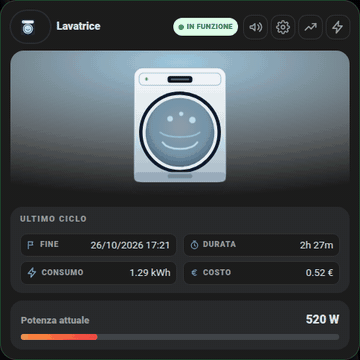</a><br><b><a href="https://github.com/Simonz82/smart-home-cards/blob/main/docs/elettrodomestici.md">🧺 Lavatrice</a></b></td>
    <td align="center" valign="top" width="33%"><a href="https://github.com/Simonz82/smart-home-cards/blob/main/docs/elettrodomestici.md">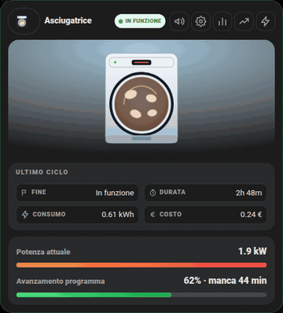</a><br><b><a href="https://github.com/Simonz82/smart-home-cards/blob/main/docs/elettrodomestici.md">🧺 Asciugatrice</a></b></td>
    <td align="center" valign="top" width="33%"><a href="https://github.com/Simonz82/smart-home-cards/blob/main/docs/elettrodomestici.md">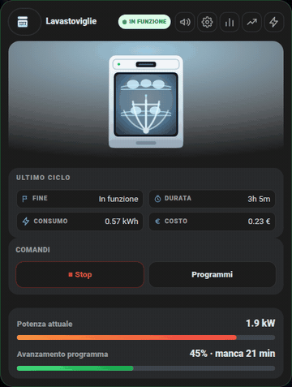</a><br><b><a href="https://github.com/Simonz82/smart-home-cards/blob/main/docs/elettrodomestici.md">🍽️ Lavastoviglie</a></b></td>
  </tr>
  <tr>
    <td align="center" valign="top" width="33%"><a href="https://github.com/Simonz82/smart-home-cards/blob/main/docs/elettrodomestici.md">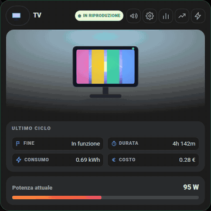</a><br><b><a href="https://github.com/Simonz82/smart-home-cards/blob/main/docs/elettrodomestici.md">📺 TV</a></b></td>
    <td align="center" valign="top" width="33%"><a href="#-guida-tv-epg-nella-card-tv-novità-1170">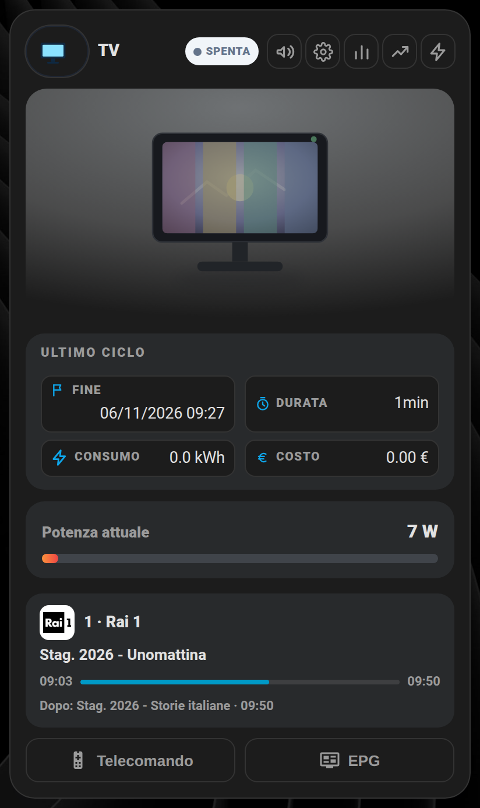</a><br><b><a href="#-guida-tv-epg-nella-card-tv-novità-1170">📺 TV + guida TV (EPG)</a></b></td>
    <td align="center" valign="top" width="33%"><a href="#-telecomando-samsung-sotto-la-card-tv-novità-1160">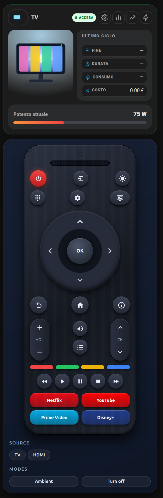</a><br><b><a href="#-telecomando-samsung-sotto-la-card-tv-novità-1160">📺 TV + telecomando Samsung</a></b></td>
  </tr>
  <tr>
    <td align="center" valign="top" width="33%"><a href="https://github.com/Simonz82/smart-home-cards/blob/main/docs/elettrodomestici.md">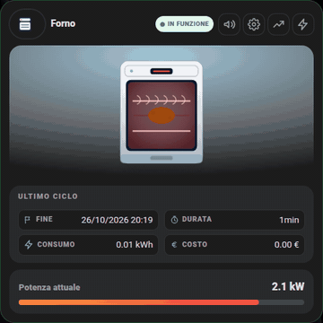</a><br><b><a href="https://github.com/Simonz82/smart-home-cards/blob/main/docs/elettrodomestici.md">🍗 Forno</a></b></td>
    <td align="center" valign="top" width="33%"><a href="#frigo-anche-non-smart-solo-presa-con-misura-dei-watt">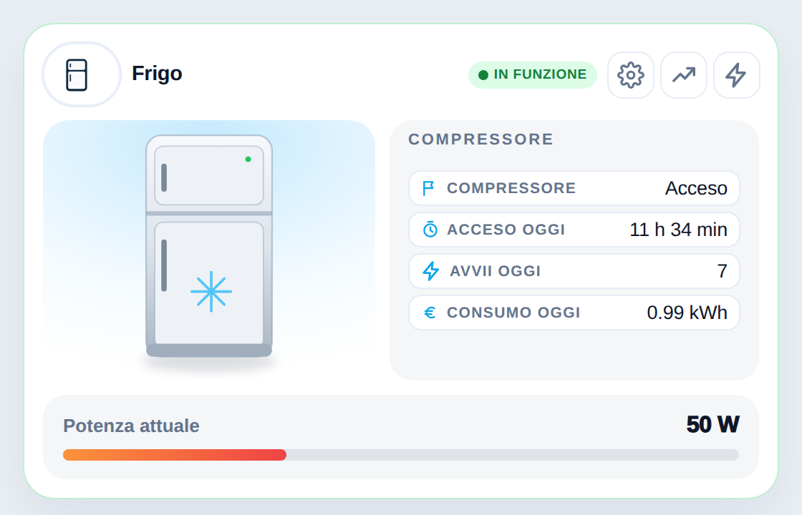</a><br><b><a href="#frigo-anche-non-smart-solo-presa-con-misura-dei-watt">🧊 Frigo</a></b></td>
    <td align="center" valign="top" width="33%"><a href="#tablet-a-muro-fully-kiosk-e-simili">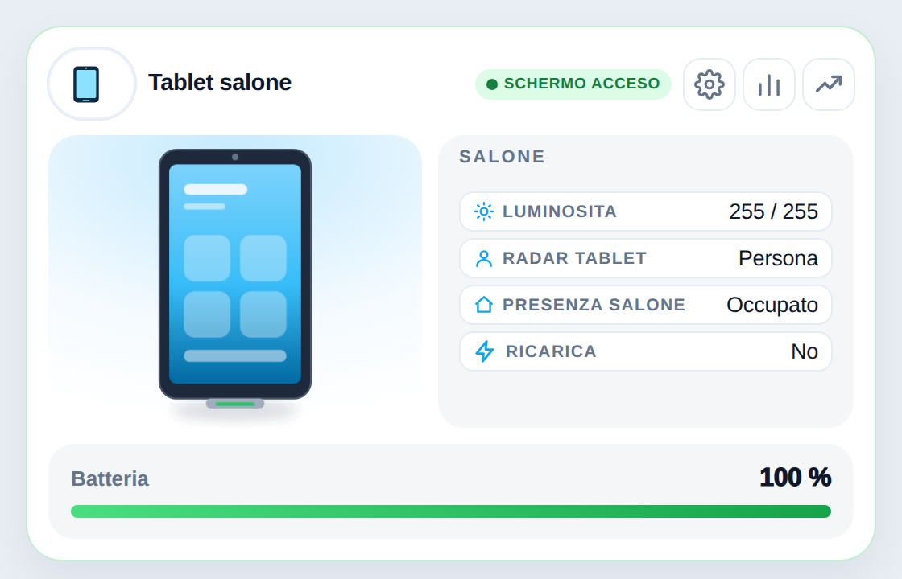</a><br><b><a href="#tablet-a-muro-fully-kiosk-e-simili">📱 Tablet a muro</a></b></td>
  </tr>
  <tr>
    <td align="center" valign="top" width="33%"><a href="#-friggitrice-microonde-piastra-e-piano-a-induzione-novità-1150">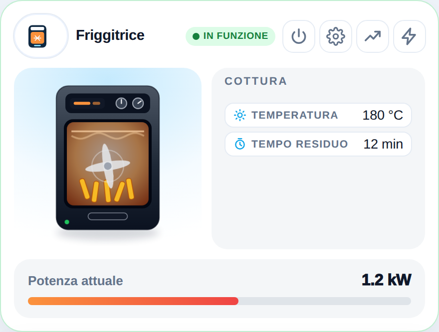</a><br><b><a href="#-friggitrice-microonde-piastra-e-piano-a-induzione-novità-1150">🍟 Friggitrice ad aria</a></b></td>
    <td align="center" valign="top" width="33%"><a href="#-friggitrice-microonde-piastra-e-piano-a-induzione-novità-1150">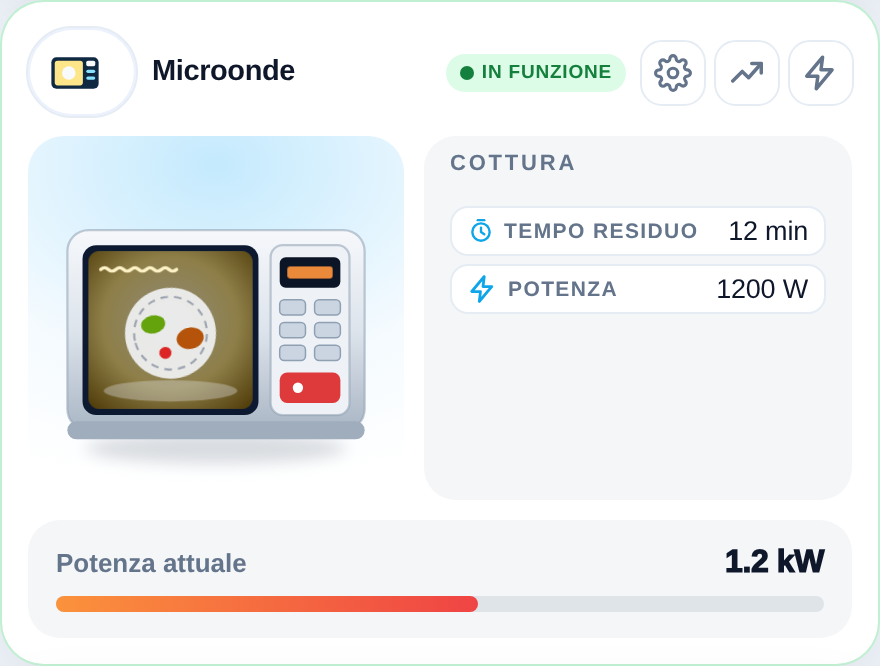</a><br><b><a href="#-friggitrice-microonde-piastra-e-piano-a-induzione-novità-1150">📡 Microonde</a></b></td>
    <td align="center" valign="top" width="33%"><a href="#-friggitrice-microonde-piastra-e-piano-a-induzione-novità-1150">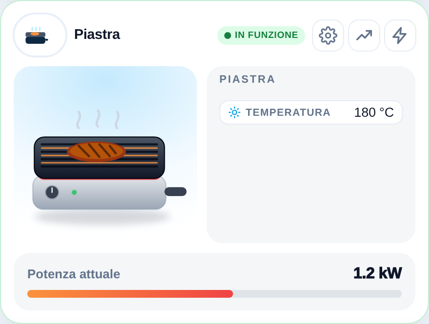</a><br><b><a href="#-friggitrice-microonde-piastra-e-piano-a-induzione-novità-1150">🥩 Piastra / bistecchiera</a></b></td>
  </tr>
  <tr>
    <td align="center" valign="top" width="33%"><a href="#-friggitrice-microonde-piastra-e-piano-a-induzione-novità-1150">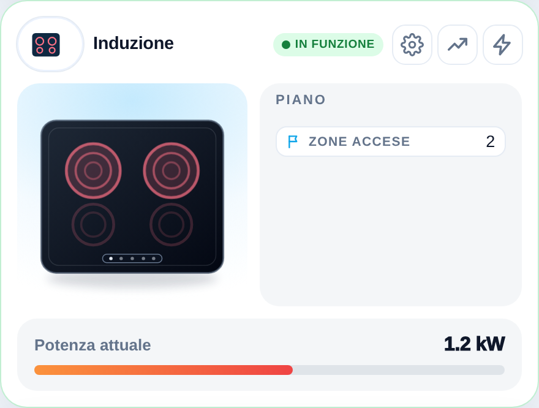</a><br><b><a href="#-friggitrice-microonde-piastra-e-piano-a-induzione-novità-1150">🍳 Piano a induzione</a></b></td>
    <td align="center" valign="top" width="33%"><a href="https://github.com/Simonz82/smart-home-cards/blob/main/docs/energia.md">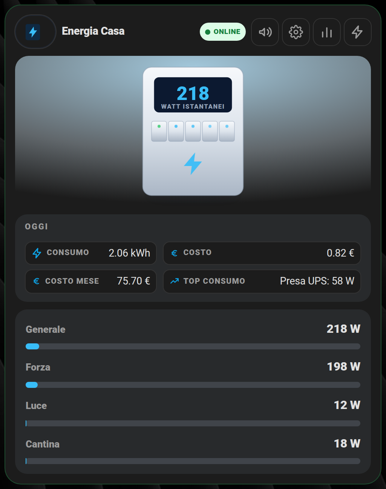</a><br><b><a href="https://github.com/Simonz82/smart-home-cards/blob/main/docs/energia.md">⚡ Energia Casa</a></b></td>
    <td align="center" valign="top" width="33%"><a href="https://github.com/Simonz82/smart-home-cards/blob/main/docs/clima.md">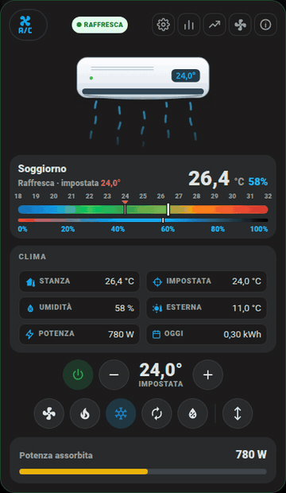</a><br><b><a href="https://github.com/Simonz82/smart-home-cards/blob/main/docs/clima.md">❄️ Climatizzatore</a></b></td>
  </tr>
  <tr>
    <td align="center" valign="top" width="33%"><a href="https://github.com/Simonz82/smart-home-cards/blob/main/docs/stufetta.md">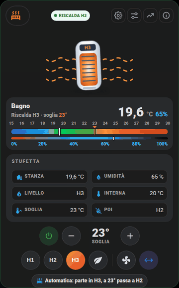</a><br><b><a href="https://github.com/Simonz82/smart-home-cards/blob/main/docs/stufetta.md">🔥 Stufetta</a></b></td>
    <td align="center" valign="top" width="33%"><a href="https://github.com/Simonz82/smart-home-cards/blob/main/docs/ventilatore.md">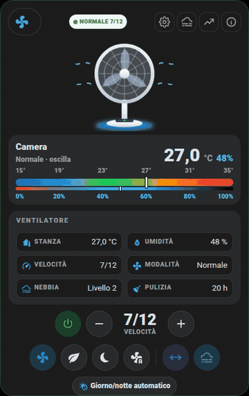</a><br><b><a href="https://github.com/Simonz82/smart-home-cards/blob/main/docs/ventilatore.md">🌀 Ventilatore</a></b></td>
    <td align="center" valign="top" width="33%"><a href="https://github.com/Simonz82/smart-home-cards/blob/main/docs/caldaia.md">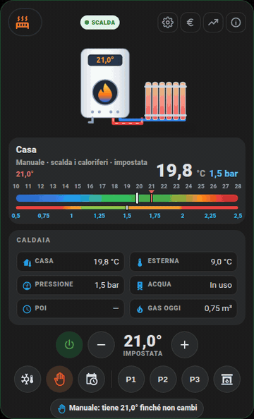</a><br><b><a href="https://github.com/Simonz82/smart-home-cards/blob/main/docs/caldaia.md">🔥 Caldaia e caloriferi</a></b></td>
  </tr>
  <tr>
    <td align="center" valign="top" width="33%"><a href="https://github.com/Simonz82/smart-home-cards/blob/main/docs/fritzbox.md">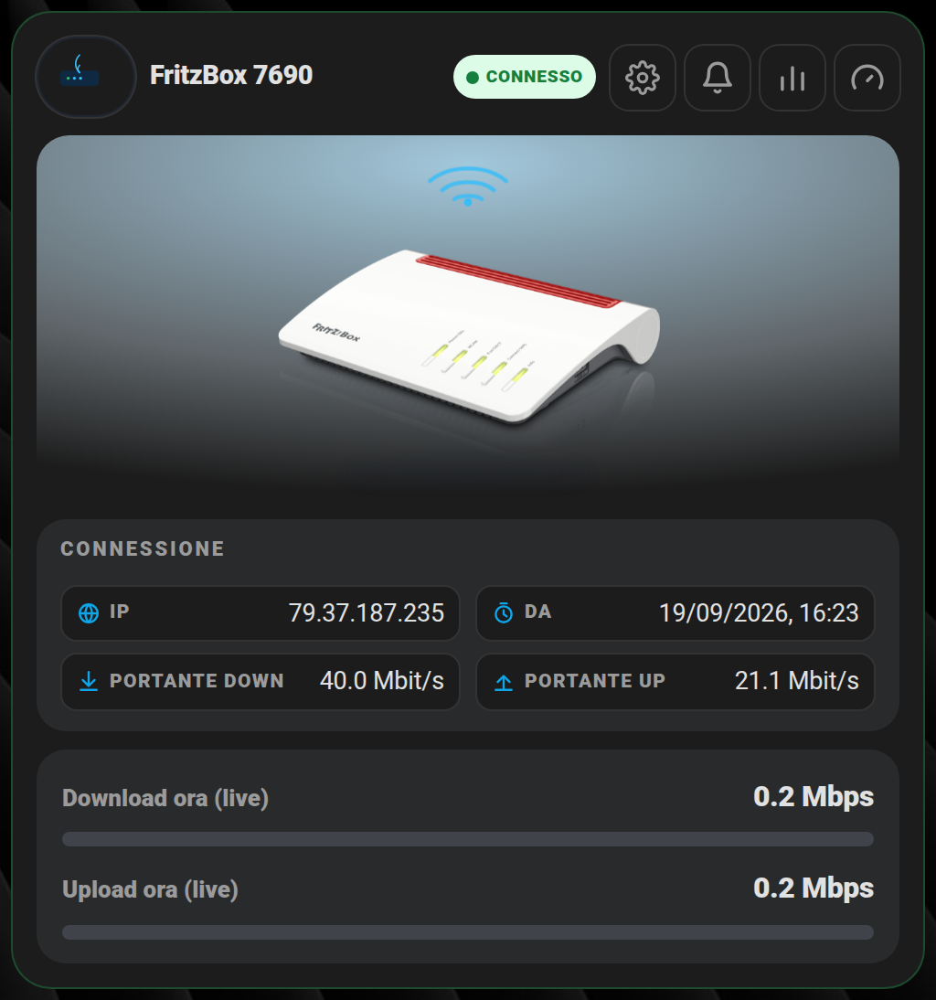</a><br><b><a href="https://github.com/Simonz82/smart-home-cards/blob/main/docs/fritzbox.md">📶 FritzBox</a></b></td>
    <td align="center" valign="top" width="33%"><a href="https://github.com/Simonz82/smart-home-cards/blob/main/docs/zigbee.md">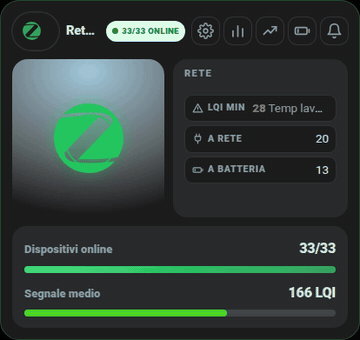</a><br><b><a href="https://github.com/Simonz82/smart-home-cards/blob/main/docs/zigbee.md">📡 Rete Zigbee</a></b></td>
    <td align="center" valign="top" width="33%"><a href="https://github.com/Simonz82/smart-home-cards/blob/main/docs/homeassistant-server.md">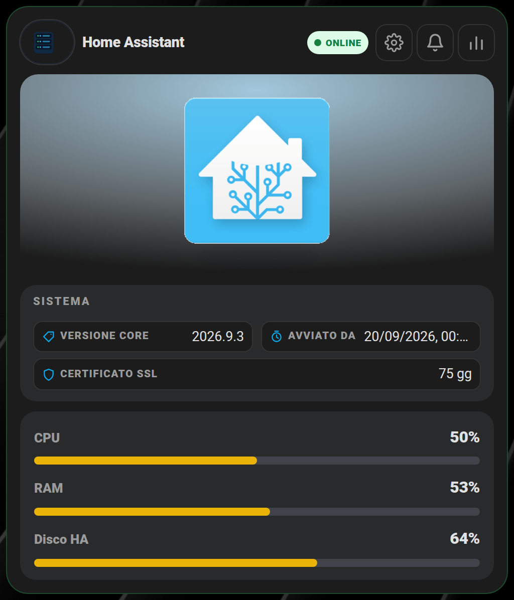</a><br><b><a href="https://github.com/Simonz82/smart-home-cards/blob/main/docs/homeassistant-server.md">🖥️ Server Home Assistant</a></b></td>
  </tr>
  <tr>
    <td align="center" valign="top" width="33%"><a href="https://github.com/Simonz82/smart-home-cards/blob/main/docs/nas-synology.md">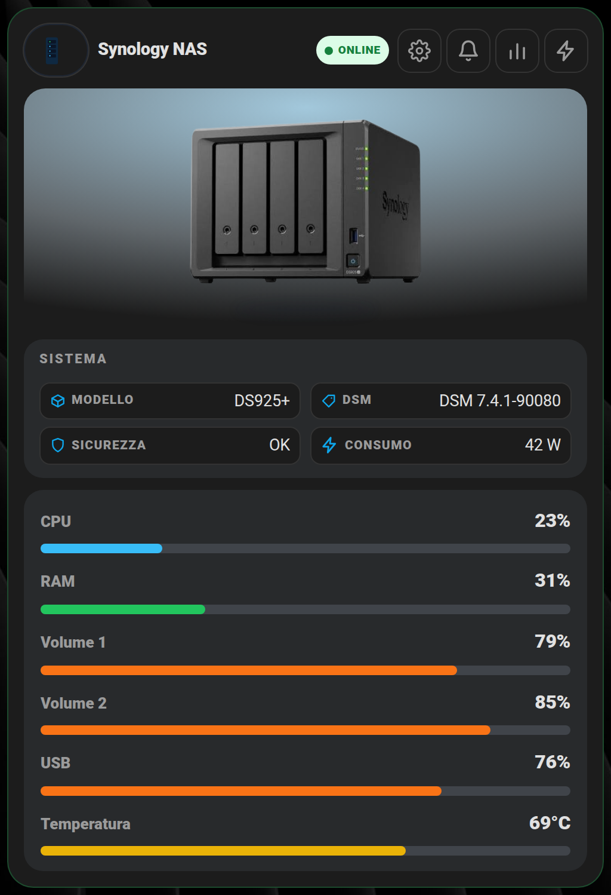</a><br><b><a href="https://github.com/Simonz82/smart-home-cards/blob/main/docs/nas-synology.md">💾 NAS Synology</a></b></td>
    <td align="center" valign="top" width="33%"><a href="https://github.com/Simonz82/smart-home-cards/blob/main/docs/proxmox.md">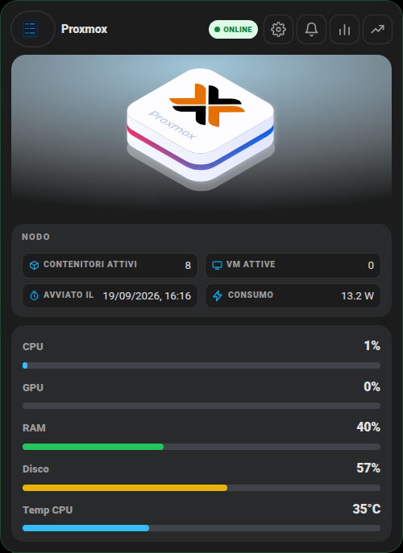</a><br><b><a href="https://github.com/Simonz82/smart-home-cards/blob/main/docs/proxmox.md">🖧 Proxmox</a></b></td>
    <td align="center" valign="top" width="33%"><a href="https://github.com/Simonz82/smart-home-cards/blob/main/docs/ups.md">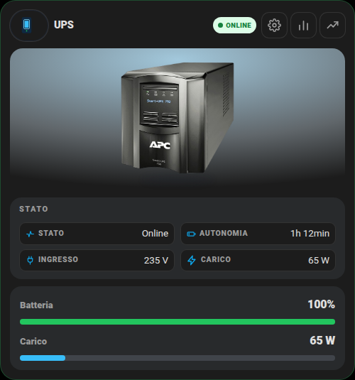</a><br><b><a href="https://github.com/Simonz82/smart-home-cards/blob/main/docs/ups.md">🔋 UPS</a></b></td>
  </tr>
  <tr>
    <td align="center" valign="top" width="33%"><a href="https://github.com/Simonz82/smart-home-cards/blob/main/docs/differenziata.md">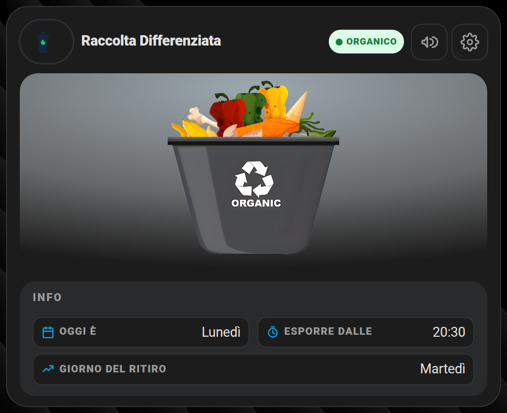</a><br><b><a href="https://github.com/Simonz82/smart-home-cards/blob/main/docs/differenziata.md">♻️ Raccolta Differenziata</a></b></td>
    <td align="center" valign="top" width="33%"><a href="https://github.com/Simonz82/smart-home-cards/blob/main/docs/centro-notifiche.md">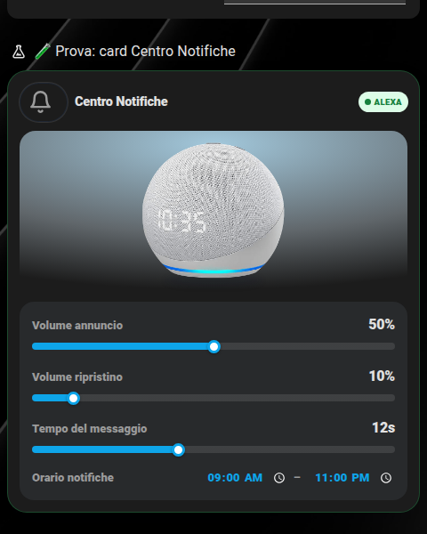</a><br><b><a href="https://github.com/Simonz82/smart-home-cards/blob/main/docs/centro-notifiche.md">🔔 Centro Notifiche</a></b></td>
    <td align="center" valign="top" width="33%"><a href="https://github.com/Simonz82/smart-home-cards/blob/main/docs/alexa.md">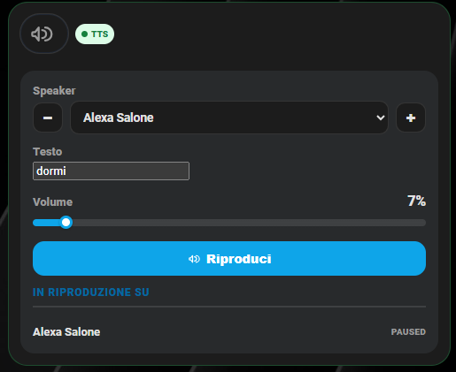</a><br><b><a href="https://github.com/Simonz82/smart-home-cards/blob/main/docs/alexa.md">🔊 Alexa Annuncio Testo</a></b></td>
  </tr>
  <tr>
    <td align="center" valign="top" width="33%"><a href="https://github.com/Simonz82/smart-home-cards/blob/main/docs/alexa.md">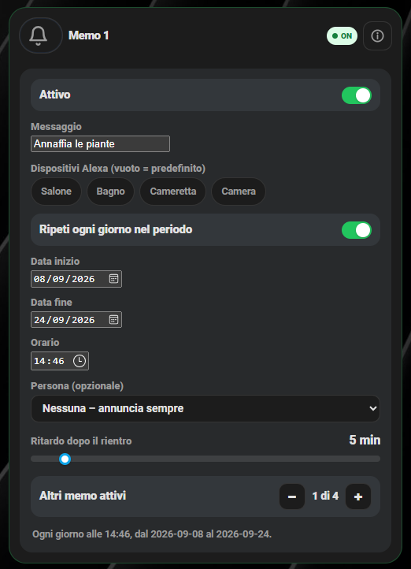</a><br><b><a href="https://github.com/Simonz82/smart-home-cards/blob/main/docs/alexa.md">🔊 Alexa Memo</a></b></td>
    <td align="center" valign="top" width="33%"><a href="https://github.com/Simonz82/smart-home-cards/blob/main/docs/alexa.md">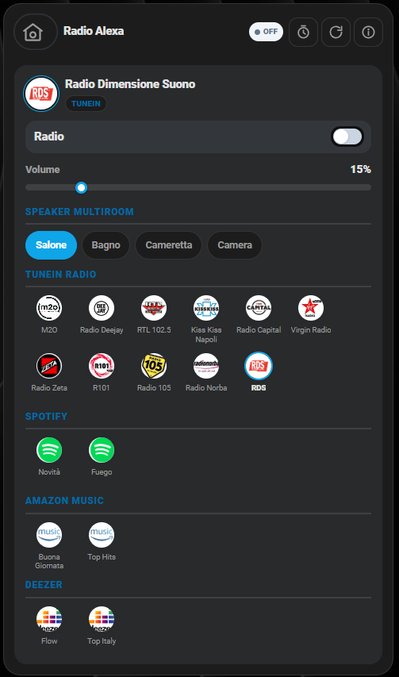</a><br><b><a href="https://github.com/Simonz82/smart-home-cards/blob/main/docs/alexa.md">📻 Alexa WebRadio</a></b></td>
  </tr>
</table>

## 🍳 Friggitrice, microonde, piastra e piano a induzione (novità 1.15.0)

Quattro nuovi disegni della card **Elettrodomestici** (`custom:shc-appliance-clone-card`), con animazione "in funzione": `artwork: airfryer`, `microwave`, `griddle`, `induction`. In più, per **tutti** gli elettrodomestici, il pulsante di accensione con script (`power_script`), utile per apparecchi IR/RF come quelli con Broadlink. Esempi YAML: [docs/elettrodomestici.md](https://github.com/Simonz82/smart-home-cards/blob/main/docs/elettrodomestici.md#-friggitrice-microonde-piastra-e-piano-a-induzione).

Foto nella tabella [Tutte le card a colpo d'occhio](#-tutte-le-card-a-colpo-docchio).

<sub>Immagini con dati di esempio.</sub>

## 🌍 Translations / contribute a language (new in 1.18.0, all cards in 1.19.0)

**EN:** **all cards** (Appliances, Energy, NAS, Proxmox, Home Assistant server, FRITZ!Box, UPS, Zigbee, Climate, Heater, Fan, Boiler, Waste collection, Alexa, Notification Center) and their **visual editors** now follow the language of Home Assistant automatically (`it` and `en`; any other language shows English). There is no language option to set. With Home Assistant in Italian nothing changes.

**Available languages:** Italian (`it`), English (`en`), Dutch (`nl`, thanks to @hartliefHA). Any other language falls back to English.

**Contribute a language:** open `smart-home-cards.js`, find `const SHC_I18N = { it: {...}, en: {...} }` (just above the `shcT()` function), copy the whole `en` block, rename it with the two-letter language code (for example `nl`), translate the **values** only (keep the keys and the `{1}`, `{2}`, `{value}` placeholders) and send a pull request. No other change is needed: missing keys fall back to English.

**IT:** **tutte le card** e i loro **editor visuali** seguono da soli la lingua di Home Assistant (`it` ed `en`; con altre lingue mostrano l'inglese). Non c'è nessuna opzione da impostare; con Home Assistant in italiano non cambia nulla. Per aggiungere una lingua: copia il blocco `en` in `SHC_I18N`, traduci solo i valori e apri una pull request.

## ⏱️ Riquadro "Ultimo ciclo": cycle_sensor + cycle_attrs (novità 1.17.2)

Nelle card **Elettrodomestici** il riquadro "Ultimo ciclo" (fine, durata, consumo, costo) non indovina nulla da solo: legge gli **attributi di un unico sensore** che indichi tu.

- `cycle_sensor`: l'entità "riepilogo" (di solito un template sensor).
- `cycle_attrs`: il **nome degli attributi** di quel sensore, uno per riga del riquadro: `end` (fine), `duration` (durata), `energy` (consumo), `cost` (costo).

Se manca `cycle_sensor` (e non usi `side`), dalla 1.17.2 il riquadro mostra il suggerimento "Imposta cycle_sensor e cycle_attrs per vedere l'ultimo ciclo" invece dei trattini. Il frigo senza `side` continua a nascondere il riquadro. Le card già configurate non cambiano.

Esempio (forno): il sensore `sensor.time_on_elettrodomestici_2` ha gli attributi `terminato`, `tempo_ciclo_elettrodomestici_2`, `consumo_ciclo_elettrodomestici_2`, `costo_ciclo_elettrodomestici_2`:

```yaml
type: custom:shc-appliance-clone-card
name: Forno
cycle_sensor: sensor.time_on_elettrodomestici_2
cycle_attrs:
  end: terminato
  duration: tempo_ciclo_elettrodomestici_2
  energy: consumo_ciclo_elettrodomestici_2
  cost: costo_ciclo_elettrodomestici_2
```

Tutti i nomi sono esempi: usa quelli degli attributi del tuo sensore. Dettagli e campi opzionali (periodi, cicli contati) in [docs/elettrodomestici.md](docs/elettrodomestici.md).

**EN:** the "Last cycle" box reads the attributes of one summary sensor. Set `cycle_sensor` (the entity) and `cycle_attrs` (attribute names for `end`, `duration`, `energy`, `cost`). Without `cycle_sensor` (and without `side`) the box now shows a hint instead of dashes (1.17.2). The fridge without `side` still hides the box; existing setups are unchanged.

## 📺 Guida TV (EPG) nella card TV (novità 1.17.0)

Con `epg_channels` la card TV mostra sotto la barra della potenza il canale in onda (logo, titolo, avanzamento, cosa c'è dopo) e i pulsanti **Telecomando** ed **EPG**. Il pannello EPG elenca i canali con adesso/dopo, la scheda **Prima serata** mostra la serata di tutti i canali, e toccando un canale la TV ci va da sola (SamsungTV Smart). Dati dall'integrazione [XMLTV EPG](https://github.com/shadow578/homeassistant_xmltv-epg); opzioni `epg_channels`, `channel_entity`, `channel_name_entity` nella tabella del telecomando qui sotto.

<table>
  <tr>
    <td align="center" valign="top" width="33%"><br><sub>Canale in onda</sub></td>
    <td align="center" valign="top" width="33%">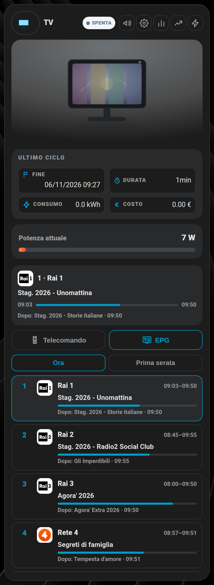<br><sub>Guida: adesso e dopo</sub></td>
    <td align="center" valign="top" width="33%">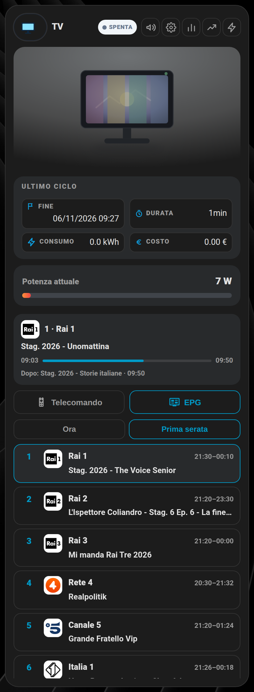<br><sub>Prima serata</sub></td>
  </tr>
</table>

## 📺 Telecomando Samsung sotto la card TV (novità 1.16.0)

La card **Elettrodomestici** con `artwork: tv` può mostrare, **sotto la card**, lo stesso telecomando in stile Samsung della card [samsung-tv-remote-card](https://github.com/Simonz82/ha_tv_samsung): tasti, D-pad, volume e canali, tasti colorati, app, sorgenti, immagine/audio, Art Mode. Tutto in una sola risorsa: non serve installare altro. È **facoltativo e spento di default**: senza l'opzione la card TV resta identica a prima.

```yaml
type: custom:shc-appliance-clone-card
name: TV
artwork: tv
power_entity: sensor.presa_tv_power
live:
  state_entity: media_player.tv
show_samsung_remote: true        # il telecomando compare sotto la card
```

<table>
  <tr>
    <td align="center" valign="top" width="40%"><br><sub>Telefono: telecomando verticale</sub></td>
    <td align="center" valign="top" width="60%">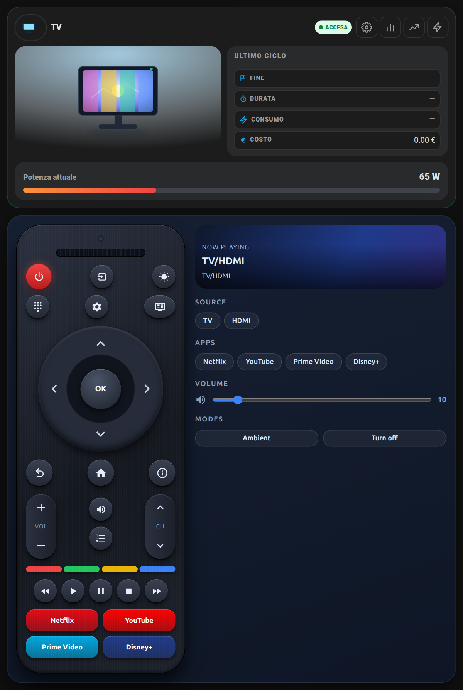<br><sub>Tablet / PC: telecomando + pannello</sub></td>
  </tr>
</table>

**Requisiti.** Una TV Samsung Tizen e l'integrazione **[SamsungTV Smart](https://github.com/ollo69/ha-samsungtv-smart)** (integrazione custom, si installa da HACS: `ollo69/ha-samsungtv-smart`). Serve quella, e non solo l'integrazione Samsung TV di Home Assistant, perché molte funzioni del telecomando sono sue:

| Funzione | Con SamsungTV Smart | Con la sola integrazione core "Samsung TV" |
|---|---|---|
| Accensione/spegnimento, volume, muto, play/pausa/stop | si | si (sono funzioni standard del `media_player`) |
| Tasti del telecomando (frecce, OK, Home, Menu, colori, numeri...) | si (`media_player.play_media` con `send_key`) | solo se indichi una `samsung_remote_entity` (un'entità `remote` che accetta `send_command`); non verificato |
| Elenco sorgenti | si (attributo `source_list`) | in parte: dipende da cosa espone l'integrazione |
| Avvio app (Netflix, YouTube...) | si (`play_media` di tipo `app`) | no |
| Immagine e audio (modalità) | si (`picture_mode_list`, `sound_mode_list`, servizio `select_picture_mode`) | no, i selettori restano nascosti |
| Art Mode (The Frame) | si (`art_mode_status`, servizio `set_art_mode`) | no, il tasto resta nascosto |

Le sezioni che la TV non espone (immagine/audio, Art Mode) vengono nascoste da sole. Con la TV spenta o non disponibile restano attivi solo l'accensione e lo spegnimento.

**Opzioni** (tutte facoltative tranne `show_samsung_remote`):

| Opzione | Cosa fa |
|---|---|
| `show_samsung_remote: true` | mostra il telecomando sotto la card (solo con `artwork: tv`) |
| `samsung_remote_position` | `below` (predefinito: telecomando sempre sotto la card) oppure `button` (telecomando chiuso, si apre dal pulsante `mdi:remote-tv` accanto all'ingranaggio) |
| `epg_channels` | Elenco canali per la guida TV (EPG): `[{number, name, id}]`, `id: null` = canale senza guida. Con l'elenco la card mostra sotto la barra della potenza la riga del canale in onda e i pulsanti Telecomando / EPG (con `epg_channels` `samsung_remote_position` non serve: il telecomando si apre dal pulsante). Senza elenco la card resta identica. Sensori attesi: `sensor.<id>_program_current`, `_upcoming` e, se presente, `_primetime` (scheda "Prima serata"). Logo: automatico da `image.<id>_icon` (opzione "enable_channel_icons" dell'integrazione XMLTV EPG) oppure campo facoltativo `logo` (URL) per canale; senza logo resta il numero |
| `channel_entity`, `channel_name_entity` | Sensori con numero e nome del canale corrente (es. SmartThings). Il canale si riconosce prima dal numero, poi dal nome. Se non disponibili la card usa l'ultimo canale scelto da lei (tocco nell'EPG o tasti numerici del telecomando), salvato nel browser |
| `samsung_entity` | `media_player` della TV, se diverso da `live.state_entity` (se manca si usa quello) |
| `samsung_remote_entity` | entità `remote` per inviare i tasti con `remote.send_command` invece di `play_media` |
| `samsung_turn_on_script` | script da lanciare per accendere (utile se la TV non si accende da sola, es. con Wake-on-LAN o presa) |
| `samsung_layout` | `auto` (predefinito: affiancato da 600 px in su), `remote` (solo telecomando), `panel` |
| `samsung_apps` | elenco app, fino a 4 sul telecomando: `- { name: Plex, app_id: "3201512006963", color: "#e5a00d" }`; con `source:` usa `select_source` |
| `samsung_sources` | elenco sorgenti da mostrare al posto di `source_list` |
| `samsung_show_picture`, `samsung_show_sound`, `samsung_show_art`, `samsung_show_ambient` | `false` per nascondere la sezione |

**Editor visuale: dove si trova la spunta.** La spunta non è sulla card ma nell'editor della card:
1. Apri la dashboard in modifica (matita in alto a destra) e premi **Modifica** sulla card TV (`artwork: tv`).
2. Scorri l'editor fino in fondo, dopo la sezione "Accensione con script (facoltativo)".
3. Nella sezione **"Telecomando Samsung (facoltativo)"** spunta **"Mostra il telecomando Samsung sotto la card"**.
4. Si aprono i campi facoltativi *TV (media_player)*, se è diversa dall'entità dello stato live, ed *Entità remote per i tasti*. Salva: il telecomando compare sotto la card TV.

La sezione compare solo con `artwork: tv`. Le app si impostano in YAML (`samsung_apps`). Se dopo l'aggiornamento la sezione non compare, svuota la cache del browser (Ctrl+F5). Nell'app Companion usa Impostazioni → Companion app → Debug → Reimposta cache frontend.

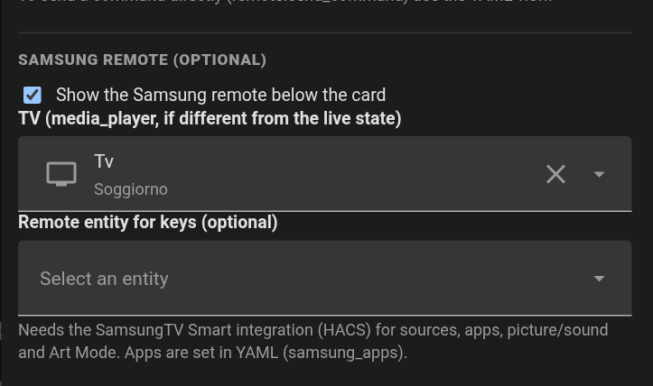

**Limiti noti.** Le app predefinite (Netflix, YouTube, Prime Video, Disney+) non hanno ID verificati su tutti i modelli: se una non parte, impostala in `samsung_apps` con `app_id` o `source`. Il telecomando integrato è un componente interno della card (`shc-samsung-remote`) e non ha un editor suo: usa questa card. Se hai anche installato `samsung-tv-remote-card` non c'è conflitto (nomi diversi). Provato su una TV Samsung Tizen con SamsungTV Smart (interfaccia, layout, editor); l'invio dei singoli tasti dipende dal modello. Con la sola integrazione core i soli comandi `media_player` sono sicuri.

<details>
<summary><b>English</b></summary>

With `artwork: tv` the **Appliances** card can show, **below the card**, the same Samsung-style remote as [samsung-tv-remote-card](https://github.com/Simonz82/ha_tv_samsung): keys, D-pad, volume/channel, colour keys, apps, sources, picture/sound modes, Art Mode. It is bundled in the same single resource and is **opt-in**: without the option the TV card is unchanged.

```yaml
type: custom:shc-appliance-clone-card
name: TV
artwork: tv
power_entity: sensor.tv_plug_power
live:
  state_entity: media_player.tv
show_samsung_remote: true
```

**Requirements.** A Samsung Tizen TV and the **[SamsungTV Smart](https://github.com/ollo69/ha-samsungtv-smart)** custom integration (HACS: `ollo69/ha-samsungtv-smart`). The core "Samsung TV" integration alone is not enough: power, volume, mute and play/pause/stop are standard `media_player` features and work with both, but remote keys (`send_key`), app launch, `source_list` with apps, picture/sound modes and Art Mode come from SamsungTV Smart. With only the core integration you can pass `samsung_remote_entity` (a `remote` entity supporting `send_command`) for the keys (untested), and the picture/sound/Art Mode sections stay hidden.

**Options:** `show_samsung_remote`, `samsung_remote_position` (`below` default or `button`: remote opens from an `mdi:remote-tv` button next to the gear), `samsung_entity`, `samsung_remote_entity`, `samsung_turn_on_script`, `samsung_layout` (`auto`/`remote`/`panel`), `samsung_apps`, `samsung_sources`, `samsung_show_picture|sound|art|ambient`. Visual editor: open the TV card editor (pencil, then Edit on the card), scroll to the bottom past "Turn on with a script (optional)", section "Samsung remote (optional)", tick "Show the Samsung remote below the card"; the TV / remote entity pickers then appear. The section is shown only with `artwork: tv`. Apps are set in YAML. If the section is missing after updating, clear the browser cache (Companion app: Settings → Companion app → Debug → Reset frontend cache). Known limits: default app IDs are not verified on every model (set `app_id` or `source` in `samsung_apps`); the embedded remote has no editor of its own; no conflict if `samsung-tv-remote-card` is also installed.

</details>

## 🧊 Frigo e 📱 Tablet a muro (novità)

Due nuovi disegni della card **Elettrodomestici** (`custom:shc-appliance-clone-card`). Guida completa: [docs/elettrodomestici.md](https://github.com/Simonz82/smart-home-cards/blob/main/docs/elettrodomestici.md).

### Frigo (anche non smart, solo presa con misura dei Watt)


```yaml
type: custom:shc-appliance-clone-card
name: Frigo
artwork: fridge
power_entity: sensor.frigo_power
threshold_run: 20
max_power: 150
side:
  title: Compressore
  rows:
    - label: Compressore
      icon: flag
      entity: binary_sensor.frigo_compressore
      format: onoff
      on_label: Acceso
      off_label: Spento
    - label: Acceso oggi
      icon: timer
      entity: sensor.frigo_compressore_tempo_oggi
      format: hours
settings_sections: []
```

Sul frigo non c'è nessun interruttore on/off, di proposito.

### Tablet a muro (Fully Kiosk e simili)


<sub>Nell'immagine alcuni stati sono simulati (schermo acceso, radar attivo).</sub>

```yaml
type: custom:shc-appliance-clone-card
name: Tablet salone
artwork: tablet
power_entity: sensor.tablet_battery_level   # batteria
power_label: Batteria
power_unit: "%"
max_power: 100
threshold_run: 101
threshold_standby: 101
live:
  state_entity: switch.tablet_schermo
state_map:
  "on":  { mode: running, label: SCHERMO ACCESO }
  "off": { mode: "off",   label: SCHERMO SPENTO }
side:
  title: Salone
  rows:
    - label: Luminosita
      icon: sun
      entity: number.tablet_luminosita_dello_schermo
      format: ratio
      max: 255
    - label: Radar tablet
      icon: user
      entity: binary_sensor.tablet_radar_presenza
      format: onoff
      on_label: Persona
      off_label: Nessuno
    - label: Presenza salone
      icon: home
      entity: binary_sensor.presenza_salone_occupancy
      format: onoff
      on_label: Occupato
      off_label: Libero
hide_consumi: true        # nasconde il pulsante Consumi
bar_color: linear-gradient(90deg,#4ade80,#16a34a)
settings_sections: []
```

## Indice

| Card | Cosa mostra | Serve per |
|---|---|---|
| [🧺 Elettrodomestici](https://github.com/Simonz82/smart-home-cards/blob/main/docs/elettrodomestici.md) | Lavatrice, lavastoviglie, asciugatrice, forno, TV, frigorifero (anche non smart, solo presa): stato, ciclo in corso, consumi, storico settimanale (anche senza YAML, vedi guida), comandi a distanza per chi li ha (es. lavastoviglie Home Connect) | Qualsiasi elettrodomestico collegato a una presa/misuratore di potenza |
| [⚡ Energia Casa](https://github.com/Simonz82/smart-home-cards/blob/main/docs/energia.md) | Consumo istantaneo, circuiti singoli, costi, confronto con periodo precedente | Un misuratore di potenza generale casa in Watt |
| [❄️ Climatizzatore](https://github.com/Simonz82/smart-home-cards/blob/main/docs/clima.md) | Split animato che soffia aria (blu freddo, arancio caldo), gauge dritta con temperatura stanza/impostata e umidità, comandi diretti anche da spento, programmazione accensione/spegnimento, consumi, ventola e alette, diagnostica | Qualsiasi entità `climate.` |
| [🔥 Stufetta](https://github.com/Simonz82/smart-home-cards/blob/main/docs/stufetta.md) | Stufetta animata (onde di calore per livello), gauge dritta con stanza e soglia, livelli H1/H2/H3/Eco, gestione automatica "parte al massimo, alla soglia scende" | Qualsiasi stufetta `climate.` (esempio: Dreo 314S DR-HSH004S) |
| [🌀 Ventilatore](https://github.com/Simonz82/smart-home-cards/blob/main/docs/ventilatore.md) | Ventilatore animato (pale, oscillazione, nebbia, luce), velocità, modalità, programmazione, nebbia e luce, serbatoio e pulizia | Qualsiasi ventilatore `fan.` (esempio: Dreo DR-HEC005S con nebulizzatore) |
| [🔥 Caldaia e caloriferi](https://github.com/Simonz82/smart-home-cards/blob/main/docs/caldaia.md) | Caldaia animata con calorifero, gauge dritta con casa/impostata e barra della pressione impianto, programmi orari, consumi gas per giorni/settimane/mesi/anni divisi riscaldamento e acqua calda | Qualsiasi caldaia o termostato `climate.` (esempio: Baxi Luna Classic con Remeha Home) |
| [📶 FritzBox / Router](https://github.com/Simonz82/smart-home-cards/blob/main/docs/fritzbox.md) | Stato connessione, banda impegnata, velocità, test di velocità | Router AVM FritzBox (integrazione ufficiale HA) |
| [📡 Rete Zigbee](https://github.com/Simonz82/smart-home-cards/blob/main/docs/zigbee.md) | Dispositivi online/offline e da quanto, segnale LQI medio e minimo, batterie, elenco con foto, abbinamenti, avvisi in fascia oraria | Zigbee2MQTT con disponibilità attiva |
| [🖥️ Server Home Assistant](https://github.com/Simonz82/smart-home-cards/blob/main/docs/homeassistant-server.md) | CPU/RAM/disco del server, aggiornamenti, backup, riavvii programmati | Qualsiasi installazione Home Assistant (OS/Supervised/Container) |
| [💾 NAS Synology](https://github.com/Simonz82/smart-home-cards/blob/main/docs/nas-synology.md) | CPU/RAM/volumi/dischi, stato sicurezza, consumo, riavvio/spegnimento | NAS Synology con integrazione DSM |
| [🖧 Proxmox](https://github.com/Simonz82/smart-home-cards/blob/main/docs/proxmox.md) | Stato nodo, CPU/RAM/disco, VM/container attivi, salute SSD | Host Proxmox VE con un'integrazione che esponga questi sensori |
| [🔋 UPS](https://github.com/Simonz82/smart-home-cards/blob/main/docs/ups.md) | Stato, carica batteria, carico, autonomia residua | Gruppo di continuità (es. tramite NUT/apcupsd) |
| [♻️ Raccolta Differenziata](https://github.com/Simonz82/smart-home-cards/blob/main/docs/differenziata.md) | Rifiuto del giorno, giorno del ritiro, orario di esposizione, tipi di raccolta scritti a mano | Nessun hardware, solo un `input_text` |
| [🔔 Centro Notifiche](https://github.com/Simonz82/smart-home-cards/blob/main/docs/centro-notifiche.md) | Volumi e finestra oraria degli annunci Alexa condivisi da tutte le altre card, in un'unica card di impostazioni | Il package `centro_notifiche_alexa.yaml` + integrazione Alexa Media Player |
| [🔊 Alexa Annuncio Testo / Memo / WebRadio](https://github.com/Simonz82/smart-home-cards/blob/main/docs/alexa.md) | Annuncio vocale al volo con selettore multiroom e volume; fino a 4 promemoria vocali programmati con riprova al rientro in casa; oppure radio/playlist su Alexa multiroom con sveglia programmata e volume ridotto automatico | Integrazione Alexa Media Player |
| [📈 Grafici 24 h / 7 gg / 30 gg / da … a](https://github.com/Simonz82/smart-home-cards/blob/main/docs/grafici.md) | Su ogni card un pulsante apre il grafico storico del dispositivo, adattato a PC e smartphone, con i picchi reali | Tutte le card |
| [🎛️ Layout classico / centrato](https://github.com/Simonz82/smart-home-cards/blob/main/docs/layout.md) | Ogni card in due layout (foto a sinistra oppure foto centrale in alto), scelto da un menu nelle Impostazioni | Tutte le card |

Tutte le card condividono lo stesso motore di **notifiche personalizzate** (push + Alexa) — vedi [docs/notifiche-personalizzate.md](https://github.com/Simonz82/smart-home-cards/blob/main/docs/notifiche-personalizzate.md) — e lo stesso mini-linguaggio per il popup Impostazioni — vedi [docs/settings-sections.md](https://github.com/Simonz82/smart-home-cards/blob/main/docs/settings-sections.md).

## 📦 Installazione con HACS


Disponibile nell'elenco predefinito di HACS dal 2 novembre 2026 (Available in the HACS default store since 2 Nov 2026).

Apri **HACS**, cerca **Smart Home Cards** e premi **Scarica**: aggiornamenti automatici, nessun file da ricopiare a mano. Oppure clicca il pulsante per aprire il repository direttamente in HACS:

[](https://my.home-assistant.io/redirect/hacs_repository/?owner=Simonz82&repository=smart-home-cards&category=plugin)

Nota: se usi una versione molto vecchia di HACS che non la trova, aggiornala (in alternativa: Repository personalizzati, `https://github.com/Simonz82/smart-home-cards`, categoria Dashboard). Dettagli: [docs/installazione.md](https://github.com/Simonz82/smart-home-cards/blob/main/docs/installazione.md#0-con-hacs-se-preferisci-non-copiare-i-file-a-mano).

## Installazione rapida

Guida completa passo-passo: [docs/installazione.md](https://github.com/Simonz82/smart-home-cards/blob/main/docs/installazione.md). In breve:

1. Scarica [`smart-home-cards.js`](https://github.com/Simonz82/smart-home-cards/blob/main/smart-home-cards.js) e copialo in `/config/www/` sul tuo Home Assistant.
2. Impostazioni → Dashboard → (⋮ in alto a destra) → Risorse → Aggiungi risorsa → `/local/smart-home-cards.js` (tipo: Modulo JavaScript).
3. Ricarica la pagina (svuota la cache se serve).
4. Aggiungi una card, modalità YAML, incolla uno degli esempi nelle guide sopra, sostituisci le entità con le tue.
5. (Facoltativo) Per scegliere il layout dalle Impostazioni copia anche [`packages/layout_schede.yaml`](https://github.com/Simonz82/smart-home-cards/blob/main/packages/layout_schede.yaml) (vedi [docs/layout.md](https://github.com/Simonz82/smart-home-cards/blob/main/docs/layout.md)).
6. (Facoltativo, ma consigliato) Installa anche il mio package originale per quella card, in [`packages/`](https://github.com/Simonz82/smart-home-cards/tree/main/packages/) — vedi il paragrafo "🚀 Metodo veloce" in cima a ogni guida. Sono i file **reali** che uso io, con solo poche righe da cambiare in cima (o da cercare e sostituire): niente da scrivere da zero.

Un solo file JS contiene tutte e 17 le card — installi una volta sola, poi usi quelle che ti servono.

## 🎛️ Due layout per ogni card

Ogni card si può mostrare in **classico** (foto a sinistra) o **centrato** (foto centrale in alto, informazioni su due colonne, poi le barre). La scelta è la **prima riga delle Impostazioni** della card: un menu a tendina, e la card cambia subito. Guida completa: **[docs/layout.md](https://github.com/Simonz82/smart-home-cards/blob/main/docs/layout.md)**.

| Classico | Centrato |
|---|---|
| 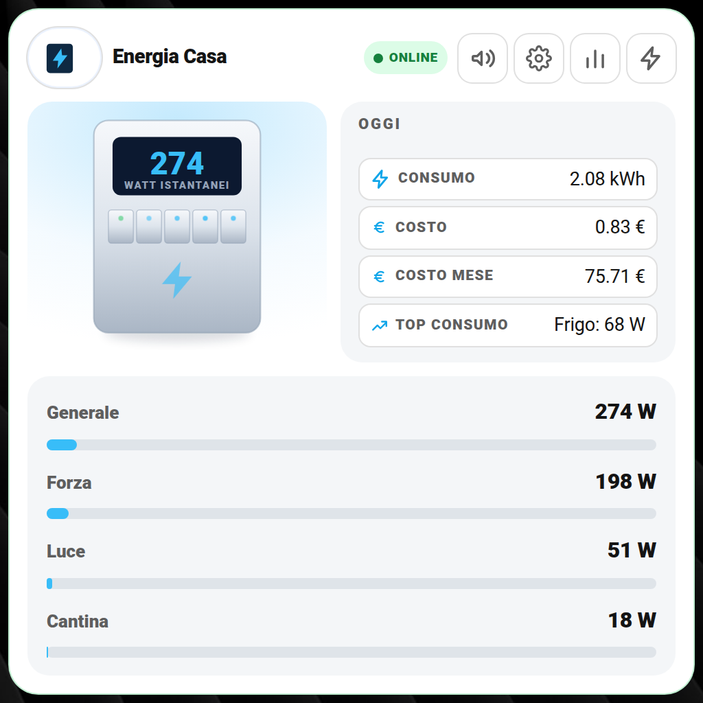 | 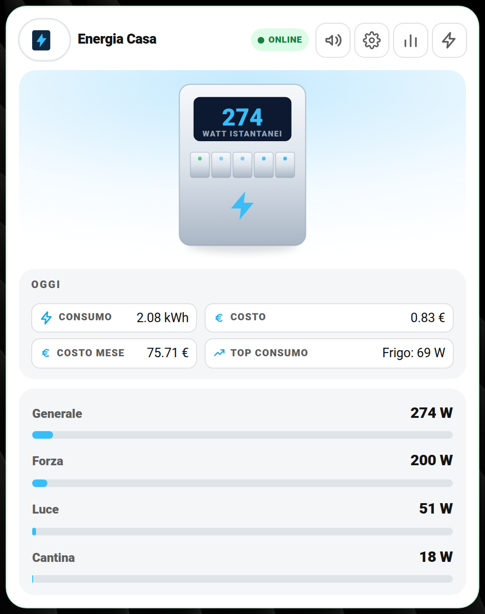 |
| 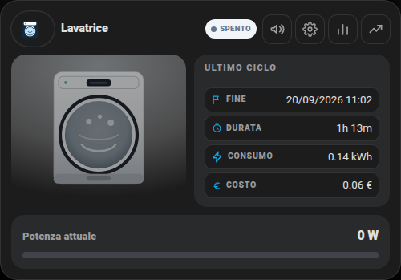 | 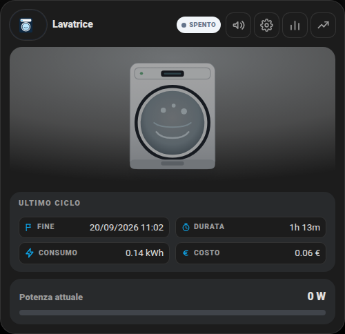 |

## Cosa include, cosa devi adattare tu

- **Le immagini prodotto** (foto del router/NAS/UPS/logo Proxmox/HA mostrate nelle card) sono incluse in [`foto-pkg/`](https://github.com/Simonz82/smart-home-cards/tree/main/foto-pkg/) — copiale insieme al file della card, vedi [docs/installazione.md](https://github.com/Simonz82/smart-home-cards/blob/main/docs/installazione.md).
- **Le immagini dei rifiuti** (per la card Raccolta Differenziata) sono in [`rifiuti/`](https://github.com/Simonz82/smart-home-cards/tree/main/rifiuti/) — vedi [docs/differenziata.md](https://github.com/Simonz82/smart-home-cards/blob/main/docs/differenziata.md).
- **I package reali** (sensori, helper, automazioni di notifica/report/riavvio) sono in [`packages/`](https://github.com/Simonz82/smart-home-cards/tree/main/packages/) — sono letteralmente quelli che uso io in produzione, con i dati personali tolti. Ogni guida spiega, nel paragrafo "🚀 Metodo veloce", esattamente quali righe cambiare per il tuo impianto.
- **Le entità** che ogni card e ogni package si aspettano dipendono comunque dal tuo impianto/integrazioni — ogni guida elenca esattamente quali servono e a cosa servono, sia per chi usa i miei package sia per chi preferisce costruire i propri da zero.

## Licenza

Nessuna restrizione: usale, modificale, ridistribuiscile. Se vuoi, cita la fonte.

---

## ☕ Vuoi darmi una mano?

Il contenuto di questa pagina è completamente gratuito e lo scopo non è certamente fare soldi. Se vuoi darmi una mano per le spese e il tempo perso, ecco alcuni modi:

| | |
|---|---|
| [](https://ko-fi.com/C0C713VTGJ) | Offrimi un caffè su Ko-fi |
| [](https://www.paypal.com/paypalme/simongmail) | Una donazione libera su PayPal |
| [](https://amzn.to/3XWWTgz) | Fai i tuoi acquisti Amazon partendo da questo link |

**Canali Telegram:**

| | |
|---|---|
| [](https://t.me/Home_Assistant_News) | Notizie dedicate a Home Assistant |
| [](https://t.me/offerte_domotica_ita) | Offerte sui prodotti di domotica |
