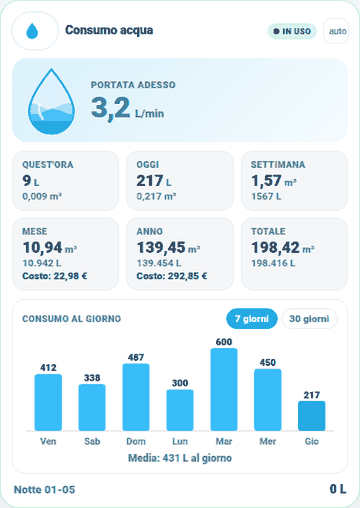

# 💧 Card Consumi acqua (`shc-water-card`)

Una card per vedere **quanta acqua consumi**: ora, oggi, settimana, mese, anno e totale, in **litri e in m³**, più la **portata in L/min**, un **grafico a barre** dei giorni, l'**avviso perdita**, il **consumo di notte** e, se vuoi, il **costo**.

Funziona con **un solo sensore**: quello che conta *tutta* l'acqua passata e sale sempre (il "totale"). Va bene qualunque fonte: contatore a impulsi (vedi sotto), ESPHome `pulse_meter`, Shelly, l'integrazione del tuo contatore.



## Cosa mostra

| Voce | Come è calcolata |
|---|---|
| Quest'ora, Oggi, Settimana (da lunedì), Mese, Anno | dalle **statistiche a lungo termine** di Home Assistant, più quello che è passato negli ultimi minuti |
| Totale | il valore del sensore |
| Portata adesso (L/min) | dal tuo sensore di portata, oppure calcolata dalla card sugli ultimi 2 minuti (0 se non passa acqua) |
| Grafico | litri di ogni giorno, ultimi 7 o 30 giorni. Tocca una barra per vedere il valore |
| Perdita | se l'acqua scorre **senza mai fermarsi** per 120 minuti (puoi cambiare) la card diventa rossa |
| Notte | litri consumati tra l'1 e le 5; avviso se superano un limite che scegli tu |
| Costo | mese e anno, se scrivi il prezzo dell'acqua |

Il pulsante in alto a destra cambia l'unità grande: **auto** (litri se pochi, m³ se tanti), **L**, **m³**. Sotto ogni numero vedi sempre anche l'altra unità.

## Installazione passo per passo

1. Installa **Smart Home Cards** (Marketplace/HACS, vedi [installazione](installazione.md)). Se l'hai già, aggiornala alla versione 1.33.0 o successiva.
2. Premi **Ctrl+F5** nella pagina (sul telefono: App Companion > Risoluzione problemi > Reimposta cache del frontend).
3. **Hai già un sensore del totale acqua?** Vai al punto 5. **Hai solo un contatore con contatto a impulsi** (1 impulso = 1 litro)? Fai prima la parte "Contatore a impulsi" qui sotto, poi torna qui.
4. Apri la dashboard, clicca i tre puntini in alto a destra > **Modifica dashboard** > **Aggiungi scheda**.
5. Cerca **Consumi acqua** e cliccala. La card sceglie da sola il primo sensore acqua che trova (campo **Sensore del contatore acqua**). Se è quello giusto, non toccare nulla.
6. Clicca **Salva**.

In YAML basta:

```yaml
type: custom:shc-water-card
entity: sensor.acqua_totale_litri
```

Le statistiche si riempiono con il tempo: il primo giorno vedi poco, dopo qualche ora i numeri e il grafico sono completi.

## Contatore a impulsi (1 impulso = 1 litro)

Serve per creare il sensore del totale. Ti serve un dispositivo che dia a Home Assistant l'impulso come `binary_sensor` (Shelly Uni / Plus i4, ingresso di un ESP32 con ESPHome, sensore porta Zigbee con contatto esterno).

1. Copia il file [`examples/acqua_contatore_impulsi.yaml`](../examples/acqua_contatore_impulsi.yaml) in `/config/packages/acqua.yaml`.
2. In `configuration.yaml` ci deve essere, una volta sola:
   ```yaml
   homeassistant:
     packages: !include_dir_named packages
   ```
3. Nel file `acqua.yaml` cerca la riga `binary_sensor.contatore_acqua_impulso` e scrivi al posto suo il tuo sensore dell'impulso (lo trovi in **Impostazioni > Dispositivi e servizi > Entità**).
4. Cerca anche `notify.notify` e metti il tuo servizio di notifica (per esempio `notify.mobile_app_il_tuo_telefono`), oppure togli quell'automazione se non vuoi l'avviso di notte.
5. **Impostazioni > Sistema > Riavvia Home Assistant** (serve il riavvio completo).
6. Apri una volta il rubinetto: in **Strumenti per sviluppatori > Stati** cerca `sensor.acqua_totale_litri`: deve salire di 1 a ogni litro.
7. Per partire dalla lettura vera del contatore: **Strumenti per sviluppatori > Azioni**, azione `counter.set_value`, entità `counter.acqua_litri_impulsi`, valore = i litri scritti sul contatore.
8. Metti la card con `entity: sensor.acqua_totale_litri`.

> Un sensore Zigbee a batteria può perdere impulsi se l'acqua scorre veloce. Con ESPHome la soluzione più precisa è `pulse_meter` sul microcontrollore (vedi sotto).

### ESPHome (consigliato se hai un ESP32)

```yaml
sensor:
  - platform: pulse_meter
    pin:
      number: GPIO4
      mode: INPUT_PULLUP
    name: "Acqua portata"
    unit_of_measurement: "L/min"
    internal_filter: 100ms
    timeout: 2min
    total:
      name: "Acqua totale"
      unit_of_measurement: "L"
      device_class: water
      state_class: total_increasing
      accuracy_decimals: 0
```

Nella card: `entity` = "Acqua totale", `flow_entity` = "Acqua portata". Il totale di `pulse_meter` riparte da zero a ogni riavvio dell'ESP: i periodi (oggi, mese...) restano giusti, ma il "Totale" non è quello del contatore. Per un totale che non si perde usa il package qui sopra (il contatore ricorda il valore).

## Tutte le opzioni

| Opzione | Cosa fa | Default |
|---|---|---|
| `entity` | Sensore del totale acqua (L, m³, gal, ft³). Se manca, la card cerca il primo sensore `device_class: water` | automatico |
| `flow_entity` | Sensore di portata (L/min, L/h, m³/h...). Se manca la portata è calcolata dal totale | calcolata |
| `name` | Nome sulla card | Consumo acqua |
| `unit` | Unità grande: `L` o `m3` (vuoto = automatica) | automatica |
| `chart_days` | Giorni del grafico: `7` o `30` | 7 |
| `leak_minutes` | Minuti di acqua senza pause per l'avviso perdita; `0` = spento | 120 |
| `night_from`, `night_to` | Ore della notte | 1 e 5 |
| `night_limit` | Litri di notte oltre i quali scatta l'avviso; `0` = solo il numero | 0 |
| `price_per_m3` | Prezzo dell'acqua in euro per m³ (mostra il costo di mese e anno) | spento |
| `currency` | Simbolo della valuta | € |
| `flow_minutes` | Minuti usati per calcolare la portata | 2 |

## Se qualcosa non va

- **"Scegli il sensore del contatore acqua"**: nessun sensore acqua trovato. Scrivi tu `entity:`; il sensore deve avere `device_class: water` e `state_class: total_increasing` (o `total`).
- **"Le statistiche non ci sono ancora"**: aspetta un paio d'ore. Se non passa, controlla in **Strumenti per sviluppatori > Statistiche** che il sensore sia elencato senza errori (il sensore deve avere `state_class`).
- **I numeri sono 10 volte troppo piccoli o grandi**: controlla l'unità del sensore (`L` o `m³`): la card converte da sola, ma l'unità deve essere scritta giusta.
- **Il sensore sale solo a scatti di 1 L**: normale con un contatore a impulsi, la portata ha la risoluzione di 1 L per 2 minuti.
- Orari e giorni seguono il fuso orario del dispositivo che guarda la dashboard.
