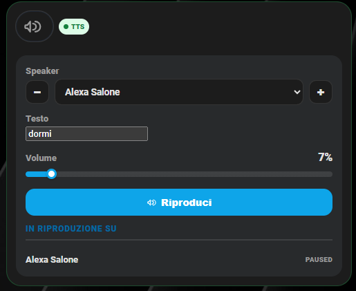
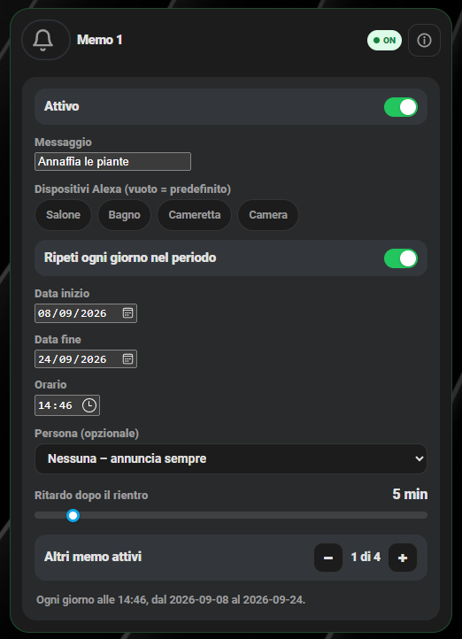
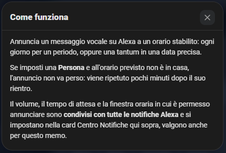
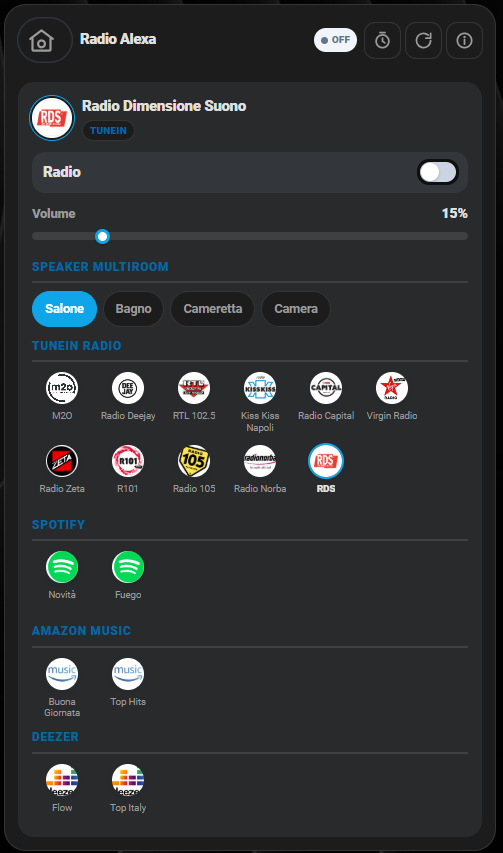
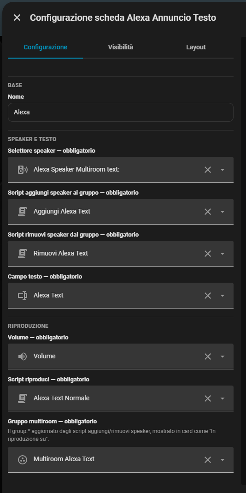
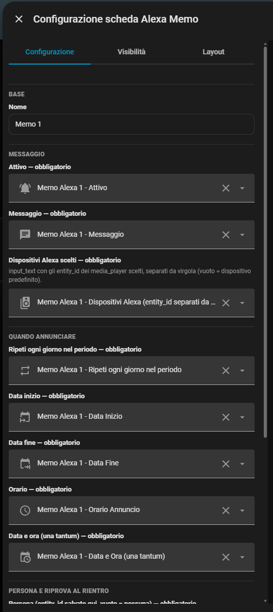

# 🔊 Card Alexa: Annuncio Testo (`shc-alexa-text-card`), Memo (`shc-alexa-memo-card`) e WebRadio (`shc-alexa-webradio-card`)

Tre card pensate per usare Alexa come "citofono/radio di casa", senza passare da automazioni scritte a mano ogni volta:

- **Alexa Annuncio Testo**: scrivi un messaggio al volo, scegli su quale speaker (o gruppo multiroom) farlo sentire, regoli il volume e lo riproduci con un tap. Pensata per gli annunci "adesso", non programmati.
- **Alexa Memo**: fino a **4 promemoria vocali indipendenti** (la card Memo 1 permette di sbloccarne altre, 2/3/4, in base a quanti ti servono), ognuno con un proprio testo, un intervallo di date + orario (oppure una singola data/ora se non ripetuto) e, opzionalmente, un **dispositivo Alexa dedicato**. Il campo **Persona** (opzionale) evita che un promemoria vada perso se all'orario previsto quella persona non è in casa: resta "in sospeso" e viene annunciato pochi minuti dopo il suo rientro.
- **Alexa WebRadio**: accendi una radio TuneIn o una playlist Spotify/Amazon Music/Deezer sugli speaker multiroom scelti, con controllo volume, sveglia programmata (a due orari, nei giorni scelti) e volume ridotto automatico allo spegnimento.

| Alexa Annuncio Testo | Alexa Memo |
|---|---|
|  |  |

Le prime due riusano lo stesso motore vocale condiviso di [`packages/centro_notifiche_alexa.yaml`](../packages/centro_notifiche_alexa.yaml) (script `script.notifica_vocale_alexa`), lo stesso usato dalle altre card di questa raccolta — vedi [notifiche-personalizzate.md](notifiche-personalizzate.md). **Alexa WebRadio è indipendente** da quel motore (riproduce stazioni/playlist, non messaggi vocali) — vedi la sua sezione più sotto per i prerequisiti specifici.

## Cosa ti serve prima di iniziare

- L'integrazione HACS **[Alexa Media Player](https://github.com/alandtse/alexa_media_player)** (non è nativa in Home Assistant) con almeno un dispositivo Alexa già collegato al tuo account Amazon.
- Il package condiviso [`packages/centro_notifiche_alexa.yaml`](../packages/centro_notifiche_alexa.yaml) — se lo hai già installato per un'altra card (es. Raccolta Differenziata) non serve ricopiarlo.

## 🚀 Metodo veloce: usa i miei package originali

- **Alexa Annuncio Testo** → [`packages/alexa_text.yaml`](../packages/alexa_text.yaml). In cima trovi il blocco `IMPOSTAZIONI PACKAGE`: sostituisci il servizio di notifica push (`mobile_app_il_tuo_telefono`) col tuo, e nella lista `list_alexa_speaker_multiroom_text` metti i **friendly name** dei tuoi `media_player.*` Alexa al posto dei miei.
- **Alexa Memo** → [`packages/memo_alexa.yaml`](../packages/memo_alexa.yaml). Nessun dato da cambiare in cima: crea solo gli `input_text`/`input_boolean`/`input_datetime`/`input_number` per i 4 memo e le automazioni che li annunciano. Nelle automazioni "Annuncio al rientro" sostituisci gli `entity_id` di esempio (`person.residente_1`, `person.residente_2`, …) con i tuoi `person.*` reali, oppure lascia solo quelli che ti servono.
- Copia entrambi i file dentro `/config/packages/` (richiede i [Packages](https://www.home-assistant.io/docs/configuration/packages/) attivi) insieme a `centro_notifiche_alexa.yaml`, poi riavvia Home Assistant.

## Configurazione minima — Alexa Annuncio Testo

```yaml
type: custom:shc-alexa-text-card
name: Alexa
speaker_select_entity: input_select.list_alexa_speaker_multiroom_text
add_script: script.add_alexa_text
remove_script: script.remove_alexa_text
text_entity: input_text.alexa_text
volume_entity: input_number.volume_alexa_text
play_script: script.alexa_text_normale
group_entity: group.multiroom_alexa_text
```

### Campo per campo

| Campo | Obbligatorio | Descrizione |
|---|---|---|
| `speaker_select_entity` | **Sì** | `input_select` con l'elenco dei friendly name degli speaker Alexa disponibili |
| `add_script` / `remove_script` | **Sì** | Script che aggiungono/rimuovono lo speaker selezionato dal gruppo multiroom |
| `text_entity` | **Sì** | `input_text` col messaggio da annunciare |
| `volume_entity` | **Sì** | `input_number` (0–1) col volume del gruppo |
| `play_script` | **Sì** | Script che avvia l'annuncio TTS sul gruppo |
| `group_entity` | **Sì** | `group` multiroom su cui viene riprodotto il messaggio (mostrato in card come elenco "In riproduzione su") |
| `name` | No | Titolo card (default `"Alexa"`) |

## Configurazione minima — Alexa Memo (una per slot, 1 a 4)

```yaml
type: custom:shc-alexa-memo-card
name: Memo 1
active_entity: input_boolean.memo_alexa_1_attivo
text_entity: input_text.memo_alexa_1_testo
repeat_entity: input_boolean.memo_alexa_1_ripetizione
date_start_entity: input_datetime.memo_alexa_1_data_inizio
date_end_entity: input_datetime.memo_alexa_1_data_fine
time_entity: input_datetime.memo_alexa_1_orario
once_datetime_entity: input_datetime.memo_alexa_1_data_singola
person_entity: input_text.memo_alexa_1_persona
pending_entity: input_boolean.memo_alexa_1_pending
retry_delay_entity: input_number.memo_alexa_1_ritardo_rientro
devices_entity: input_text.memo_alexa_1_dispositivi
slot_count_entity: input_number.memo_alexa_slot_attivi
```

Le card Memo 2/3/4 sono identiche (cambia solo il numero nell'`entity_id`) e in genere si nascondono da sole in dashboard finché non servono, con una `visibility` sul valore di `input_number.memo_alexa_slot_attivi`:

```yaml
visibility:
  - condition: numeric_state
    entity: input_number.memo_alexa_slot_attivi
    above: 1   # 2 per Memo 3, 3 per Memo 4
```

### Campo per campo

| Campo | Obbligatorio | Descrizione |
|---|---|---|
| `active_entity` | **Sì** | `input_boolean` che attiva/disattiva il memo |
| `text_entity` | **Sì** | `input_text` col messaggio da annunciare |
| `repeat_entity` | **Sì** | `input_boolean`: acceso = ripete ogni giorno nell'intervallo date, spento = una tantum su `once_datetime_entity` |
| `date_start_entity` / `date_end_entity` | **Sì** | `input_datetime` (solo data) con l'intervallo in cui il memo è attivo, se ripetuto |
| `time_entity` | **Sì** | `input_datetime` (solo ora) con l'orario dell'annuncio giornaliero |
| `once_datetime_entity` | **Sì** | `input_datetime` (data+ora) usato quando il memo **non** è ripetuto |
| `person_entity` | **Sì** | `input_text` col `person.*` da controllare (vuoto = annuncia comunque all'orario, nessun controllo presenza) |
| `pending_entity` | **Sì** | `input_boolean` interno: resta acceso se l'annuncio è "in sospeso" in attesa del rientro |
| `retry_delay_entity` | **Sì** | `input_number` con i minuti di attesa dopo il rientro prima di riprovare |
| `devices_entity` | **Sì** | `input_text` con gli `entity_id` `media_player.*` scelti per la riproduzione (separati da virgola, vuoto = dispositivo Alexa predefinito) — nell'editor visuale è una selezione a chip |
| `devices` | No | Speaker mostrati come chip nella card: elenco di `entity` (`media_player.*`) + `name` facoltativo (vuoto = friendly name dell'entità). Default: i miei 4 speaker (Salone, Bagno, Cameretta, Camera). Vedi l'esempio sotto la tabella |
| `slot_count_entity` | No (solo su Memo 1) | `input_number` che mostra sulla card 1 uno stepper "Altri memo attivi" per sbloccare Memo 3/4 |
| `name` | No | Titolo card (default `"Alexa"`) |

Esempio con i tuoi speaker (basta anche il solo `entity_id`, il nome arriva dal friendly name):

```yaml
devices:
  - entity: media_player.echo_cucina
    name: Cucina
  - media_player.echo_studio
```

Il pulsante ℹ️ sulla card Memo apre un piccolo popup che spiega il funzionamento (utile per chi la usa, non solo per chi la configura):



## 📻 Alexa WebRadio



Stazioni TuneIn e playlist Spotify/Amazon Music/Deezer raggruppate in griglie con logo piccolo (non a schermo intero), tema chiaro/scuro. Tocca una stazione per selezionarla, i chip degli speaker per aggiungerli/rimuoverli dal gruppo multiroom (quello evidenziato in blu è già acceso), il cursore per il volume. I due pulsanti in alto (orologio e "restart") aprono le impostazioni di **Sveglia** e **Volume ridotto automatico** senza uscire dalla card.

### Prima di iniziare ti serve

- **Home Assistant** con **smart-home-cards 1.30.1 o più nuova** (Impostazioni > Marketplace/HACS).
- L'integrazione **[Alexa Media Player](https://github.com/alandtse/alexa_media_player)**, già collegata al tuo account Amazon. Si installa da HACS. Senza questa la radio **non può suonare**: la card comanda i suoi `media_player`.
- Almeno un **Echo/Alexa** che compare in Home Assistant. Per controllare: **Impostazioni > Dispositivi e servizi > Entità**, cerca `media_player`. Devi vedere i tuoi Echo.
- Per Spotify, Amazon Music o Deezer: il servizio deve essere già collegato nell'app **Alexa** del telefono. TuneIn (le radio) non serve collegarlo.
- **Non serve** `centro_notifiche_alexa.yaml`.

### Installazione, passo per passo

La card da sola **non basta**. Ha bisogno del **package**: un file di testo con gli interruttori, le liste, gli script e le automazioni. Se manca, la card ti mostra un riquadro arancione con scritto cosa non trova. Fai i passi in ordine.

#### Passo 1 - Trova i nomi dei tuoi speaker

1. Vai su **Impostazioni > Dispositivi e servizi > Entità**.
2. Nella ricerca scrivi `media_player`.
3. Per ogni Echo che vuoi usare scrivi su un foglio **due cose**: l'**ID** (per esempio `media_player.echo_cucina`) e il **nome** accanto (per esempio `Echo Cucina`). Il nome è il *friendly name*: si vede anche cliccando sull'entità e aprendo l'ingranaggio.
4. Scrivili **esattamente come sono**, con le maiuscole.

#### Passo 2 - Controlla che i package siano attivi

1. Apri `/config/configuration.yaml` con **File editor** o **Studio Code Server** (si installano da **Impostazioni > App**).
2. Se non ci sono, aggiungi **in fondo** queste due righe:

```yaml
homeassistant:
  packages: !include_dir_named packages
```

3. Se esiste già un blocco `homeassistant:`, aggiungi solo la riga `packages: !include_dir_named packages` sotto quello che c'è. Salva.

#### Passo 3 - Copia il package

1. Apri [`packages/alexa_webradio.yaml`](../packages/alexa_webradio.yaml) su GitHub e premi **Copy raw file**.
2. Nel File editor crea la cartella `/config/packages` se non c'è.
3. Crea il file `/config/packages/alexa_webradio.yaml`, incolla tutto e salva.

#### Passo 4 - Scrivi i tuoi speaker nel package

1. Apri `/config/packages/alexa_webradio.yaml` e cerca `list_alexa_speaker_multiroom` (Ctrl+F).
2. Vedi quattro righe con `Alexa Bagno`, `Alexa Salone`, `Alexa Cameretta`, `Alexa Camera`. Sono i miei speaker. **Cancellale e scrivi i tuoi nomi del passo 1**, uno per riga, uguali al friendly name:

```yaml
  list_alexa_speaker_multiroom:
    name: "Alexa Speaker Multiroom"
    options:
      - "Echo Cucina"
      - "Echo Studio"
    icon: mdi:speaker-wireless
```

3. Salva. Il nome nel package, il nome nella card (passo 6) e il friendly name devono essere **identici**: è l'errore più comune.

#### Passo 5 - Riavvia Home Assistant (completo)

1. **Impostazioni > Sistema** > icona di accensione in alto a destra > **Riavvia Home Assistant**.
2. Serve il **riavvio completo**: **ricaricare** non basta, gli interruttori e i sensori nascono solo al riavvio.
3. Aspetta 1-2 minuti, poi premi **Ctrl+F5** nel browser.

#### Passo 6 - Aggiungi la card

1. Apri la dashboard > matita > **Aggiungi scheda** > **Alexa WebRadio** (oppure **Manuale**).
2. Nell'editor o nel YAML scrivi la configurazione qui sotto. **Cambia solo la parte `speakers`**: `entity` è l'ID del passo 1, `option` è il nome del passo 1 (identico al package), `name` è il testo che vuoi sul pulsante.

```yaml
type: custom:shc-alexa-webradio-card
name: Radio Alexa
power_entity: input_boolean.web_radio_alexa
station_select_entity: input_select.stazioni_radio_alexa
station_sensor_entity: sensor.radio_alexa
volume_entity: input_number.volume_radio_alexa
group_entity: group.multiroom_alexa
speaker_list_entity: input_select.list_alexa_speaker_multiroom
add_script: script.add_alexa
remove_script: script.remove_alexa
speakers:
  - entity: media_player.echo_cucina
    name: Cucina
    option: "Echo Cucina"
  - entity: media_player.echo_studio
    name: Studio
    option: "Echo Studio"
```

3. Salva.

#### Passo 7 - Controlla e prova

1. Guarda la card. Se vedi un **riquadro arancione**, leggilo: dice cosa manca (vedi "Problemi comuni").
2. Tocca il pulsante di uno **speaker**: deve diventare blu.
3. Tocca una **stazione** (per esempio RTL 102.5).
4. Accendi l'interruttore **Radio**. Dopo qualche secondo la radio parte sullo speaker blu.
5. Muovi il **Volume**.

Le **immagini delle stazioni** non sono nel repository: se non le copi in `/config/www/loghi_radio_alexa/4_4/` i pulsanti mostrano solo il nome. Funziona lo stesso.

### Problemi comuni

- **Vedo il riquadro arancione "Manca il package"** -> il package non è caricato. Controlla il passo 2 (righe in `configuration.yaml`), il passo 3 (percorso `/config/packages/alexa_webradio.yaml`) e fai il riavvio **completo** (passo 5). Il riquadro elenca gli ID che non trova.
- **Vedo "Questi speaker non esistono in Home Assistant"** -> nella card hai scritto un `entity` che non esiste (o hai lasciato i miei speaker di esempio). Rifai il passo 1 e correggi `speakers`.
- **Vedo "Questi speaker non sono nell'elenco del package"** -> il `option` della card non è uguale al nome scritto nel package al passo 4. Rendili identici (maiuscole comprese), riavvia.
- **Tocco gli speaker ma non diventano blu** -> stesso problema: nome diverso tra card, package e friendly name. Guarda anche **Impostazioni > Sistema > Registri**.
- **Tocco la stazione ma non suona niente** -> controlla che **Alexa Media Player** funzioni (prova a far parlare l'Echo da **Strumenti per sviluppatori > Azioni**). Controlla che almeno uno speaker sia blu e l'interruttore **Radio** acceso.
- **Spotify/Amazon Music/Deezer non parte** -> collega il servizio nell'app Alexa.
- **Nessuna immagine sulle stazioni** -> normale, le immagini non sono incluse (vedi sopra).

**EN** — WebRadio needs **Alexa Media Player** and the **package**. Steps: 1) note the `media_player` ID and friendly name of each Echo; 2) make sure `homeassistant: packages: !include_dir_named packages` is in `configuration.yaml`; 3) copy `packages/alexa_webradio.yaml` into `/config/packages/`; 4) in the package, replace the four speaker names under `list_alexa_speaker_multiroom` with your friendly names; 5) **fully restart** Home Assistant and press Ctrl+F5; 6) add the card and set `speakers` (`entity`, `name`, `option` = exactly the name in the package); 7) tap a speaker (blue), a station, then the Radio switch. If the card shows an orange box, it lists what is missing: package not loaded, speakers that do not exist, or names that differ between card and package. Station logos are not included in the repository (optional).

### Configurazione minima

```yaml
type: custom:shc-alexa-webradio-card
name: Radio Alexa
power_entity: input_boolean.web_radio_alexa
station_select_entity: input_select.stazioni_radio_alexa
station_sensor_entity: sensor.radio_alexa
volume_entity: input_number.volume_radio_alexa
group_entity: group.multiroom_alexa
speaker_list_entity: input_select.list_alexa_speaker_multiroom
alarm_entity: input_boolean.sveglia_alexa
alarm_on_entity: input_datetime.ora_sveglia_alexa_on
alarm_off_entity: input_datetime.ora_sveglia_alexa_off
volume_off_automation: automation.radio_off_volume_alexa
volume_off_entity: input_number.volume_radio_off_alexa
```

### Campo per campo

| Campo | Obbligatorio | Descrizione |
|---|---|---|
| `power_entity` | **Sì** | `input_boolean` che accende/spegne la radio sul gruppo multiroom |
| `station_select_entity` | **Sì** | `input_select` con l'elenco delle stazioni/playlist (i separatori `-- ... --` sono ignorati dalla card) |
| `station_sensor_entity` | **Sì** | Sensore template con attributi `select` (nome per Alexa), `servizi` (TUNEIN/SPOTIFY/AMAZON_MUSIC/DEEZER) e `entity_picture` (logo) — vedi il package |
| `volume_entity` | **Sì** | `input_number` (0–1) col volume del gruppo |
| `group_entity` | **Sì** | `group` multiroom su cui viene riprodotta la radio |
| `speaker_list_entity` | **Sì** | `input_select` usato dai chip degli speaker per selezionare quale aggiungere/rimuovere dal gruppo |
| `add_script` / `remove_script` | No | Script lanciati dai chip per aggiungere/rimuovere dal gruppo lo speaker appena scelto in `speaker_list_entity`. Default `script.add_alexa` / `script.remove_alexa` (quelli del package) |
| `speakers` | No | Speaker mostrati come chip: elenco di `entity` (`media_player.*`), `name` (testo del chip) e `option` (opzione di `speaker_list_entity` da selezionare). `name` e `option` vuoti = friendly name dell'entità. Default: i miei 4 speaker |
| `stations` | No | Stazioni/playlist mostrate in griglia: elenco di `option` (opzione di `station_select_entity`), `name`, `image` e `group` (titolo della griglia, es. "TuneIn Radio"). Default: le mie 17 stazioni |
| `image_path` | No | Cartella delle immagini indicate in `stations` solo come nome file (default `/local/loghi_radio_alexa/4_4/`). Un'immagine che inizia con `/` o `http` è usata così com'è |
| `alarm_entity` / `alarm_on_entity` / `alarm_off_entity` | No | Sveglia: attiva/disattiva + i due orari |
| `alarm_days` | No | Chip dei giorni della sveglia: elenco di `entity` (`input_boolean`) + `name`. Default: i 7 `input_boolean.alexa_sveglia_<giorno>` del package |
| `volume_off_automation` / `volume_off_entity` | No | Automazione che, allo spegnimento, abbassa il volume del gruppo al valore scelto |
| `name` | No | Titolo card (default `"Radio Alexa"`) |

### Speaker, stazioni e sveglia personalizzati

Aggiungi alla card solo gli elenchi che vuoi cambiare; quelli che non scrivi restano ai valori del mio package:

```yaml
add_script: script.add_alexa
remove_script: script.remove_alexa
speakers:
  - entity: media_player.echo_cucina
    name: Cucina
    option: Echo Cucina        # come scritto in speaker_list_entity
  - media_player.echo_studio   # solo entity_id: nome e opzione = friendly name
image_path: /local/loghi_radio_alexa/4_4/
stations:
  - option: RADIO DEEJAY       # come scritto in station_select_entity
    name: Radio Deejay
    image: radio_deejay.jpg
    group: TuneIn Radio
  - option: TOP HITS
    name: Top Hits
    image: /local/le_mie_immagini/amazon.jpg
    group: Amazon Music
alarm_days:
  - entity: input_boolean.alexa_sveglia_lunedi
    name: Lunedì
  - entity: input_boolean.alexa_sveglia_martedi
    name: Martedì
```

Gli stessi elenchi si modificano anche dall'editor visuale (sezioni Multiroom, Stazioni e playlist, Sveglia): ogni elenco si apre con "mostra/modifica" e ha i pulsanti Aggiungi e Rimuovi.

### Speaker personalizzati (i chip non compaiono o non rispondono)

I chip degli speaker vengono dall'opzione `speakers` **della card**, non dal package. Se non la imposti, la card mostra i 4 Alexa di default (`media_player.alexa_salone`, `alexa_bagno`, `alexa_cameretta`, `alexa_camera`): se i tuoi media player hanno un altro nome, i chip non funzionano. Imposta i tuoi (editor visuale, sezione Multiroom, oppure YAML):

```yaml
speakers:
  - entity: media_player.il_mio_echo_cucina   # il tuo media_player Alexa
    name: Cucina                               # testo sul chip
    option: "Echo Cucina"                      # IDENTICO a una voce di input_select.list_alexa_speaker_multiroom
```

Nel package `input_select.list_alexa_speaker_multiroom` deve elencare i **friendly name** dei tuoi media_player; `option` deve essere uguale (maiuscole comprese) alla voce corrispondente. Toccando il chip la card seleziona quella voce e lancia `script.add_alexa` / `script.remove_alexa`.

### Aggiungere una playlist (Amazon Music, Spotify, Deezer) o una radio

Non serve nessun URL: Alexa riceve il **nome** della playlist/radio e il **servizio**. Passi, tutti e tre necessari:

1. In `input_select.stazioni_radio_alexa` (package) aggiungi la voce, es. `MIA PLAYLIST`.
2. Nel template sensor `Radio Alexa` (entity `sensor.radio_alexa`) aggiungi un ramo per la voce in tutti e tre gli attributi: `select` (il nome esatto da cercare su Alexa, come nell'app), `servizi` (`TUNEIN`, `SPOTIFY`, `AMAZON_MUSIC` o `DEEZER`) ed `entity_picture` (logo). Copia un ramo esistente e cambia i valori.
3. Nella card aggiungi la voce a `stations`:

```yaml
stations:
  - option: MIA PLAYLIST      # uguale alla voce dell'input_select
    name: La mia playlist
    image: amazon.jpg
    group: Amazon Music
```

Riavvia (o ricarica template e input_select) e prova.

### Problemi comuni

#### La card dice "Non trovo: sensor.radio_alexa"

Il file del package c'è, ma Home Assistant non ha creato il sensore **Radio Alexa**. Con la 1.30.1 la card cerca da sola anche `sensor.radio_alexa_2`, `sensor.template_radio_alexa` o qualunque sensore chiamato "Radio Alexa", e ti dice come si chiama. Se non lo trova, fai questi passi in ordine.

1. Vai su **Impostazioni > Dispositivi e servizi > Entità** e scrivi `radio` nella ricerca. Se vedi un sensore **Radio Alexa** con un id diverso (per esempio `sensor.radio_alexa_2`), copia l'id.
2. Apri la card, premi la matita, e nel campo **Sensore stazione corrente** (`station_sensor_entity`) incolla quell'id. Salva.
3. Apri `/config/packages/alexa_webradio.yaml` e cerca `sensor.radio_alexa` (compare nell'automazione **Multiroom Alexa**, due volte). Scrivi lo stesso id che hai copiato al passo 1. Salva.
4. Se il sensore non c'è proprio, vai su **Strumenti per sviluppatori > YAML > Verifica configurazione**. Se compare un errore, leggilo: di solito dice la riga del file che non va.
5. Apri **Impostazioni > Sistema > Log** e cerca la parola `template` o `alexa_webradio`. Se leggi un errore, correggi quella riga e passa al passo 8.
6. Apri `/config/configuration.yaml` (Ctrl+F e cerca `homeassistant:`). Se la parola compare **due volte** sulla riga senza spazi davanti, la seconda cancella la prima: i `packages` possono non essere caricati o essere caricati a metà. Lascia **una sola** chiave `homeassistant:` e metti sotto tutte le righe (`name`, `packages`, `customize`...). Esempio:

```yaml
homeassistant:
  name: Casa
  packages: !include_dir_named packages
```

7. Se hai già un blocco `template:` nel tuo `configuration.yaml` scritto come `template: !include templates.yaml`, va bene lo stesso. Il package aggiunge il suo sensore senza toccare il tuo.
8. Torna su **Strumenti per sviluppatori > YAML**, premi **Verifica configurazione** e poi **Riavvia Home Assistant** (un ricaricamento dei template non basta per un package nuovo). Poi premi **Ctrl+F5** sulla pagina della dashboard.

#### Il sensore si chiama `sensor.radio_alexa_2` (o `_3`)

Vuol dire che esisteva già un sensore con quel nome, di una vecchia prova o di un'installazione precedente. Home Assistant lo ha tenuto e ha dato il numero al nuovo. Hai due strade.

1. Più semplice: segui i passi 1-3 qui sopra e usa l'id con il numero.
2. Più pulita: vai su **Impostazioni > Dispositivi e servizi > Entità**, cerca `radio_alexa`, apri il sensore **vecchio** (quello senza numero, di solito "non disponibile"), premi l'ingranaggio e **Elimina**. Poi apri quello con il numero, premi l'ingranaggio e scrivi `sensor.radio_alexa` come **ID entità**. Salva.

#### Altre entità del package non trovate (`input_select`, `group`, `script`)

1. Il riquadro arancione le elenca tutte: sono quelle che il package avrebbe dovuto creare.
2. Controlla che il file sia proprio in `/config/packages/alexa_webradio.yaml` e che in `configuration.yaml` ci sia `packages: !include_dir_named packages` sotto **una sola** chiave `homeassistant:`.
3. Fai i passi 4-8 qui sopra.
4. Se manca solo `sensor.alexa_speaker_multiroom` o uno script (`script.add_alexa`, `script.remove_alexa`), il file è stato copiato a metà: ricopialo tutto da [`packages/alexa_webradio.yaml`](../packages/alexa_webradio.yaml).

### Non parte nulla?

- Il sensore delle stazioni si chiama `sensor.radio_alexa` (dalla 1.21.1 package e documentazione lo usano; prima c'era `sensor.template_radio_alexa`, che esiste solo se importato da una vecchia installazione). Nell'automazione `Multiroom Alexa` del package l'id deve essere quello che esiste davvero nel tuo HA (Strumenti per sviluppatori > Stati). La card prova da sola entrambi gli id.
- Guarda la traccia dell'automazione `Multiroom Alexa` quando tocchi una stazione: se `media_content_type`/`media_content_id` sono vuoti, il sensore non esiste o ha un altro id.
- Serve Alexa Media Player funzionante e il servizio (Spotify/Amazon Music/Deezer) collegato nell'app Alexa.

## 🖊️ Editor visuale (senza YAML)

Non serve scrivere configurazione a mano: "Aggiungi card" → cerca **"Alexa Annuncio Testo"**, **"Alexa Memo"** o **"Alexa WebRadio"** → compili i campi, ogni entità si cerca per nome con anteprima. Lo stesso editor si apre anche per modificare una card già aggiunta (pulsante "⋮" sulla card in modalità modifica → "Edit"). Sulla card Memo, il campo Dispositivi si compila con **chip a selezione multipla** (una per ogni `media_player.*` Alexa rilevato) invece di scrivere gli `entity_id` a mano. Gli speaker mostrati come chip nelle card Memo e WebRadio, le stazioni e i giorni della sveglia sono elenchi modificabili nell'editor, con Aggiungi/Rimuovi.

| Editor Alexa Annuncio Testo | Editor Alexa Memo |
|---|---|
|  |  |
