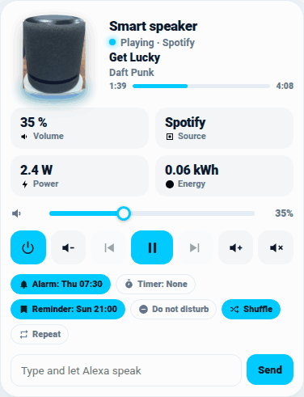

# 🔊 Card Altoparlante (Echo / Alexa e altoparlanti)

`custom:shc-speaker-card` mostra un altoparlante intelligente (Echo, Nest, Sonos, HomePod o qualsiasi `media_player`) con foto del modello, anello animato quando suona, titolo e artista, barra di avanzamento, volume, comandi, sveglia/timer/promemoria e un campo per far parlare Alexa. Editor visuale incluso, italiano / inglese / olandese.



## Esempio minimo

```yaml
type: custom:shc-speaker-card
entity: media_player.alexa_salotto
```

Con le integrazioni **Alexa Media Player** (o simili) la card trova da sola, tra le entità dello stesso dispositivo, prossima sveglia, prossimo timer, prossimo promemoria, non disturbare, casuale e ripeti. Con `auto_entities: false` si spegne la ricerca automatica.

## Opzioni

| Opzione | Descrizione |
|---|---|
| `entity` | **Obbligatoria.** Il `media_player` dell'altoparlante |
| `name` | Nome mostrato (predefinito: nome dell'entità) |
| `speaker_model` | `auto` (predefinito, dal nome del dispositivo) oppure `echo_dot`, `echo_dot_clock`, `echo_studio`, `echo_show`, `echo_spot`, `nest_mini`, `nest_audio`, `sonos_one`, `homepod_mini`, `sphere`, `screen`, `generic` (gli ultimi tre sono disegni) |
| `image` | Foto tua (URL o file in `/local/`), al posto di quella del modello |
| `power_entity`, `energy_entity` | Sensori di potenza e di energia, mostrati in due riquadri |
| `switch_entity` | Presa che alimenta l'altoparlante: il tasto di accensione la commuta |
| `ring_color` | Colore dell'anello animato (CSS) |
| `volume_step` | Passo dei tasti volume in % (predefinito 5) |
| `show_tts` | `false` nasconde il campo "Scrivi e fai parlare Alexa" |
| `tts_service` | Servizio di notifica da usare (es. `notify.alexa_media_salotto`); se manca la card lo ricava dal nome |
| `tts_type` | `tts` (predefinito) oppure `announce` |
| `next_alarm_entity`, `next_timer_entity`, `next_reminder_entity`, `dnd_entity`, `shuffle_entity`, `repeat_entity` | Forzano le entità trovate in automatico |
| `auto_entities` | `false` per non cercare le entità del dispositivo |

Le foto dei modelli sono di Wikimedia Commons, ritagliate e incorporate nel file: autori e licenze in [CREDITS.md](../CREDITS.md). Per i modelli senza foto libera (Echo 4, Pop, Show moderni, Sonos Era, Nest Hub) la card usa un disegno; con `image` si può mettere la propria foto.
