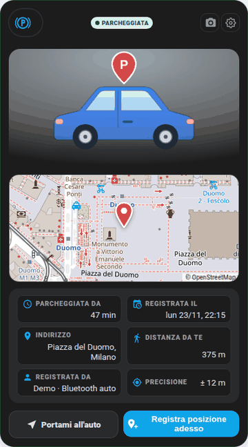

# Auto parcheggiata (`shc-parking-card`)

**IT** — Mostra dove hai lasciato l'auto: disegno dell'auto (o una tua foto), mappa OpenStreetMap con il segnaposto, da quanto è parcheggiata, indirizzo, distanza da te, chi ha registrato la posizione e con quale metodo, il pulsante **Portami all'auto** (navigazione a piedi su Google Maps) e il pulsante **Registra posizione adesso**.

**EN** — Shows where you left the car: a car drawing (or your own photo), an OpenStreetMap map with a pin, how long it has been parked, address, distance from you, who saved the position and how, a **Take me to the car** button (walking directions) and a **Save position now** button.

<p align="center"></p>


## Più auto (fino a 3)

Ogni card è legata a un'auto con `car: 1`, `2` o `3`: una famiglia mette 1, 2 o 3 card. Ogni auto ha i suoi helper `auto_parcheggio_auto<N>_*` (posizione, indirizzo, foto, nome dell'auto, nome Bluetooth, persona associata, notifica, attività, soglia) e il suo sensore `sensor.auto_parcheggio_auto<N>_posizione`.

**EN** — Each card is tied to one car with `car: 1`, `2` or `3`, so a family can add 1, 2 or 3 cards. Every car has its own helpers `auto_parcheggio_auto<N>_*` (position, address, photo, car name, Bluetooth name, linked person, notification, activity, threshold) and its own sensor `sensor.auto_parcheggio_auto<N>_posizione`.

## Come funziona il salvataggio automatico

1. Ad ogni auto è associata una persona (`input_text.auto_parcheggio_auto<N>_persona`, il nome come in `person.<nome>`). Il telefono di quella persona (app Companion Android) espone `sensor.<persona>_bluetooth_connection`; l'attributo `connected_paired_devices` elenca i dispositivi Bluetooth collegati.
2. In `input_text.auto_parcheggio_auto<N>_bt` scrivi il nome Bluetooth di quell'auto (anche solo un pezzo, più nomi separati da virgola).
3. Quando quel nome sparisce dai dispositivi collegati e resta assente 20 secondi, un'unica automazione chiama `script.auto_parcheggio_salva` con `auto: N`: chiede al telefono una posizione fresca (`request_location_update`), scarta il risultato se il GPS è più impreciso della soglia dell'auto (`input_number.auto_parcheggio_auto<N>_soglia_precisione`, 60 m, fino a 3 tentativi) e salva coordinate, ora e indirizzo sull'auto N. Se sei a casa usa le coordinate della zona Casa.
4. In alternativa, con `input_boolean.auto_parcheggio_auto<N>_usa_attivita` acceso, anche l'uscita dall'attività `in_vehicle` del telefono associato salva la posizione (spento di default: vale anche per bus e treno).
5. Il pulsante della card salva sull'auto della card, con la posizione del telefono di chi preme (la persona dell'utente Home Assistant collegato, altrimenti la persona associata all'auto). La notifica va sempre alla persona associata all'auto.

Metodo ispirato al video https://www.youtube.com/watch?v=JF5k4Pg0IEY (sensore Bluetooth dell'app Companion + `request_location_update`). Su iPhone il sensore Bluetooth non esiste: resta il pulsante manuale.

## Impostazioni (ingranaggio)

L'ingranaggio in alto a destra della card apre le impostazioni dell'auto della card, come nelle altre card smart-home-cards: **nome dell'auto**, **persona associata**, **notifica a ogni parcheggio** (spento = la posizione si registra comunque, senza notifica), **nome Bluetooth dell'auto**, **anche quando scendo dall'auto** e **precisione GPS massima**. Sono gli helper `auto_parcheggio_auto<N>_*` del package; le righe compaiono solo se l'helper esiste. Entità personalizzabili con `entity`, `name_entity`, `phone_entity`, `notify_entity`, `activity_entity`, `threshold_entity`, `bt_entity`, `photo_entity`.

**EN** — The gear icon opens the settings of the car of that card: car name, linked person, notify on every parking (off = position still saved, no notification), car Bluetooth name, also detect when leaving the car (activity) and maximum GPS accuracy. Rows only appear when the helper exists; every entity can be overridden in the card config.

## Installazione

1. Copia [`packages/auto_parcheggio.yaml`](../packages/auto_parcheggio.yaml) nei tuoi `packages` e sostituisci `persona1` / `persona2` / `persona3` con i nomi delle tue persone (o lascia i trigger che non ti servono). Ricarica o riavvia HA.
2. Aggiungi una card per auto (`car: 1`, `car: 2`, ...). Dall'ingranaggio imposta nome dell'auto, persona associata, nome Bluetooth e notifica.
3. Esempio di card:

```yaml
type: custom:shc-parking-card
car: 1                            # 1, 2 o 3 (default 1)
# opzionali
name: La mia auto                 # se manca, il nome impostato nell'ingranaggio
person: person.persona1          # distanza; se manca, la persona dell'utente collegato o quella associata all'auto
save_script: script.auto_parcheggio_salva
image: /local/auto.jpg           # foto fissa (ha la precedenza sulla foto caricata dalla card)
car_color: "#3b82f6"             # colore del disegno
hide_map: false
```

## Foto dell'auto

Il disegno è quello predefinito. L'icona della fotocamera in alto a destra apre il dialogo **Foto dell'auto**: scegli una foto dal telefono, viene ridimensionata a 1000 px, caricata in Home Assistant (stessa API delle foto persona, serve un utente amministratore) e il suo indirizzo salvato in `input_text.auto_parcheggio_auto<N>_foto`, quindi la vedono tutti i dispositivi. **Usa il disegno** la rimuove. Con `image:` in YAML la foto è fissa.

## Note

- La mappa usa le tessere di OpenStreetMap (nessuna chiave); se il sensore non ha l'indirizzo, la card lo chiede una sola volta per punto a Nominatim (OpenStreetMap) e lo ricorda nel browser.
- Posizione, ora, indirizzo e metodo sono helper (`input_number`, `input_datetime`, `input_text`): reggono riavvio e reload di Home Assistant.
