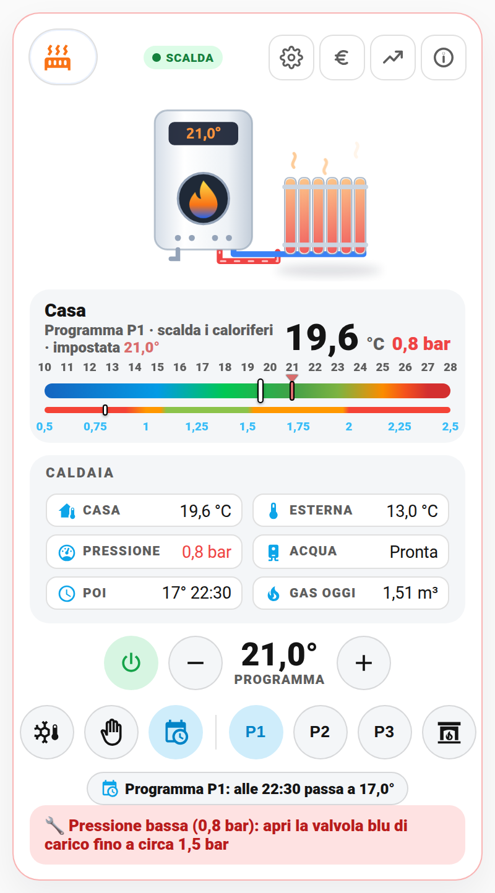
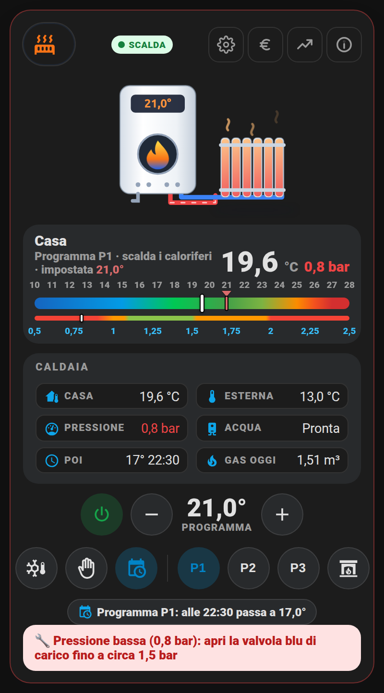
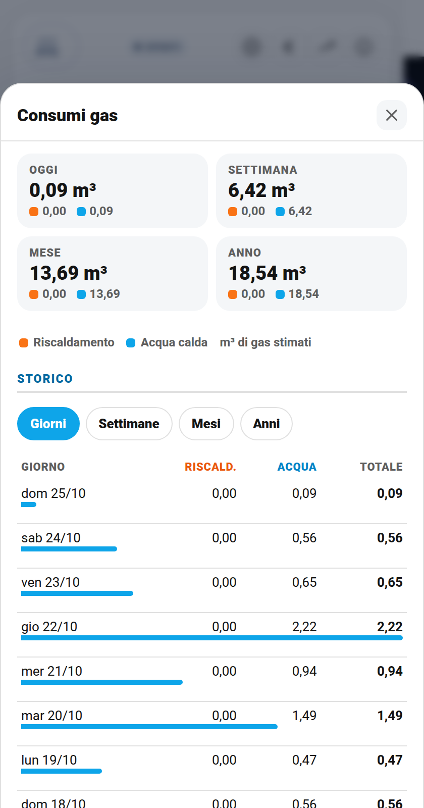
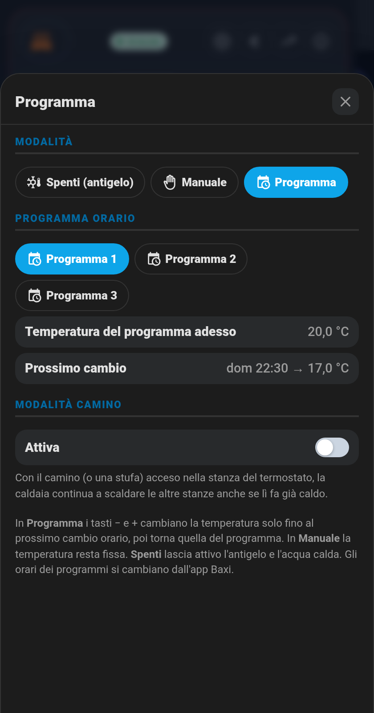

# 🔥 Card Caldaia e caloriferi (`shc-boiler-card`)

La caldaia a gas in una card sola, nello stesso stile della [card Climatizzatore](clima.md): in alto la **caldaia animata collegata a un calorifero**, sotto la **gauge dritta** con la temperatura di casa, quella impostata e la **pressione dell'impianto**, poi i dati, i comandi diretti e i **consumi di gas** per giorni, settimane, mesi e anni, divisi tra riscaldamento e acqua calda.

| Chiaro | Scuro |
|---|---|
|  |  |

> **Esempio reale**: io la uso con una caldaia **Baxi Luna Classic** con termostato smart Baxi (piattaforma Remeha, modello RU2), integrata con [Remeha Home](https://github.com/msvisser/remeha_home) da HACS. La card però funziona con **qualsiasi caldaia o termostato** che in Home Assistant sia un'entità `climate.` (Netatmo, tado°, Honeywell, Viessmann…). Pressione, acqua calda, programmi orari, modalità camino e consumi sono facoltativi: se non li hai, quelle parti non compaiono.

## Cosa mostra

- **Caldaia animata**: fiamma accesa e tremolante quando lavora; quando scalda la casa i tubi diventano rosso (mandata) e blu (ritorno) e il calorifero si colora di arancione con il calore che sale; quando fa acqua calda scendono le gocce dal rubinetto. Sul display la temperatura impostata oppure `OFF`.
- **Gauge dritta**:
  - sopra la **temperatura di casa** (10°…28°, un numero per ogni grado) con la lancetta bianca e il **cursore rosso della temperatura impostata**, visibile anche a caldaia spenta;
  - qualche pixel più sotto, staccata, la **pressione dell'impianto** (0,5…2,5 bar, un numero ogni 0,25 bar) con i suoi colori: rosso troppo bassa, arancione al limite, verde giusta, rosso troppo alta. Accanto alla temperatura c'è anche il valore, rosso se fuori range.
- **Riquadro Caldaia**: casa, esterna, pressione, acqua calda (pronta / in uso), prossimo cambio del programma ("17° 22:30") e gas di oggi.
- **Comandi**: accendi/spegni, − e + per la temperatura (0,5° alla volta), Spenti (antigelo), Manuale, Programma, i programmi orari P1/P2/P3 e la modalità camino.
- **− e + anche a caldaia spenta**: molte caldaie (Remeha compresa) da spente ignorano la temperatura. La card allora se la ricorda e, quando premi l'accensione, accende in Manuale a quella temperatura.
- **Riga di avviso**: pressione bassa ("apri la valvola blu fino a circa 1,5 bar"), pressione alta, caldaia non raggiungibile.

## I pulsanti in alto

- **⚙️ Programma**: modalità, programma orario, temperatura del programma adesso, prossimo cambio e modalità camino, con la spiegazione di cosa fa ogni modalità.
- **€ Consumi**: vedi sotto.
- **📈 Grafici**: temperatura esterna e pressione (e temperatura di casa se indichi un sensore separato).
- **ℹ️ Stato caldaia**: stato, pressione, acqua calda, accesso a internet della caldaia (interruttore del router, se ce l'hai), quando sono scattati gli avvisi e **Nascondi se scollegata**.

## 📊 Consumi di gas

| Consumi | Programma |
|---|---|
|  |  |

- **Oggi, settimana, mese, anno** in quattro riquadri, ognuno diviso tra 🟧 riscaldamento e 🟦 acqua calda.
- **Storico** in tabella per **giorni** (14), **settimane** (12), **mesi** (12) e **anni** (5), con una barretta per riga che mostra quanto pesa ciascuna parte, e il totale in fondo.
- I dati arrivano dalle **statistiche a lungo termine** di Home Assistant: nessun sensore in più da creare oltre ai due del gas, e lo storico resta anche dopo i 10 giorni del registro.
- Con l'opzione `gas_price` (€/m³) compare anche il costo.
- Sotto, i kWh di oggi comunicati dalla caldaia (consumati e prodotti).

Il gas è **stimato** dai kWh che comunica la caldaia, con circa 10,7 kWh per m³ di metano: è la stessa stima che fa l'app del produttore.

## 🚀 Metodo veloce: usa il mio package originale

Il package [`packages/caldaia_remeha.yaml`](../packages/caldaia_remeha.yaml) contiene:

- i due sensori **Gas Riscaldamento Stimato** e **Gas Acqua Calda Stimato** (m³, con statistiche a lungo termine), che non diventano 0 quando la caldaia va offline (altrimenti le statistiche conterebbero il consumo due volte);
- avvisi di **pressione bassa** (sotto 1 bar per 10 minuti, con promemoria giornaliero) e **alta** (sopra 2,5 bar), con messaggio quando rientrano;
- avviso se la **caldaia non è raggiungibile** per più di 3 ore, e quando torna online.

Cosa fare:

1. Copialo in `/config/packages/`.
2. Con Remeha Home i nomi sono già giusti. Con un'altra integrazione sostituisci `sensor.home_water_pressure` e i sensori `sensor.home_*_energy_consumed` con i tuoi.
3. Sostituisci `mobile_app_il_tuo_telefono` / `mobile_app_del_partner` con i tuoi servizi di notifica.
4. Riavvia Home Assistant.

## Configurazione

Minima:

```yaml
type: custom:shc-boiler-card
entity: climate.caldaia
```

Quella che uso io (Remeha Home):

```yaml
type: custom:shc-boiler-card
name: Caloriferi
room_name: Casa
entity: climate.generale
outdoor_entity: sensor.home_cloud_outdoor_temperature
pressure_entity: sensor.home_water_pressure
fireplace_entity: switch.generale_fireplace_mode
heating_status_entity: binary_sensor.generale_status
hot_water_status_entity: binary_sensor.dhw_status
hot_water_temperature_entity: sensor.dhw_water_temperature
schedule_setpoint_entity: sensor.generale_current_schedule_setpoint
next_setpoint_entity: sensor.generale_next_setpoint
next_setpoint_time_entity: sensor.generale_next_setpoint_time
gas_heating_entity: sensor.gas_riscaldamento_stimato
gas_hot_water_entity: sensor.gas_acqua_calda_stimato
heating_energy_entity: sensor.home_heating_energy_consumed
heating_delivered_entity: sensor.home_heating_energy_delivered
hot_water_energy_entity: sensor.home_hot_water_energy_consumed
hot_water_delivered_entity: sensor.home_hot_water_energy_delivered
diagnostics:
  - entity: automation.caldaia_pressione_acqua_bassa
    name: Pressione bassa
  - entity: automation.caldaia_pressione_acqua_alta
    name: Pressione alta
  - entity: automation.caldaia_offline
    name: Caldaia offline
```

| Opzione | Default | Cosa fa |
|---|---|---|
| `entity` | — | Termostato o zona della caldaia (`climate.`), obbligatorio |
| `name` / `room_name` | Caloriferi / nome | Titolo della card / della gauge |
| `outdoor_entity` | — | Temperatura esterna |
| `temperature_entity` | — | Sensore di casa separato (se il termostato non la dà, e per il grafico) |
| `pressure_entity` | — | Pressione impianto (bar): barra sotto la gauge e avvisi |
| `pressure_min`, `pressure_max` | 1, 2,5 | Soglie dell'avviso di pressione |
| `pressure_segments`, `pressure_scale_min`, `pressure_scale_max` | colori pronti, 0,5, 2,5 | Colori e scala della barra della pressione |
| `heating_status_entity`, `hot_water_status_entity` | — | `binary_sensor` accesi quando scalda / fa acqua calda |
| `hot_water_temperature_entity` | — | Temperatura dell'acqua calda |
| `schedule_setpoint_entity`, `next_setpoint_entity`, `next_setpoint_time_entity` | — | Programma: temperatura attuale, prossima e ora del cambio |
| `fireplace_entity` | — | Modalità camino (`switch.`) |
| `gas_heating_entity`, `gas_hot_water_entity` | — | Sensori del gas (m³, `total_increasing`) per i consumi |
| `heating_energy_entity`, `heating_delivered_entity`, `hot_water_energy_entity`, `hot_water_delivered_entity` | — | kWh consumati e prodotti, oggi |
| `gas_price` | — | Prezzo del gas in €/m³ per il costo |
| `step` | 0,5 | Passo di − e + |
| `min`, `max` | 10, 28 | Scala della temperatura |
| `scale_step` | 1 | Ogni quanti gradi un numero sulla scala (es. `2`) |
| `pressure_scale_step` | 0,25 | Ogni quanti bar un numero sotto la barra della pressione (es. `0.5`) |
| `internet_entity` | — | Interruttore del router per l'accesso a internet della caldaia |
| `diagnostics` | — | Automazioni/sensori nel popup Stato (`entity`, `name`, `alarm`) |
| `hide_when_offline` | `false` | Nascondi se scollegata (striscia bassa "Caloriferi offline") |
| `layout_entity` | — | Menu layout classico/centrato, vedi [layout.md](layout.md) |

## 💡 Idee d'uso

- **Pressione sotto controllo**: la lancetta sulla barra colorata ti dice al volo se sei nel verde. Se va nel rosso compare l'avviso con cosa fare.
- **Rientro anticipato**: in Programma premi + e la casa si scalda subito; al prossimo cambio orario torna da sola al programma.
- **Quanto costa l'acqua calda**: nei consumi vedi che d'estate il gas è quasi tutto acqua calda, d'inverno quasi tutto riscaldamento.
