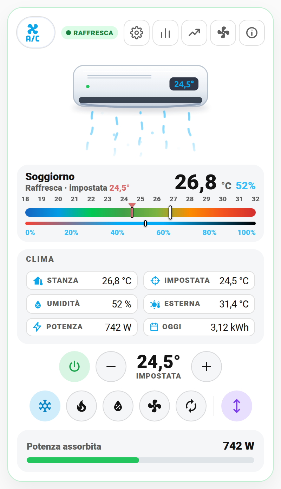
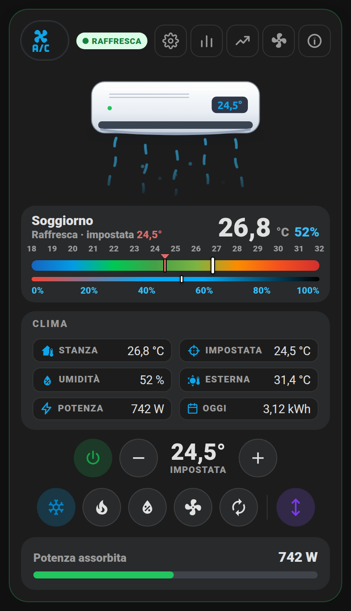
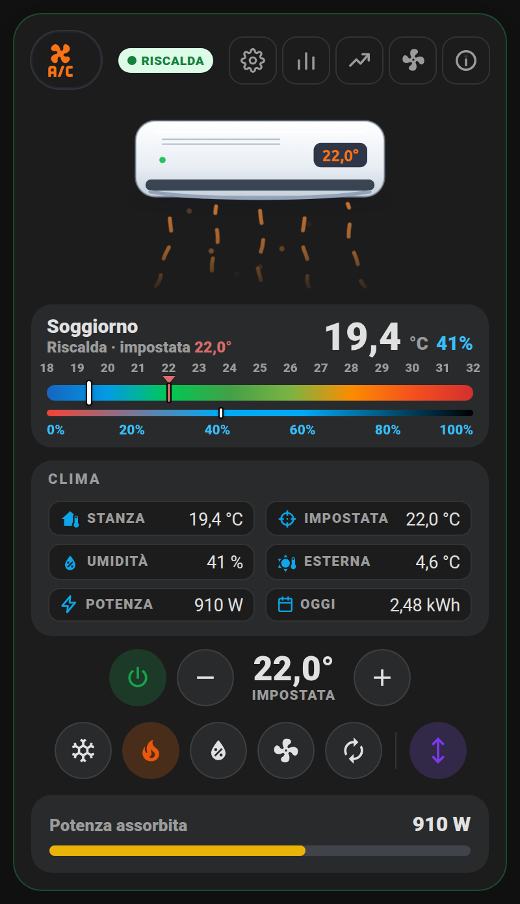
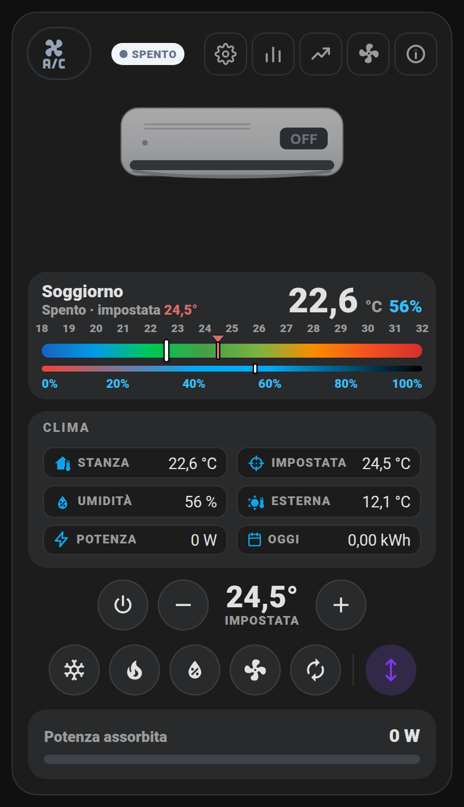
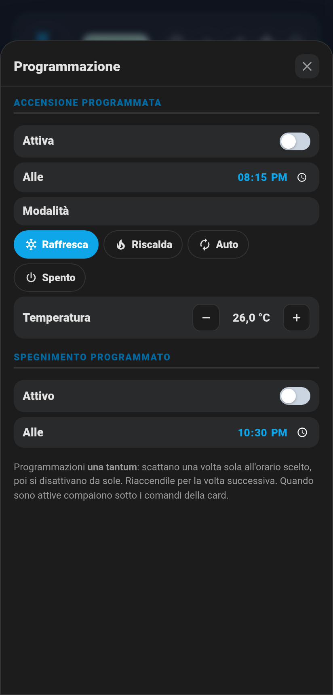
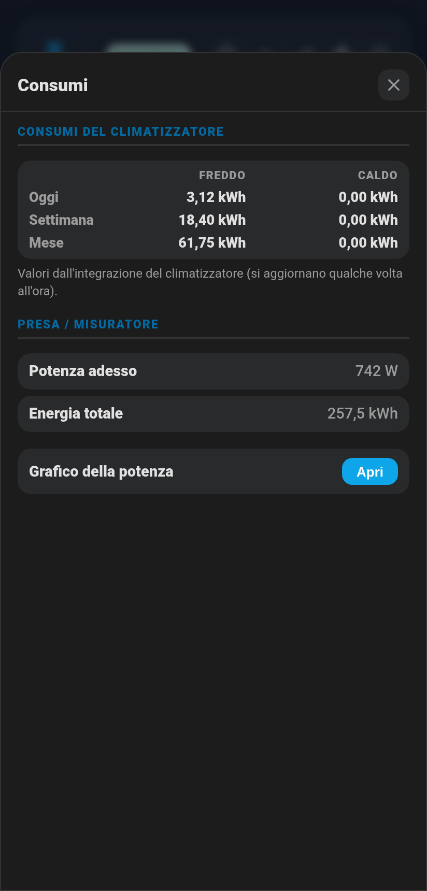
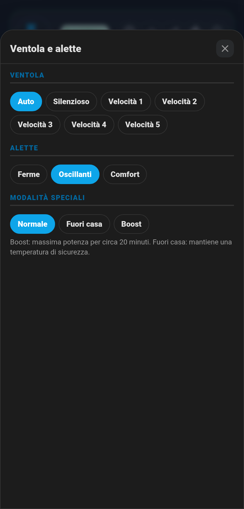
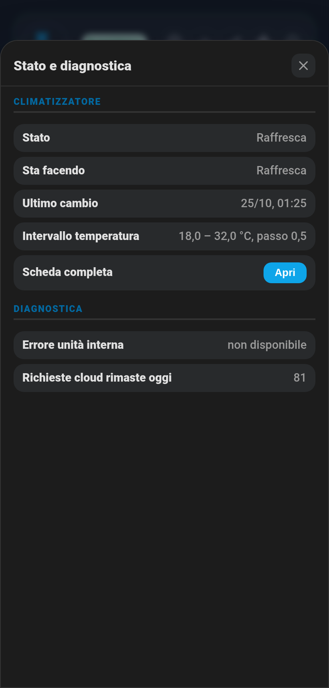

# ❄️ Card Climatizzatore (`shc-climate-card`)

Il climatizzatore in una card sola, con la stessa grafica delle altre: in alto lo **split che soffia aria** (animato, come il cestello di lavatrice e lavastoviglie), sotto una **gauge dritta** con temperatura della stanza, temperatura impostata e umidità, poi i dati, i comandi diretti e la potenza. Parte già nel **layout centrato**.

| Chiaro | Scuro |
|---|---|
|  |  |

| Riscalda | Spento |
|---|---|
|  |  |

## Perché questa card

Prima il mio climatizzatore era una pila di card diverse: una markdown per il titolo, la gauge, sette `button-card` per i comandi, una card entità per la programmazione, tutto incollato con `card_mod`. Funzionava, ma era lunga da copiare e da mantenere. Qui c'è tutto in un unico blocco, con un editor visuale. La gauge dritta usa la stessa scala e gli stessi colori della gauge che avevo, ma si legge al volo e non serve nessuna card esterna. Chi preferisce la gauge rotonda la può ancora avere (vedi `hero: gauge` più sotto).

> 🎞️ **Le immagini sono animate**, come una GIF: si muovono e cambiano colore in base a temperatura, modalità e livello. Le schermate qui sotto sono foto ferme di un istante.

## Cosa mostra

- **Split animato** (in alto): l'aria esce dal climatizzatore quando lavora. Colore per modalità: **blu** raffresca, **arancio** riscalda, **azzurro** deumidifica, **grigio** ventilazione. Quando la stanza ha raggiunto la temperatura (compressore in pausa) l'aria resta tenue; da spento lo split è grigio e fermo. Sul display dello split c'è la temperatura impostata, oppure `OFF`. Toccandolo si apre la scheda del climatizzatore di Home Assistant.
- **Gauge dritta** (sotto lo split): a sinistra il nome della stanza e la modalità con la temperatura impostata in rosso, a destra la temperatura della stanza in grande e l'umidità.
  - **Scala della temperatura sopra** (18°…32°, colori da blu a rosso, uguali alla gauge rotonda) con la **lancetta bianca** sulla temperatura della stanza e la **lancetta rossa con triangolino** sulla temperatura impostata (visibile anche a clima spento).
  - **Barra sottile dell'umidità** 2 px sotto, con la sua **scala sotto** (0%…100%) e la sua lancetta. Rossa se l'aria è troppo secca, azzurra nella fascia 40–60%, scura se troppo umida.
  - Lancette bianche con bordo nero: si vedono su tutti i colori, in tema chiaro e scuro.
- **Badge**: RAFFRESCA, RISCALDA, DEUMIDIFICA, VENTILAZIONE, AUTO, IN PAUSA (raggiunta la temperatura), SPENTO oppure OFFLINE.
- **Riquadro Clima**: temperatura stanza, temperatura impostata, umidità, temperatura esterna, potenza assorbita, consumo di oggi. Le righe senza sensore non compaiono.
- **Comandi**: accendi/spegni (riaccende nell'ultima modalità usata), − e + con la temperatura impostata in grande (più tocchi veloci mandano un solo comando, la lancetta rossa si sposta subito; funzionano **anche a clima spento**, così lo prepari prima di accenderlo), un pulsante per ogni modalità supportata dal climatizzatore, e alette oscillanti sì/no.
- **Programmazione attiva**: quando l'accensione o lo spegnimento programmato sono attivi compare una pillola sotto i comandi (es. "Accensione 20:15 · Raffresca 26°"), toccandola si apre la programmazione.
- **Barra potenza assorbita** (verde/giallo/rosso rispetto a `max_power`). Toccandola si apre il grafico. L'umidità non ha più una barra a parte: è già nella gauge dritta.
- **Riga rossa** se il climatizzatore non è raggiungibile o se uno dei sensori di errore che indichi è acceso.

## I pulsanti in alto

### ⚙️ Programmazione

Accensione programmata (attiva sì/no, orario, modalità, temperatura) e spegnimento programmato (attivo sì/no, orario). Sono **una tantum**: scattano una volta e si disattivano da sole. Usano gli helper del package [`packages/clima.yaml`](../packages/clima.yaml).

### 📊 Consumi

Tabella freddo/caldo per oggi, settimana, mese e anno (i sensori di consumo dell'integrazione del climatizzatore, se li ha: per esempio Daikin Onecta), potenza ed energia totale della presa smart, pulsante per il grafico della potenza.

### 📈 Grafici

Temperatura stanza, temperatura esterna, umidità, potenza (24 h / 7 gg / 30 gg / da … a). Vedi [grafici.md](grafici.md).

### 🌀 Ventola e alette

Velocità della ventola, posizione delle alette e modalità speciali (Boost, Fuori casa…), solo quelle che il tuo climatizzatore espone.

### ℹ️ Stato e diagnostica

Stato, cosa sta facendo in questo momento, ultimo cambio, intervallo di temperatura, scheda completa, pulsante per aggiornare i dati dal cloud e l'elenco dei sensori di diagnostica che scegli (errori, codici errore, rete Wi‑Fi, richieste cloud rimaste…).

| Programmazione | Consumi | Ventola e alette | Diagnostica |
|---|---|---|---|
|  |  |  |  |

## Cosa ti serve prima di iniziare

- Un climatizzatore in Home Assistant (`climate.xxx`), con qualunque integrazione: Daikin Onecta, Midea, Tado, un termostato… La card legge modalità, ventola, alette e preset dall'entità stessa e mostra solo quello che c'è.
- Nient'altro da installare: split animato e gauge dritta sono disegnati dalla card. Solo se vuoi la gauge rotonda (`hero: gauge`) serve [gauge-card-pro](https://github.com/benjamin-dcs/gauge-card-pro) (HACS → cerca "Gauge Card Pro"); senza, la card ripiega sulla gauge standard di Home Assistant.
- Facoltativi: sensore di umidità della stanza, sensore di temperatura esterna, presa smart con potenza (W) ed energia (kWh) su cui è collegato il climatizzatore.

## 🚀 Metodo veloce: usa il mio package originale

Il package [`packages/clima.yaml`](../packages/clima.yaml) crea gli helper e le due automazioni della programmazione. I nomi degli helper sono già quelli predefiniti della card: non serve configurare niente.

1. Copialo in `/config/packages/`.
2. Cerca `climate.daikin_salone_temperature` (3 punti) e mettici il tuo climatizzatore.
3. Riavvia Home Assistant.

Senza il package la card funziona lo stesso: il pulsante ⚙️ mostra solo che la programmazione non è configurata.

## Configurazione minima

```yaml
type: custom:shc-climate-card
entity: climate.climatizzatore
```

Configurazione completa che uso io (Daikin Onecta + presa smart):

```yaml
type: custom:shc-climate-card
name: Climatizzatore
entity: climate.daikin_salone_temperature
room_name: Soggiorno
temperature_entity: sensor.daikin_climatecontrol_room_temperature
humidity_entity: sensor.temp_salone_humidity
outdoor_entity: sensor.daikin_salone_outdoor_temperature
power_entity: sensor.clima_power
energy_entity: sensor.clima_energia
refresh_entity: button.daikin_salone_refresh
consumption:
  cooling_day: sensor.daikin_climatecontrol_cooling_daily_electrical_consumption
  heating_day: sensor.daikin_climatecontrol_heating_daily_electrical_consumption
  cooling_week: sensor.daikin_climatecontrol_cooling_weekly_electrical_consumption
  heating_week: sensor.daikin_climatecontrol_heating_weekly_electrical_consumption
  cooling_month: sensor.daikin_salone_climatecontrol_cooling_monthly_electrical_consumption
  heating_month: sensor.daikin_salone_climatecontrol_heating_monthly_electrical_consumption
  cooling_year: sensor.daikin_climatecontrol_cooling_yearly_electrical_consumption
  heating_year: sensor.daikin_climatecontrol_heating_yearly_electrical_consumption
diagnostics:
  - entity: binary_sensor.daikin_climatecontrol_is_in_error_state
    name: Errore unità interna
    alarm: true          # se acceso: card con bordo rosso e riga di avviso
  - entity: binary_sensor.daikin_outdoorunit_is_in_error_state
    name: Errore unità esterna
    alarm: true
  - entity: sensor.daikin_climatecontrol_error_code
    name: Codice errore unità interna
  - entity: sensor.daikin_ratelimit_remaining_day
    name: Richieste cloud rimaste oggi
```

### Colori della scala

Per una scala diversa (per esempio solo riscaldamento, 15–25 °C):

```yaml
type: custom:shc-climate-card
entity: climate.climatizzatore
min: 15
max: 25
segments:
  - from: 15
    color: "#1565c0"
  - from: 19
    color: "#00c853"
  - from: 22
    color: "#fb8c00"
  - from: 25
    color: "#d32f2f"
```

## 🖊️ Editor visuale (senza YAML)

"Aggiungi card" → cerca **"Climatizzatore"** → scegli il climatizzatore e i sensori che hai. L'elenco `diagnostics` è l'unica parte da scrivere a mano (YAML), perché è un elenco libero.

## Campo per campo

| Campo | Obbligatorio | Predefinito | Descrizione |
|---|---|---|---|
| `entity` | **Sì** | — | Il climatizzatore (`climate.xxx`) |
| `name` | No | `Climatizzatore` | Nome della card |
| `room_name` | No | = `name` | Nome della stanza nella gauge dritta |
| `hero` | No | `immagine` | `immagine` = split animato + gauge dritta; `gauge` = gauge rotonda (gauge-card-pro) come nella 1.9.0 |
| `layout` | No | `centrato` | `centrato` o `classico` (split e gauge a sinistra, dati a destra) |
| `min` / `max` | No | `18` / `32` | Scala della temperatura |
| `scale_step` | No | `1` | Ogni quanti gradi un numero sulla scala (es. `2`) |
| `bar_gap` | No | `true` | Barra dell'umidità staccata da quella della temperatura; `false` per attaccarle |
| `idle_power` | No | `60` | Se il clima non dice se il compressore è fermo (es. Daikin Onecta), sotto questi W la card mostra "In pausa"; più la potenza è bassa, più l'aria animata rallenta |
| `segments` | No | blu → verde → rosso | Colori della scala temperatura: elenco `{from, color}` |
| `humidity_segments` | No | rosso → azzurro → nero | Colori della barra umidità (0–100): elenco `{from, color}` |
| `temperature_entity` | No | — | Sensore temperatura stanza: serve per il grafico (senza, la card usa la temperatura del climatizzatore) |
| `humidity_entity` | No | — | Sensore umidità stanza (barra e lancetta dell'umidità, riga nel riquadro Clima) |
| `outdoor_entity` | No | — | Sensore temperatura esterna |
| `power_entity` | No | — | Potenza in W della presa del climatizzatore |
| `max_power` | No | `1500` | Fondo scala della barra potenza |
| `energy_entity` | No | — | Energia totale in kWh |
| `price_entity` | No | — | Prezzo €/kWh: mostra il costo stimato nei Consumi |
| `consumption` | No | — | `cooling_day/week/month/year`, `heating_day/week/month/year` (kWh) |
| `schedule` | No | helper del package | `on_enabled`, `on_time`, `on_mode`, `on_temperature`, `off_enabled`, `off_time` |
| `modes` | No | dal climatizzatore | Elenco delle modalità da mostrare come pulsanti (es. `[cool, heat, dry]`) |
| `refresh_entity` | No | — | Pulsante (`button.`) per aggiornare i dati dal cloud |
| `diagnostics` | No | — | Elenco `{entity, name, alarm}`; con `alarm: true` un `binary_sensor` acceso fa scattare l'avviso |
| `gauge` | No | gauge pronta | Con `hero: gauge`: configurazione completa di una gauge-card-pro tua, al posto di quella predefinita |
| `layout_entity` | No | — | Menu layout classico/centrato, vedi [layout.md](layout.md) |

### Gauge rotonda al posto dello split

Se preferisci la gauge rotonda (come nella versione 1.9.0) metti `hero: gauge`. Le lancette hanno il contorno nero, come nelle gauge delle stanze. Se hai già una gauge-card-pro configurata come piace a te, incollala sotto `gauge:` e la card la usa al posto di quella predefinita:

```yaml
type: custom:shc-climate-card
entity: climate.climatizzatore
hero: gauge
gauge:
  type: custom:gauge-card-pro
  entity: climate.climatizzatore
  min: 16
  max: 30
  # ...tutto il resto della tua gauge
```

## 💡 Idee d'uso

- **Prepararlo prima di accenderlo**: a clima spento imposta la temperatura con − e + (la lancetta rossa si sposta), poi accendi: parte già alla temperatura giusta.
- **Accorgersi che ha raggiunto la temperatura**: badge IN PAUSA e aria tenue. Se resta in pausa per ore con la stanza lontana dall'impostata, c'è qualcosa che non va (finestra aperta, sonda sbagliata).
- **Umidità**: d'estate in raffrescamento la lancetta dell'umidità scende; se resta alta nella zona scura prova la modalità Deumidifica.
- **Accensione al rientro**: con la ⚙️ Programmazione lo accendi alle 18:30 a 26° per trovarlo fresco, una volta sola, senza automazioni fisse.
- **Consumi**: il pulsante 📊 mostra freddo e caldo separati per giorno, settimana, mese e anno; con `price_entity` vedi anche quanto spendi.
