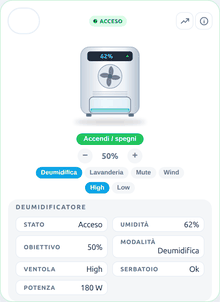

# 💧 Card Deumidificatore (`shc-dehumidifier-card`)

> **Nuova - feedback benvenuto.** Provata con entità simulate: se la usi con il tuo deumidificatore scrivimi com'è andata (issue o discussione su GitHub).

<p align="center"></p>

Funziona in due modi:

- **Deumidificatore come `humidifier.*`** (integrazione che lo espone come umidificatore/deumidificatore): la card usa direttamente umidità obiettivo e modalità dell'entità.
- **Deumidificatore con entità separate** (tipico di Tuya e simili): `switch.*` per l'accensione, più sensore di umidità, `number` per l'obiettivo, `select` per modalità e velocità ventola, `binary_sensor` per il serbatoio pieno, sensore di potenza.

Disegno animato: la ventola gira e le gocce cadono nel serbatoio quando è acceso; con il serbatoio pieno l'acqua diventa rossa e la card lampeggia.

## Cosa fa

- **Accendi / spegni**, **obiettivo di umidità con - / +** (rispetta minimo, massimo e passo dell'entità), **chip delle modalità** (es. Deumidifica, Lavanderia, Mute, Wind) e **chip della velocità ventola** (es. High / Low).
- Righe: stato, umidità attuale, obiettivo, modalità, ventola, serbatoio, potenza, energia (solo quelle configurate).
- Avviso **serbatoio pieno** (`tank_entity` = `on`). Pulsante grafico e pulsante ℹ.

## Esempio, deumidificatore con entità separate

```yaml
type: custom:shc-dehumidifier-card
entity: switch.deumidificatore
name: Deumidificatore
humidity_entity: sensor.deumidificatore_umidita
target_entity: number.deumidificatore_umidita_obiettivo
mode_entity: select.deumidificatore_modalita
fan_entity: select.deumidificatore_velocita_ventola
tank_entity: binary_sensor.deumidificatore_serbatoio_pieno
power_entity: sensor.deumidificatore_potenza
```

## Esempio, entità `humidifier`

```yaml
type: custom:shc-dehumidifier-card
entity: humidifier.deumidificatore
tank_entity: binary_sensor.deumidificatore_serbatoio_pieno
```

## Opzioni

| Campo | Obbligatorio | Default | Descrizione |
|---|---|---|---|
| `entity` | **Sì** | - | `humidifier.*`, `switch.*` o `input_boolean.*` |
| `name`, `icon` | No | Deumidificatore, `mdi:air-humidifier` | Nome e icona del chip |
| `humidity_entity` | No | - | Umidità attuale (con `humidifier.*` si usa `current_humidity` se c'è) |
| `target_entity` | No | - | `number.*` / `input_number.*` con l'umidità obiettivo (con `humidifier.*` si usa quella dell'entità) |
| `mode_entity` | No | - | `select.*` con le modalità (con `humidifier.*` si usano `available_modes`) |
| `fan_entity` | No | - | `select.*` con la velocità della ventola |
| `tank_entity` | No | - | `binary_sensor` (`on` = serbatoio pieno) |
| `power_entity`, `energy_entity` | No | - | Potenza (W) ed energia (kWh) |
| `target_min`, `target_max`, `target_step` | No | `30`, `80`, `5` | Limiti dell'obiettivo se l'entità non li dichiara |
| `layout`, `layout_entity` | No | centrato | Layout `classico` o `centrato` |

Testi in italiano, inglese e olandese; c'è l'editor visuale ("Aggiungi card" → "Deumidificatore").
