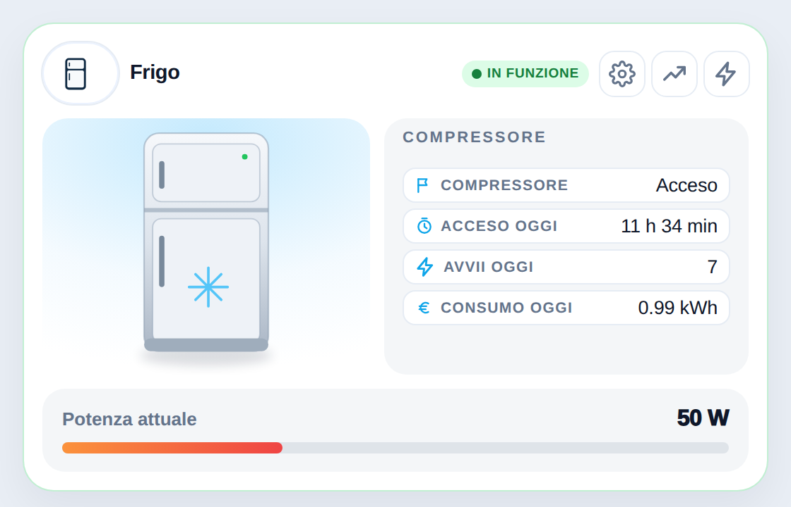
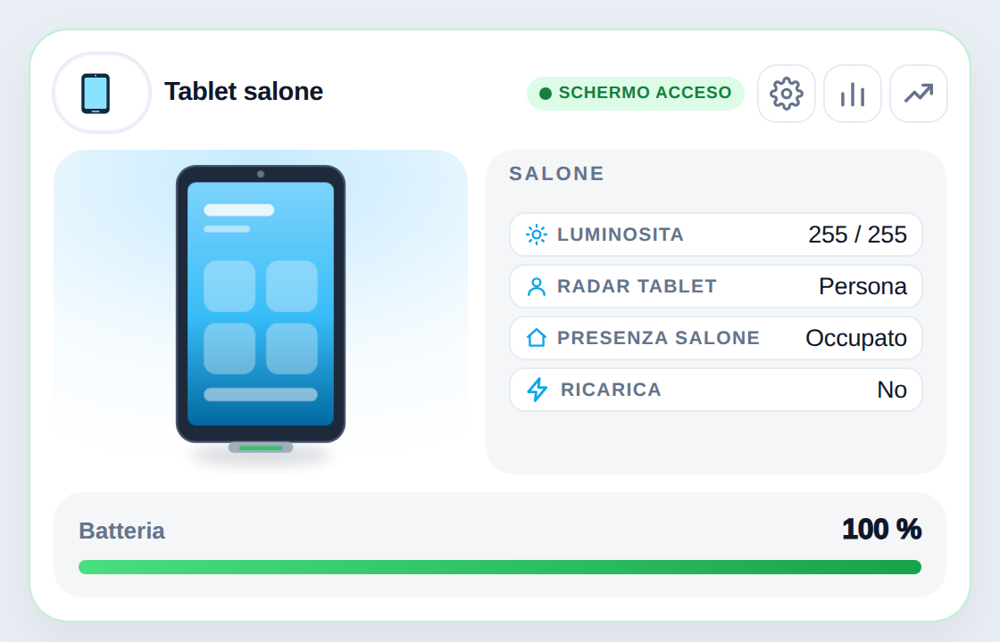

# 🧊 Frigo e 📱 Tablet a muro

Due nuovi disegni della card **Elettrodomestici** (`custom:shc-appliance-clone-card`). Guida completa: [docs/elettrodomestici.md](https://github.com/Simonz82/smart-home-cards/blob/main/docs/elettrodomestici.md).

### Frigo (anche non smart, solo presa con misura dei Watt)



```yaml
type: custom:shc-appliance-clone-card
name: Frigo
artwork: fridge
power_entity: sensor.frigo_power
threshold_run: 20
max_power: 150
side:
  title: Compressore
  rows:
    - label: Compressore
      icon: flag
      entity: binary_sensor.frigo_compressore
      format: onoff
      on_label: Acceso
      off_label: Spento
    - label: Acceso oggi
      icon: timer
      entity: sensor.frigo_compressore_tempo_oggi
      format: hours
settings_sections: []
```

Sul frigo non c'è nessun interruttore on/off, di proposito.

### Tablet a muro (Fully Kiosk e simili)



<sub>Nell'immagine alcuni stati sono simulati (schermo acceso, radar attivo).</sub>

```yaml
type: custom:shc-appliance-clone-card
name: Tablet salone
artwork: tablet
power_entity: sensor.tablet_battery_level   # batteria
power_label: Batteria
power_unit: "%"
max_power: 100
threshold_run: 101
threshold_standby: 101
live:
  state_entity: switch.tablet_schermo
state_map:
  "on":  { mode: running, label: SCHERMO ACCESO }
  "off": { mode: "off",   label: SCHERMO SPENTO }
side:
  title: Salone
  rows:
    - label: Luminosita
      icon: sun
      entity: number.tablet_luminosita_dello_schermo
      format: ratio
      max: 255
    - label: Radar tablet
      icon: user
      entity: binary_sensor.tablet_radar_presenza
      format: onoff
      on_label: Persona
      off_label: Nessuno
    - label: Presenza salone
      icon: home
      entity: binary_sensor.presenza_salone_occupancy
      format: onoff
      on_label: Occupato
      off_label: Libero
hide_consumi: true        # nasconde il pulsante Consumi
bar_color: linear-gradient(90deg,#4ade80,#16a34a)
settings_sections: []
```
