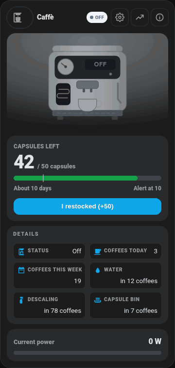

# ☕ Card Macchina del caffè (`shc-coffee-card`)

> **Nuova - feedback benvenuto.** Provata con stati simulati: se la usi con la tua macchina scrivimi com'è andata (issue o discussione su GitHub). Dalla prossima versione ha lo **stesso stile** delle card elettrodomestici (lavatrice, lavastoviglie, purificatore), la **scorta capsule** con avviso e la manutenzione.

<p align="center"></p>

Funziona con **qualsiasi macchina del caffè collegata a una presa smart** che esponga un `switch` e un sensore di potenza (W). Lo stato si ricava dalla potenza assorbita: **spenta, standby, riscaldamento, erogazione, pronta**. Disegno animato (vapore, caldaia che si scalda, manometro, caffè che scende nella tazzina) sullo stesso sfondo delle altre card elettrodomestici, scorta capsule con barra e avviso, caffè di oggi e della settimana, manutenzione (decalcificazione, acqua, vaschetta) e banda della potenza.

La card **non accende né spegne mai la presa**. I soli pulsanti sono quelli che chiedi tu: "Ho ricaricato" (somma una confezione alla scorta, con conferma) e "Fatto" nella finestra ℹ per azzerare i contatori di manutenzione. **Tutto è facoltativo**: senza le entità della scorta la card funziona come prima.

## Cosa ti serve

- Una presa smart: `switch.<nome>` (o `input_boolean`) e il suo sensore di potenza in W.
- Per scorta, manutenzione e avvisi: il package [`packages/coffee_capsule.yaml`](../packages/coffee_capsule.yaml) (conta i caffè in Home Assistant, non nel browser, quindi il numero è uguale su tutti i dispositivi e regge i riavvii).
- Facoltativi: energia (kWh) e, se la macchina è smart, stato, contatore caffè, livello acqua, decalcificazione.

## Esempio minimo

```yaml
type: custom:shc-coffee-card
entity: switch.macchina_caffe
name: Macchina del caffè
power_entity: sensor.macchina_caffe_potenza
energy_entity: sensor.macchina_caffe_energia
# soglie (valori di esempio, vedi sotto come tararle)
standby_w: 10
active_w: 300
ready_alert: true
```

## Esempio completo (con il package `coffee_capsule.yaml`)

```yaml
type: custom:shc-coffee-card
name: Macchina del caffè
entity: switch.macchina_caffe
power_entity: sensor.macchina_caffe_potenza
energy_entity: sensor.macchina_caffe_energia_oggi   # utility_meter giornaliero = consumo di oggi
# scorta capsule
capsules_entity: input_number.macchina_caffe_capsule
capsules_threshold: input_number.macchina_caffe_soglia
capsules_pack: input_number.macchina_caffe_confezione
avg_entity: input_number.macchina_caffe_media
refill_script: script.macchina_caffe_ricarica
# consumi e manutenzione
cups_entity: input_number.macchina_caffe_oggi
cups_week_entity: input_number.macchina_caffe_settimana
descale_counter_entity: input_number.macchina_caffe_decalcifica
descale_every: input_number.macchina_caffe_decalcifica_ogni
water_counter_entity: input_number.macchina_caffe_acqua
water_every: input_number.macchina_caffe_acqua_ogni
tray_counter_entity: input_number.macchina_caffe_vaschetta
tray_every: input_number.macchina_caffe_vaschetta_ogni
# spegnimento automatico (lo fa l'automazione del package; qui cambi i minuti)
auto_off_entity: input_number.macchina_caffe_spegni_dopo
automation_entities:
  - automation.macchina_caffe_spegni_se_inattiva
```

## Come si ricavano gli stati

Con la presa **spenta** → *Spenta*. Con la presa accesa:

| Potenza | Stato |
|---|---|
| `standby_w` o meno (default 10 W) | *Standby*, oppure *Pronta* se la macchina si è appena scaldata (per `ready_min` minuti dopo l'ultimo uso, default 20) |
| tra `standby_w` e `active_w` | *Pronta* (macchina calda, assorbe poco) |
| `active_w` o più (default 300 W) | *Riscaldamento* se parte da fredda o se il picco dura più di `max_brew_s`; *Erogazione* se la macchina era già pronta |

Con `brew_w` (facoltativo) i picchi sopra quella potenza sono sempre erogazione: utile se la pompa porta il consumo più in alto del solo riscaldamento. Come tarare: guarda il grafico della potenza (icona grafico della card) mentre fai un caffè e accendi a freddo, poi imposta le soglie sotto i picchi.

## Scorta capsule

La scorta è un numero in Home Assistant (`input_number` o `counter`) che **scende di 1 a ogni caffè**: lo fa l'automazione del package, mai la card, così il valore è lo stesso su telefono, tablet e PC. La card mostra:

- le **capsule rimanenti in grande** con barra; il segno sulla barra è la soglia di avviso;
- sotto la soglia: numero e barra rossi, etichetta **"Da comprare"** e riga rossa di avviso;
- i **giorni rimanenti** stimati (capsule ÷ consumo medio giornaliero, `avg_entity`);
- il pulsante **"Ho ricaricato (+50)"**: due tocchi (il primo chiede conferma, per evitare aggiunte per sbaglio) e la scorta aumenta di una confezione (`capsules_pack`), fino al massimo dell'helper. Con `refill_script` fa partire invece il tuo script. `hide_refill: true` lo toglie.

L'unità non deve essere "capsule": `capsule_unit: cialde` (o `grammi di caffè`, ecc.) cambia le scritte.

| Opzione | Descrizione |
|---|---|
| `capsules_entity` | `input_number` / `counter` / sensore con le capsule rimanenti |
| `capsules_threshold` | soglia di avviso: un numero **oppure** un `input_number` (così la cambi dalle Impostazioni ⚙) |
| `capsules_pack` | pezzi per confezione (numero o `input_number`), usato dal pulsante "Ho ricaricato" |
| `capsules_max` | scorta a fondo barra (se manca: la confezione, o 4 volte la soglia) |
| `avg_entity` | consumo medio al giorno (sensore o `input_number`) per i giorni rimanenti |
| `refill_script` | script da avviare al posto della somma diretta |
| `capsule_unit` | nome dell'unità (default "capsule") |
| `hide_capsules`, `hide_refill` | nascondono la scorta intera o solo il pulsante |
| `show_capsule_bar` | `false` = niente barra: resta solo la scritta **Capsule rimanenti: N**. Default `true` (come prima) |

### Il package `coffee_capsule.yaml`

Copialo in `/config/packages/` (o incolla le parti che ti servono) e cambia le tre entità indicate in testa (presa, sensore potenza, servizio `notify`). Contiene:

- **helper**: capsule rimanenti, soglia, capsule per confezione, media giornaliera, contatori (oggi, settimana, dall'ultima decalcificazione / acqua / vaschetta), soglie di manutenzione, minuti di spegnimento. Imposta una volta i valori (non hanno un valore iniziale proprio perché al riavvio devono restare quelli che hai scelto);
- **"conta un caffè"**: un picco sopra 300 W che dura da 8 s a circa 70 s è un caffè → scorta −1 e contatori +1. Il picco deve chiudersi con potenza sotto soglia per 4 s: niente doppi conteggi (`mode: single`), un riscaldamento da fredda più lungo non viene contato. Se la tua macchina scalda in meno di 70 s alza i secondi dell'automazione o usa `brew_w`;
- **avviso scorta**: notifica **una sola volta** quando la scorta scende alla soglia (trigger a template: scatta al passaggio da falso a vero, quindi niente ripetizioni finché non ricarichi e niente avvisi dopo un riavvio);
- **avvisi di manutenzione**: decalcificazione, acqua, vaschetta quando il contatore raggiunge il limite;
- **nuovo giorno**: azzera "oggi" e "settimana" e aggiorna la media mobile a 7 giorni; parte anche all'avvio di Home Assistant, quindi recupera una mezzanotte persa durante un riavvio;
- **ho ricaricato** (`script.macchina_caffe_ricarica`): somma una confezione alla scorta;
- **spegnimento automatico** facoltativo: se non fai caffè per N minuti spegne la presa (0 = disattivato).

Il consumo di oggi si ottiene con un `utility_meter` giornaliero sul sensore di energia della presa e va in `energy_entity`.

## Manutenzione (facoltativa)

Per ognuna basta un contatore di caffè e la soglia "ogni N caffè":

| Voce | Contatore | Ogni | Riga |
|---|---|---|---|
| Decalcificazione | `descale_counter_entity` | `descale_every` | "tra 80 caffè" / "Da fare" |
| Serbatoio acqua | `water_counter_entity` | `water_every` | idem |
| Vaschetta capsule usate (di solito ~10) | `tray_counter_entity` | `tray_every` | idem |

Quando il limite è raggiunto compare la riga rossa di avviso. Nella finestra ℹ ogni voce ha il pulsante **Fatto**, che azzera il contatore (lo fai quando decalcifichi, riempi o svuoti). `*_every` accetta un numero o un `input_number`. Le vecchie opzioni `water_entity` e `descale_entity` (sensori della macchina smart) restano valide.

## Impostazioni ⚙

L'ingranaggio compare se hai configurato entità modificabili: capsule rimanenti (per correggere il conteggio), soglia, capsule per confezione, "ogni N caffè", minuti di spegnimento automatico (−/+), e le automazioni in `automation_entity` / `automation_entities` (interruttori).

## Caffè del giorno

- Con `cups_entity` la card mostra il valore dell'entità (contatore giornaliero: nel package `macchina_caffe_oggi`). `cups_week_entity` aggiunge i caffè della settimana.
- Senza, i caffè sono **stimati dai picchi di potenza di oggi** (valore con `~`): conta ogni picco partito a macchina pronta e lungo tra `min_brew_s` (default 8) e `max_brew_s` (default 70) secondi. Le rilevazioni più brevi di 4 s non spezzano un caffè. La storia di oggi viene riletta ad ogni apertura; riparte da zero a mezzanotte.

## Avviso "pronta"

- `ready_alert: true`: al termine del riscaldamento la card lampeggia per 10 secondi con la scritta "Pronta!" (solo se la dashboard è aperta).
- Notifica sul telefono: usa l'automazione di esempio [`packages/coffee_pronta.yaml`](../packages/coffee_pronta.yaml) (cambia le tre entità).

## Aspetto

- `image`: percorso o URL di una tua foto (es. `/local/macchina.png`), al posto del disegno animato. `icon`: icona del chip.
- `capsule_color`, `low_color`, `bar_color`: colore della barra scorta, della scorta sotto soglia e della barra potenza (qualsiasi colore CSS).
- `power_max`: potenza a fondo barra (default 1500 W).
- `show_steps: true` mostra anche le tappe (spenta, standby, riscaldamento, erogazione, pronta) sotto il disegno.
- `hide_rows`, `hide_power_band`, `hide_capsules`, `hide_refill`: nascondono le sezioni.
- `show_capsule_bar: false`: tiene la scorta capsule ma toglie la barra, la soglia e i giorni rimanenti. Resta solo la scritta con il numero.
- `show_power: false`: nasconde tutti i consumi: la banda della potenza, i watt scritti sul disegno della macchina (resta "ON") e la riga dell'energia. Default `true` (come prima).
- `layout: classico` mette la foto a sinistra e il blocco "Oggi" a destra, come le altre card elettrodomestico; `layout: centrato` (predefinito) tiene la foto in alto a tutta larghezza. Si sceglie anche dall'editor visuale (Aspetto) o con `layout_entity`, vedi [layout.md](layout.md).
- Il tocco sulla banda potenza apre il grafico; la scorta apre l'entità; il disegno apre la presa. Editor visuale completo (⚙ nella dashboard).

## Opzioni

| Campo | Obbligatorio | Default | Descrizione |
|---|---|---|---|
| `entity` | **Sì** | - | Presa smart (`switch.*` o `input_boolean.*`) |
| `power_entity` | Consigliato | - | Sensore di potenza in W (senza, la card distingue solo spenta / pronta) |
| `energy_entity` | No | - | Sensore di energia in kWh |
| `name`, `icon`, `image` | No | Macchina del caffè, `mdi:coffee-maker` | Nome, icona del chip, immagine al posto del disegno |
| `standby_w` | No | `10` | Standby fino a questa potenza (W) |
| `active_w` | No | `300` | Riscaldamento/erogazione da questa potenza (W) |
| `brew_w` | No | `0` | Se > 0, sopra questa potenza è sempre erogazione |
| `min_brew_s`, `max_brew_s` | No | `8`, `70` | Durata minima/massima di un caffè per contarlo |
| `ready_min` | No | `20` | Minuti di "pronta" dopo l'ultimo uso quando la potenza è sotto `standby_w` |
| `ready_alert` | No | `false` | Evidenzia la card quando finisce il riscaldamento |
| `power_max` | No | `1500` | Potenza a fondo barra (W) |
| `state_entity` | No | - | Stato testuale della macchina smart (mostrato in una riga) |
| `cups_entity`, `cups_week_entity` | No | - | Contatori caffè di oggi e della settimana |
| `capsules_*`, `avg_entity`, `refill_script`, `capsule_unit` | No | - | Scorta capsule, vedi sopra |
| `descale_counter_entity`, `water_counter_entity`, `tray_counter_entity` + `*_every` | No | - | Manutenzione a contatore, vedi sopra |
| `water_entity`, `water_low` | No | -, `15` | Livello acqua di una macchina smart: sensore numerico (%) oppure `binary_sensor` (`on` = da riempire); avviso sotto `water_low` |
| `descale_entity` | No | - | `binary_sensor` (`on` = decalcificazione necessaria) oppure sensore numerico |
| `auto_off_entity` | No | - | `input_number` con i minuti di spegnimento automatico (modificabile dalle Impostazioni) |
| `automation_entity`, `automation_entities` | No | - | Automazioni con interruttore nelle Impostazioni |
| `capsule_color`, `low_color`, `bar_color` | No | verde, rosso, arancio | Colori |
| `show_steps`, `hide_capsules`, `hide_refill`, `hide_rows`, `hide_power_band` | No | `false` | Sezioni da mostrare/nascondere |
| `show_capsule_bar` | No | `true` | `false` = solo la scritta con il numero delle capsule, senza barra |
| `show_power` | No | `true` | `false` = nasconde i consumi (banda potenza, watt sul disegno, energia) |
| `layout`, `layout_entity` | No | `centrato` | `classico` (foto a sinistra, dettagli a destra) o `centrato`; vedi [layout.md](layout.md) |

Le righe compaiono solo se imposti la relativa entità. Il pannello ℹ mostra scorta, manutenzione (con "Fatto"), stato, valori, soglie e l'ultimo cambio.

## English summary

`shc-coffee-card` shows a coffee machine on a smart plug in the same style as the appliance cards (washing machine, dishwasher, purifier): animated drawing, power band, and optional **capsule stock** (remaining capsules in big numbers, bar, "time to buy" below a threshold, estimated days left from the average use, "I restocked" button with confirmation), coffees today / this week, and **maintenance** counters (descaling, water tank, used capsule tray) with a "Done" reset in the Status window. Counting happens in Home Assistant, never in the browser: copy [`packages/coffee_capsule.yaml`](../packages/coffee_capsule.yaml) (helpers, "count a coffee" from the power peak with a minimum duration and no double counts, a single alert when stock falls below the threshold, maintenance alerts, daily/weekly reset with a 7-day moving average, restock script, optional auto power off) and point `capsules_entity`, `capsules_threshold`, `capsules_pack`, `avg_entity`, `refill_script`, `*_counter_entity` / `*_every` and `auto_off_entity` at its helpers. Colours (`capsule_color`, `low_color`, `bar_color`), your own picture (`image`), the capsule unit (`capsule_unit`) and every section are configurable, and the visual editor covers all options. Everything is optional: with just `entity` and `power_entity` the card works as before.

## Nascondere la barra capsule e i consumi (1.30.0), spiegato semplice

Vuoi una card più pulita? Sono due interruttori. Non cambia niente se non li tocchi.

1. Apri la card nell'**editor visuale** (matita sulla dashboard > i tre puntini sulla card > **Modifica**).
2. Nella sezione **Aspetto** togli la spunta a **Mostra la barra della scorta capsule** se vuoi vedere solo "Capsule rimanenti: N".
3. Togli la spunta a **Mostra i consumi (potenza, energia)** se non vuoi vedere i watt.
4. Premi **Salva**.

Oppure nel YAML della card:

```yaml
show_capsule_bar: false   # solo "Capsule rimanenti: N", senza barra
show_power: false         # niente consumi
```

Dopo l'aggiornamento premi **Ctrl+F5** nel browser.
