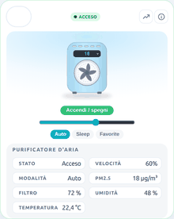

# 🌀 Card Purificatore d'aria (`shc-purifier-card`)

> **Nuova - feedback benvenuto.** Provata con entità simulate: se la usi con il tuo purificatore scrivimi com'è andata (issue o discussione su GitHub).

<p align="center"></p>

Funziona con **qualsiasi purificatore d'aria che in Home Assistant sia un `fan.*`** (Xiaomi, Philips, Dreo, Tuya, Levoit...). Disegno animato: la ventola gira più veloce con la velocità impostata, le particelle entrano e l'aria pulita esce dall'alto; il colore delle particelle segue il PM2.5 (verde, giallo, rosso). Stesso stile e stessi due layout (classico / centrato) delle altre card.

## Cosa fa

- Pulsante **Accendi / spegni**, **slider della velocità** (se il `fan` ha `percentage`) e **chip delle modalità** (se il `fan` ha `preset_modes`).
- Righe facoltative: PM2.5, qualità dell'aria, vita residua del filtro, umidità, temperatura, potenza. Compaiono solo se imposti l'entità.
- Avvisi: filtro sotto `filter_low` (default 10 %) e PM2.5 sopra `pm_warn` (default 35).
- Pulsante grafico (storico dei sensori impostati) e pulsante ℹ (stato e ultimo cambio).

## Esempio

```yaml
type: custom:shc-purifier-card
entity: fan.purificatore_soggiorno
name: Purificatore
pm25_entity: sensor.purificatore_pm2_5
aqi_entity: sensor.purificatore_qualita_aria     # numero o testo (es. "Buona")
filter_entity: sensor.purificatore_filtro        # % di vita residua
humidity_entity: sensor.purificatore_umidita
temperature_entity: sensor.purificatore_temperatura
power_entity: sensor.purificatore_potenza
filter_low: 10
pm_warn: 35
```

## Opzioni

| Campo | Obbligatorio | Default | Descrizione |
|---|---|---|---|
| `entity` | **Sì** | - | Il purificatore (`fan.*`) |
| `name`, `icon` | No | Purificatore d'aria, `mdi:air-purifier` | Nome e icona del chip |
| `pm25_entity` | No | - | Sensore PM2.5 (µg/m³) |
| `aqi_entity` | No | - | Qualità dell'aria (sensore numerico o testuale) |
| `filter_entity` | No | - | Vita residua del filtro in % |
| `filter_low` | No | `10` | Sotto questa % compare l'avviso filtro |
| `pm_warn` | No | `35` | Sopra questo PM2.5 (a purificatore acceso) compare l'avviso aria scarsa |
| `humidity_entity`, `temperature_entity`, `power_entity` | No | - | Sensori facoltativi |
| `layout`, `layout_entity` | No | centrato | Layout `classico` o `centrato`; `layout_entity` = `input_select` per cambiarlo da menu |

Tutti i testi sono in italiano, inglese e olandese (segue la lingua di Home Assistant). C'è anche l'editor visuale ("Aggiungi card" → "Purificatore d'aria").
