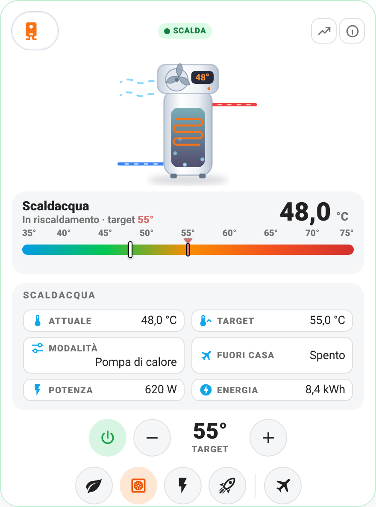

# 🚿 Card Scaldacqua / pompa di calore (`shc-water-heater-card`)

> **Nuova in 1.20.0 - feedback benvenuto.** Finora provata solo con stati simulati: se la usi con il tuo scaldacqua scrivimi com'è andata (issue o discussione su GitHub).

<p align="center"></p>

Per le entità `water_heater.*` di Home Assistant: scaldacqua elettrici e a pompa di calore (Midea Eco Master, Ariston, Atlantic, Haier...). Disegno animato (ventola, serpentina, bolle, flussi caldo/freddo), temperatura attuale e target con barra graduata, pulsanti +/- per il target, modalità operative, "fuori casa", accensione/spegnimento, potenza ed energia, grafici storici. Stesso stile e stessi due layout (classico / centrato) delle altre card.

## Cosa ti serve

Un'entità `water_heater.<nome>` (dall'integrazione del tuo scaldacqua). Facoltativi: un sensore di temperatura dell'acqua, un sensore di potenza (W) e uno di energia (kWh).

## Esempio

```yaml
type: custom:shc-water-heater-card
entity: water_heater.scaldacqua
name: Scaldacqua
power_entity: sensor.scaldacqua_potenza
energy_entity: sensor.scaldacqua_energia
min: 35
max: 75
```

## Opzioni

| Campo | Obbligatorio | Default | Descrizione |
|---|---|---|---|
| `entity` | **Sì** | - | Entità `water_heater.*` |
| `name` | No | nome dell'entità | Nome mostrato in alto |
| `icon` | No | `mdi:water-boiler` | Icona del chip |
| `temperature_entity` | No | attributo `current_temperature` | Sensore con la temperatura dell'acqua (usato anche nei grafici) |
| `power_entity` | No | - | Sensore di potenza in W |
| `energy_entity` | No | - | Sensore di energia in kWh |
| `min`, `max` | No | `min_temp` / `max_temp` dell'entità (o 30 / 75) | Estremi della barra della temperatura |
| `hide_when_offline` | No | `false` | Nasconde la card se lo scaldacqua non è raggiungibile |
| `layout`, `layout_entity` | No | classico | Layout `classico` o `centrato`; `layout_entity` = `input_select` per cambiarlo da menu |

Modalità operative e "fuori casa" compaiono solo se l'entità li supporta (`operation_list`, `away_mode`).
