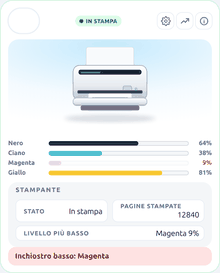

# 🖨️ Card Stampante (`shc-printer-card`)

> **Nuova - feedback benvenuto.** Provata con entità simulate: se la usi con la tua stampante scrivimi com'è andata (issue o discussione su GitHub).

<p align="center"></p>

Pensata per l'integrazione standard **[Internet Printing Protocol (IPP)](https://www.home-assistant.io/integrations/ipp/)**: un sensore di stato (`idle`, `printing`, `stopped`), un sensore per ogni livello di inchiostro / toner (in %) e, se c'è, il contatore delle pagine. Funziona con qualunque stampante che esponga questi sensori.

Disegno animato: durante la stampa il foglio esce e il LED lampeggia; lo stato ferma accende il LED rosso. Sotto il disegno ci sono le **barre dei livelli, ognuna con il suo colore**.

## Cosa fa

- Stato: **Pronta**, **In stampa**, **Ferma**.
- **Lista dei livelli** (`ink_levels`): per ognuno entità, nome e colore. Se non indichi il colore la card lo ricava dal nome (nero, ciano, magenta, giallo; altrimenti una tavolozza).
- **Avviso inchiostro basso** sotto `ink_low` (default 15 %): la barra lampeggia e compare il messaggio col nome del colore. Avviso anche se la stampante è ferma.
- Tocco su una barra = dettaglio dell'entità. Pulsante grafico (storico livelli).
- Pulsante **ℹ Stato** con tre sezioni: **Connessione** (stato, raggiungibilità, ultimo cambio, pagine), **Livello toner** (tutti i livelli) e **Automazioni** (stato e ultima esecuzione).
- Pulsante **⚙ Impostazioni**: un interruttore per ogni automazione indicata in `automation_entity` / `automation_entities` (come nella card UPS).
- Nell'editor visuale l'elenco dei livelli accetta quanti toner vuoi (Aggiungi / Rimuovi).

## Esempio

```yaml
type: custom:shc-printer-card
name: Stampante
entity: sensor.canon_pixma                 # stato IPP (idle / printing / stopped)
pages_entity: sensor.canon_pixma_pagine    # facoltativo
ink_low: 15
automation_entities:                      # facoltativo: interruttori nelle Impostazioni
  - automation.stampante_ricarica_ipp
  - entity: automation.stampante_avviso_toner
    name: Avviso toner basso
ink_levels:
  - entity: sensor.canon_pixma_nero
    name: Nero
  - entity: sensor.canon_pixma_ciano
    name: Ciano
  - entity: sensor.canon_pixma_magenta
    name: Magenta
  - entity: sensor.canon_pixma_giallo
    name: Giallo
    color: "#facc15"                        # facoltativo
```

Per trovare le entità: Strumenti per sviluppatori → Stati, filtra per il nome della stampante.

## Opzioni

| Campo | Obbligatorio | Default | Descrizione |
|---|---|---|---|
| `entity` | **Sì** | - | Sensore di stato della stampante (IPP) |
| `name`, `icon` | No | Stampante, `mdi:printer` | Nome e icona del chip |
| `ink_levels` | No | - | Elenco di `{ entity, name, color }` (anche solo il nome dell'entità) |
| `ink_low` | No | `15` | Soglia % dell'avviso inchiostro basso |
| `pages_entity` | No | - | Contatore pagine stampate |
| `automation_entity`, `automation_entities` | No | - | Automazioni con un interruttore nelle Impostazioni (⚙) e riga nella finestra Stato; `automation_entities` è un elenco di id o di `{ entity, name }` |
| `layout`, `layout_entity` | No | centrato | Layout `classico` o `centrato` |

Testi in italiano, inglese e olandese; c'è l'editor visuale ("Aggiungi card" → "Stampante").

## Esempio: ricaricare l'integrazione IPP quando la stampante si riaccende

Se la stampante resta spenta a lungo, l'integrazione IPP può rimanere in errore e va ricaricata a mano da *Dispositivi e servizi*. Questa automazione la ricarica da sola quando la stampante torna raggiungibile (qui con una presa smart; con un sensore ping basta cambiare il trigger):

```yaml
alias: Stampante, ricarica IPP all'accensione
triggers:
  - trigger: state
    entity_id: switch.presa_stampante      # presa smart (o binary_sensor di un ping)
    to: "on"
    for: "00:00:40"                        # lascia il tempo alla stampante di avviarsi
actions:
  - action: homeassistant.reload_config_entry
    target:
      entity_id: sensor.canon_pixma        # una qualsiasi entità dell'integrazione IPP
mode: single
```

Poi aggiungi l'automazione a `automation_entities` per accenderla e spegnerla dalle Impostazioni della card.
