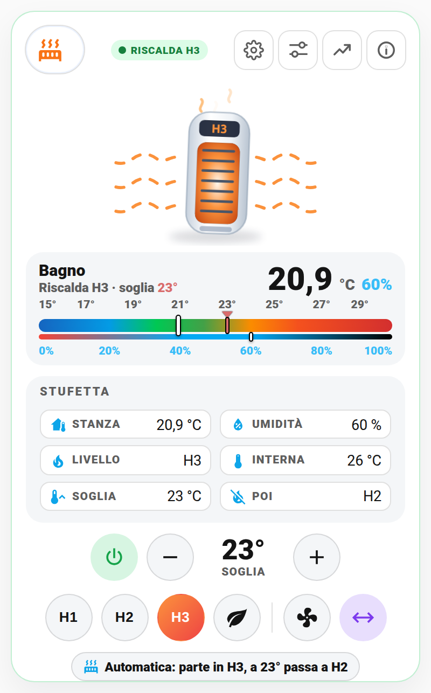
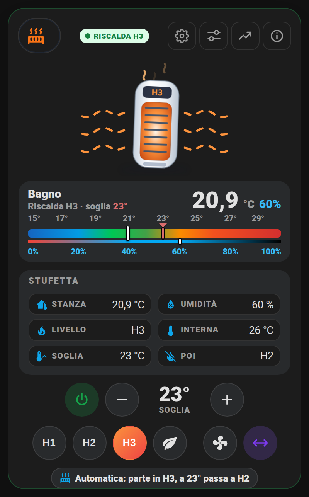
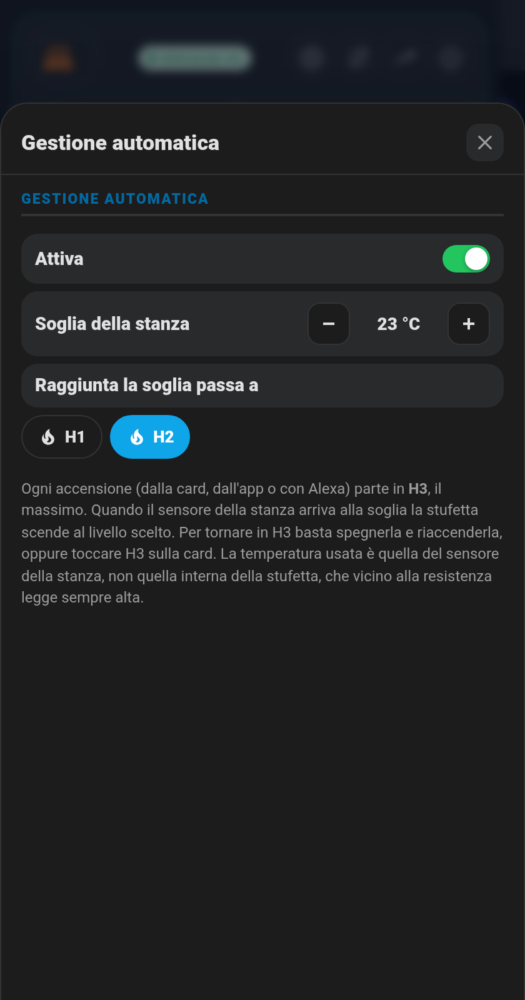

# 🔥 Card Stufetta (`shc-heater-card`)

La stufetta elettrica in una card sola, nello stesso stile della [card Climatizzatore](clima.md): in alto la **stufetta animata** (le onde di calore sono 1, 2 o 3 file a seconda del livello), sotto la **gauge dritta** con temperatura e umidità della stanza e la soglia, poi i dati e i comandi diretti. Parte già nel **layout centrato**.

| Chiaro | Scuro |
|---|---|
|  |  |

> **Esempio reale**: io la uso con una **Dreo 314S (DR-HSH004S)** in bagno, integrata con l'integrazione [Dreo](https://github.com/jeffsteinbok/hass-dreo) di HACS. La card però funziona con **qualsiasi stufetta o termoventilatore** che in Home Assistant sia un'entità `climate.`: legge da sola le modalità (riscalda, solo ventilazione, spento) e i livelli (preset) che espone. Con altre marche cambiano solo i nomi dei livelli.

## Cosa mostra

- **Stufetta animata**: griglia arancione e onde di calore quando scalda (1 fila in H1/Eco, 2 in H2, 3 in H3), onde azzurre in sola ventilazione, grigia da spenta. Se l'oscillazione è attiva, la stufetta ondeggia. Sul display c'è il livello (H1, H2, H3, Eco), `FAN` oppure `OFF`.
- **Gauge dritta**: temperatura della stanza (sensore della stanza, non quello interno della stufetta che vicino alla resistenza legge sempre alto), umidità sotto e il **cursore rosso della soglia**.
- **Riquadro Stufetta**: stanza, umidità, livello, temperatura interna della stufetta, soglia e il livello a cui scende raggiunta la soglia ("Poi").
- **Comandi**: accendi/spegni, − e + per la soglia (si sposta subito il cursore rosso), un pulsante per ogni livello (H1, H2, H3, Eco), solo ventilazione e oscillazione. Se scegli un livello a stufetta spenta, la card la accende e poi imposta il livello.
- **Pillola gestione automatica**: "Automatica: parte in H3, a 23° passa a H2". Toccandola si apre il popup.

## I pulsanti in alto

- **⚙️ Gestione automatica**: attiva sì/no, soglia della stanza, livello dopo la soglia (H1/H2) e la spiegazione di come funziona.
- **🎛️ Impostazioni**: gli interruttori della stufetta che scegli (oscillazione, resistenza PTC, blocco bambini, suono, display) e il termostato interno.
- **📈 Grafici**: temperatura e umidità della stanza, potenza se hai una presa smart. Vedi [grafici.md](grafici.md).
- **ℹ️ Stato**: stato, livello, temperatura interna, modello, ultimo cambio, quando sono scattate le automazioni e l'interruttore **Nascondi se scollegata** (vedi sotto).



## 🚀 Metodo veloce: usa il mio package originale

Il package [`packages/stufetta.yaml`](../packages/stufetta.yaml) fa due cose:

1. **Ogni accensione parte al massimo (H3)**, da qualunque parte arrivi: card, app, Alexa.
2. **Raggiunta la soglia della stanza scende** al livello scelto (H1 o H2). Per tornare in H3 basta spegnerla e riaccenderla.

Cosa fare:

1. Copialo in `/config/packages/`.
2. Sostituisci `climate.stufetta_heater` con la tua stufetta e `sensor.temp_bagno_temperature` con il sensore di temperatura della stanza.
3. Con un'altra marca, metti i nomi dei tuoi livelli al posto di `H1`, `H2`, `H3`.
4. Riavvia Home Assistant.

I nomi degli helper (`input_boolean.stufetta_gestione_automatica`, `input_number.stufetta_soglia_bagno`, `input_select.stufetta_livello_ridotto`) sono già quelli predefiniti della card. Senza il package la card funziona lo stesso: − e + cambiano la temperatura del termostato interno.

## Configurazione

Minima:

```yaml
type: custom:shc-heater-card
entity: climate.stufetta
```

Quella che uso io:

```yaml
type: custom:shc-heater-card
name: Stufetta Bagno
room_name: Bagno
entity: climate.stufetta_heater
temperature_entity: sensor.temp_bagno_temperature
humidity_entity: sensor.temp_bagno_humidity
oscillation_entity: switch.stufetta_oscillating
switches:
  - entity: switch.stufetta_oscillating
    name: Oscillazione
  - entity: switch.stufetta_ptc
    name: Resistenza PTC
  - entity: switch.stufetta_child_lock
    name: Blocco bambini
  - entity: switch.stufetta_panel_sound
    name: Suono pannello
diagnostics:
  - entity: automation.stufetta_accensione_sempre_in_h3
    name: Accensione in H3
  - entity: automation.stufetta_riduzione_al_raggiungimento_soglia
    name: Riduzione a soglia
```

| Opzione | Default | Cosa fa |
|---|---|---|
| `entity` | — | La stufetta (`climate.`), obbligatoria |
| `name` / `room_name` | Stufetta / nome | Titolo della card / della gauge |
| `temperature_entity`, `humidity_entity` | — | Sensori della stanza |
| `threshold_entity` | `input_number.stufetta_soglia_bagno` | Soglia della gestione automatica (− e +) |
| `reduced_level_entity` | `input_select.stufetta_livello_ridotto` | Livello dopo la soglia |
| `auto_entity` | `input_boolean.stufetta_gestione_automatica` | Gestione automatica sì/no |
| `start_level` | `H3` | Livello di partenza mostrato nei testi |
| `oscillation_entity` | — | Interruttore dell'oscillazione, se non è nello `swing_mode` |
| `power_entity` | — | Potenza (W) della presa, per il grafico |
| `switches` | — | Interruttori nel popup Impostazioni (`entity`, `name`) |
| `diagnostics` | — | Automazioni/sensori nel popup Stato (`entity`, `name`, `alarm`) |
| `min`, `max` | 15, 30 | Scala della gauge |
| `segments`, `humidity_segments` | colori pronti | Colori della scala, come nel [Climatizzatore](clima.md) |
| `hide_when_offline` | `false` | Nascondi se scollegata, vedi sotto |
| `layout_entity` | — | Menu layout classico/centrato, vedi [layout.md](layout.md) |

## 🙈 Nascondi se scollegata

Una stufetta d'estate sta in cantina, staccata dalla corrente. Con **Nascondi se scollegata** (casella nell'editor, oppure interruttore nel popup ℹ️ Stato) la card, quando non riceve dati, diventa una striscia bassa larga come la card: icona, "Stufetta offline", da quando, e il bollino OFFLINE. Toccando la striscia si apre un popup per rivedere la card completa o togliere l'opzione. Quando la stufetta torna online, la card completa ricompare da sola.


## 💡 Idee d'uso

- **Bagno caldo e niente sprechi**: parte in H3 per scaldare veloce, alla soglia scende a H1 e mantiene.
- **Alexa**: "Alexa, accendi la stufetta" parte comunque in H3 grazie al package.
- **Soglia al volo**: d'inverno 23°, a metà stagione 21°, con − e + direttamente dalla card.
