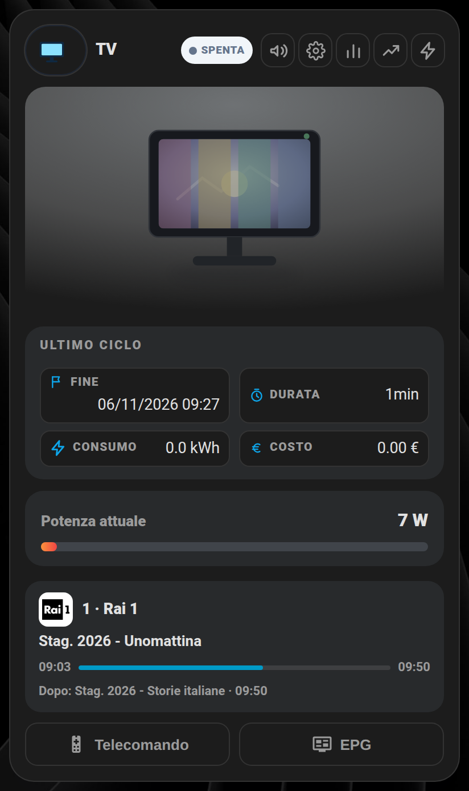
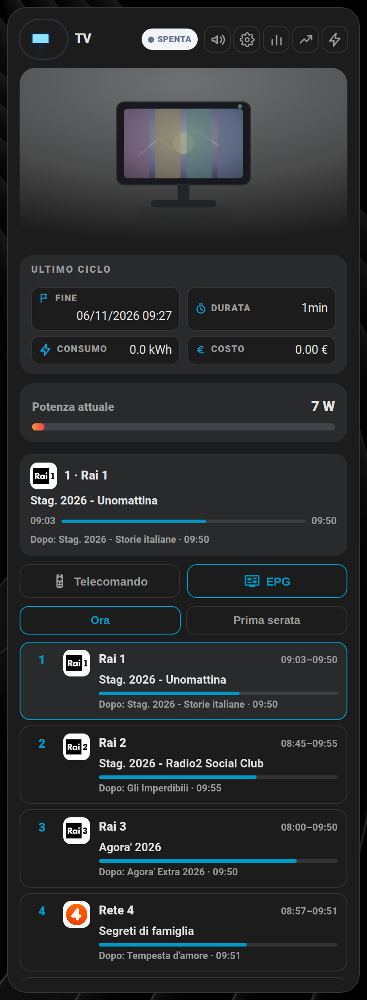
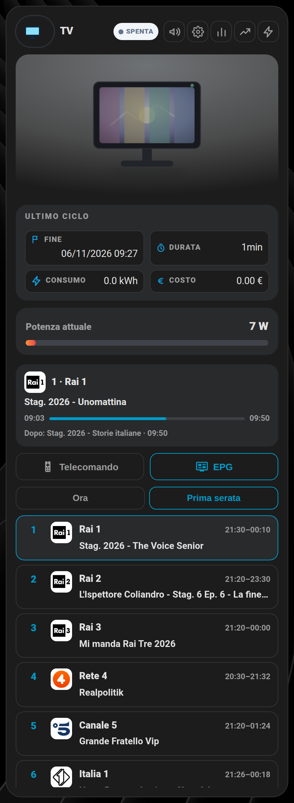
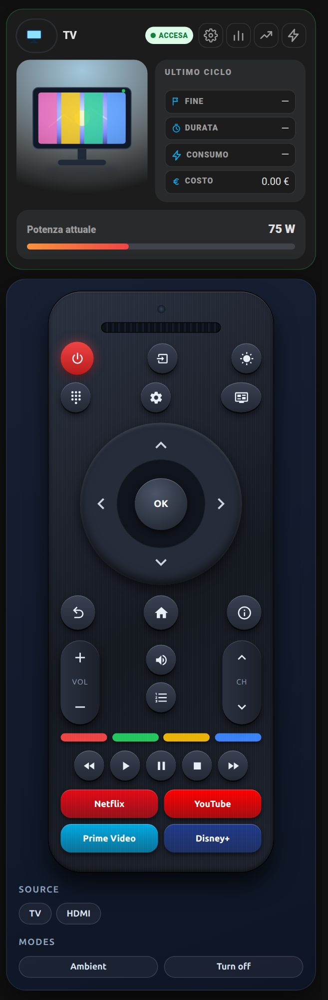
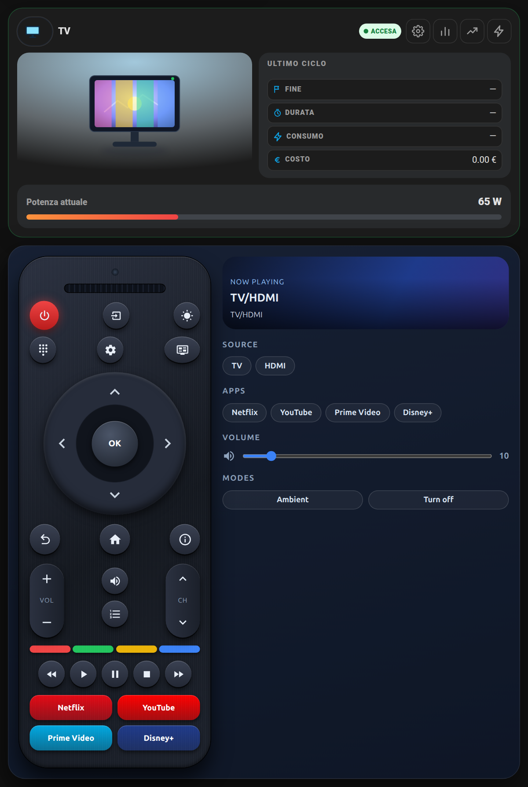
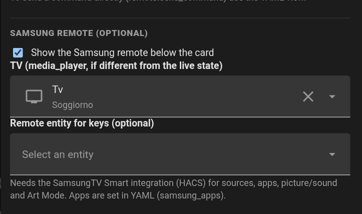

# 📺 TV: guida EPG e telecomando Samsung

Guide per la card TV (`custom:shc-appliance-clone-card` con `artwork: tv`). Tutte le opzioni TV sono nella tabella di [elettrodomestici.md](elettrodomestici.md).

## 📺 Guida TV (EPG) nella card TV (novità 1.17.0)

Con `epg_channels` la card TV mostra sotto la barra della potenza il canale in onda (logo, titolo, avanzamento, cosa c'è dopo) e i pulsanti **Telecomando** ed **EPG**. Il pannello EPG elenca i canali con adesso/dopo, la scheda **Prima serata** mostra la serata di tutti i canali, e toccando un canale la TV ci va da sola (SamsungTV Smart). Dati dall'integrazione [XMLTV EPG](https://github.com/shadow578/homeassistant_xmltv-epg); opzioni `epg_channels`, `channel_entity`, `channel_name_entity` nella tabella del telecomando qui sotto.

<table>
  <tr>
    <td align="center" valign="top" width="33%"><br><sub>Canale in onda</sub></td>
    <td align="center" valign="top" width="33%"><br><sub>Guida: adesso e dopo</sub></td>
    <td align="center" valign="top" width="33%"><br><sub>Prima serata</sub></td>
  </tr>
</table>

## 📺 Telecomando Samsung sotto la card TV (novità 1.16.0)

La card **Elettrodomestici** con `artwork: tv` può mostrare, **sotto la card**, lo stesso telecomando in stile Samsung della card [samsung-tv-remote-card](https://github.com/Simonz82/ha_tv_samsung): tasti, D-pad, volume e canali, tasti colorati, app, sorgenti, immagine/audio, Art Mode. Tutto in una sola risorsa: non serve installare altro. È **facoltativo e spento di default**: senza l'opzione la card TV resta identica a prima.

```yaml
type: custom:shc-appliance-clone-card
name: TV
artwork: tv
power_entity: sensor.presa_tv_power
live:
  state_entity: media_player.tv
show_samsung_remote: true        # il telecomando compare sotto la card
```

<table>
  <tr>
    <td align="center" valign="top" width="40%"><br><sub>Telefono: telecomando verticale</sub></td>
    <td align="center" valign="top" width="60%"><br><sub>Tablet / PC: telecomando + pannello</sub></td>
  </tr>
</table>

**Requisiti.** Una TV Samsung Tizen e l'integrazione **[SamsungTV Smart](https://github.com/ollo69/ha-samsungtv-smart)** (integrazione custom, si installa da HACS: `ollo69/ha-samsungtv-smart`). Serve quella, e non solo l'integrazione Samsung TV di Home Assistant, perché molte funzioni del telecomando sono sue:

| Funzione | Con SamsungTV Smart | Con la sola integrazione core "Samsung TV" |
|---|---|---|
| Accensione/spegnimento, volume, muto, play/pausa/stop | si | si (sono funzioni standard del `media_player`) |
| Tasti del telecomando (frecce, OK, Home, Menu, colori, numeri...) | si (`media_player.play_media` con `send_key`) | solo se indichi una `samsung_remote_entity` (un'entità `remote` che accetta `send_command`); non verificato |
| Elenco sorgenti | si (attributo `source_list`) | in parte: dipende da cosa espone l'integrazione |
| Avvio app (Netflix, YouTube...) | si (`play_media` di tipo `app`) | no |
| Immagine e audio (modalità) | si (`picture_mode_list`, `sound_mode_list`, servizio `select_picture_mode`) | no, i selettori restano nascosti |
| Art Mode (The Frame) | si (`art_mode_status`, servizio `set_art_mode`) | no, il tasto resta nascosto |

Le sezioni che la TV non espone (immagine/audio, Art Mode) vengono nascoste da sole. Con la TV spenta o non disponibile restano attivi solo l'accensione e lo spegnimento.

**Opzioni** (tutte facoltative tranne `show_samsung_remote`):

| Opzione | Cosa fa |
|---|---|
| `show_samsung_remote: true` | mostra il telecomando sotto la card (solo con `artwork: tv`) |
| `samsung_remote_position` | `below` (predefinito: telecomando sempre sotto la card) oppure `button` (telecomando chiuso, si apre dal pulsante `mdi:remote-tv` accanto all'ingranaggio) |
| `epg_channels` | Elenco canali per la guida TV (EPG): `[{number, name, id}]`, `id: null` = canale senza guida. Con l'elenco la card mostra sotto la barra della potenza la riga del canale in onda e i pulsanti Telecomando / EPG (con `epg_channels` `samsung_remote_position` non serve: il telecomando si apre dal pulsante). Senza elenco la card resta identica. Sensori attesi: `sensor.<id>_program_current`, `_upcoming` e, se presente, `_primetime` (scheda "Prima serata"). Logo: automatico da `image.<id>_icon` (opzione "enable_channel_icons" dell'integrazione XMLTV EPG) oppure campo facoltativo `logo` (URL) per canale; senza logo resta il numero |
| `channel_entity`, `channel_name_entity` | Sensori con numero e nome del canale corrente (es. SmartThings). Il canale si riconosce prima dal numero, poi dal nome. Se non disponibili la card usa l'ultimo canale scelto da lei (tocco nell'EPG o tasti numerici del telecomando), salvato nel browser |
| `remote_mode`, `epg_mode` | `inline` (predefinito: sotto la card) oppure `popup` (novità 1.20.0: il telecomando / la guida EPG si aprono in un pop-up dai pulsanti grandi **Telecomando** ed **EPG**, la card non si allunga) |
| `samsung_entity` | `media_player` della TV, se diverso da `live.state_entity` (se manca si usa quello) |
| `samsung_remote_entity` | entità `remote` per inviare i tasti con `remote.send_command` invece di `play_media` |
| `samsung_turn_on_script` | script da lanciare per accendere (utile se la TV non si accende da sola, es. con Wake-on-LAN o presa) |
| `samsung_layout` | `auto` (predefinito: affiancato da 600 px in su), `remote` (solo telecomando), `panel` |
| `samsung_apps` | elenco app, fino a 4 sul telecomando: `- { name: Plex, app_id: "3201512006963", color: "#e5a00d" }`; con `source:` usa `select_source` |
| `samsung_sources` | elenco sorgenti da mostrare al posto di `source_list` |
| `samsung_show_picture`, `samsung_show_sound`, `samsung_show_art`, `samsung_show_ambient` | `false` per nascondere la sezione |

**Editor visuale: dove si trova la spunta.** La spunta non è sulla card ma nell'editor della card:
1. Apri la dashboard in modifica (matita in alto a destra) e premi **Modifica** sulla card TV (`artwork: tv`).
2. Scorri l'editor fino in fondo, dopo la sezione "Accensione con script (facoltativo)".
3. Nella sezione **"Telecomando Samsung (facoltativo)"** spunta **"Mostra il telecomando Samsung sotto la card"**.
4. Si aprono i campi facoltativi *TV (media_player)*, se è diversa dall'entità dello stato live, ed *Entità remote per i tasti*. Salva: il telecomando compare sotto la card TV.

La sezione compare solo con `artwork: tv`. Le app si impostano in YAML (`samsung_apps`). Se dopo l'aggiornamento la sezione non compare, svuota la cache del browser (Ctrl+F5). Nell'app Companion usa Impostazioni → Companion app → Debug → Reimposta cache frontend.



**Limiti noti.** Le app predefinite (Netflix, YouTube, Prime Video, Disney+) non hanno ID verificati su tutti i modelli: se una non parte, impostala in `samsung_apps` con `app_id` o `source`. Il telecomando integrato è un componente interno della card (`shc-samsung-remote`) e non ha un editor suo: usa questa card. Se hai anche installato `samsung-tv-remote-card` non c'è conflitto (nomi diversi). Provato su una TV Samsung Tizen con SamsungTV Smart (interfaccia, layout, editor); l'invio dei singoli tasti dipende dal modello. Con la sola integrazione core i soli comandi `media_player` sono sicuri.

<details>
<summary><b>English</b></summary>

With `artwork: tv` the **Appliances** card can show, **below the card**, the same Samsung-style remote as [samsung-tv-remote-card](https://github.com/Simonz82/ha_tv_samsung): keys, D-pad, volume/channel, colour keys, apps, sources, picture/sound modes, Art Mode. It is bundled in the same single resource and is **opt-in**: without the option the TV card is unchanged.

```yaml
type: custom:shc-appliance-clone-card
name: TV
artwork: tv
power_entity: sensor.tv_plug_power
live:
  state_entity: media_player.tv
show_samsung_remote: true
```

**Requirements.** A Samsung Tizen TV and the **[SamsungTV Smart](https://github.com/ollo69/ha-samsungtv-smart)** custom integration (HACS: `ollo69/ha-samsungtv-smart`). The core "Samsung TV" integration alone is not enough: power, volume, mute and play/pause/stop are standard `media_player` features and work with both, but remote keys (`send_key`), app launch, `source_list` with apps, picture/sound modes and Art Mode come from SamsungTV Smart. With only the core integration you can pass `samsung_remote_entity` (a `remote` entity supporting `send_command`) for the keys (untested), and the picture/sound/Art Mode sections stay hidden.

**Options:** `show_samsung_remote`, `samsung_remote_position` (`below` default or `button`: remote opens from an `mdi:remote-tv` button next to the gear), `samsung_entity`, `samsung_remote_entity`, `samsung_turn_on_script`, `samsung_layout` (`auto`/`remote`/`panel`), `samsung_apps`, `samsung_sources`, `samsung_show_picture|sound|art|ambient`. Visual editor: open the TV card editor (pencil, then Edit on the card), scroll to the bottom past "Turn on with a script (optional)", section "Samsung remote (optional)", tick "Show the Samsung remote below the card"; the TV / remote entity pickers then appear. The section is shown only with `artwork: tv`. Apps are set in YAML. If the section is missing after updating, clear the browser cache (Companion app: Settings → Companion app → Debug → Reset frontend cache). Known limits: default app IDs are not verified on every model (set `app_id` or `source` in `samsung_apps`); the embedded remote has no editor of its own; no conflict if `samsung-tv-remote-card` is also installed.

</details>

### Telecomando ed EPG in pop-up (1.20.0)

Con `remote_mode: popup` e/o `epg_mode: popup` i pulsanti grandi **Telecomando** ed **EPG** aprono un pop-up invece di allungare la card.
