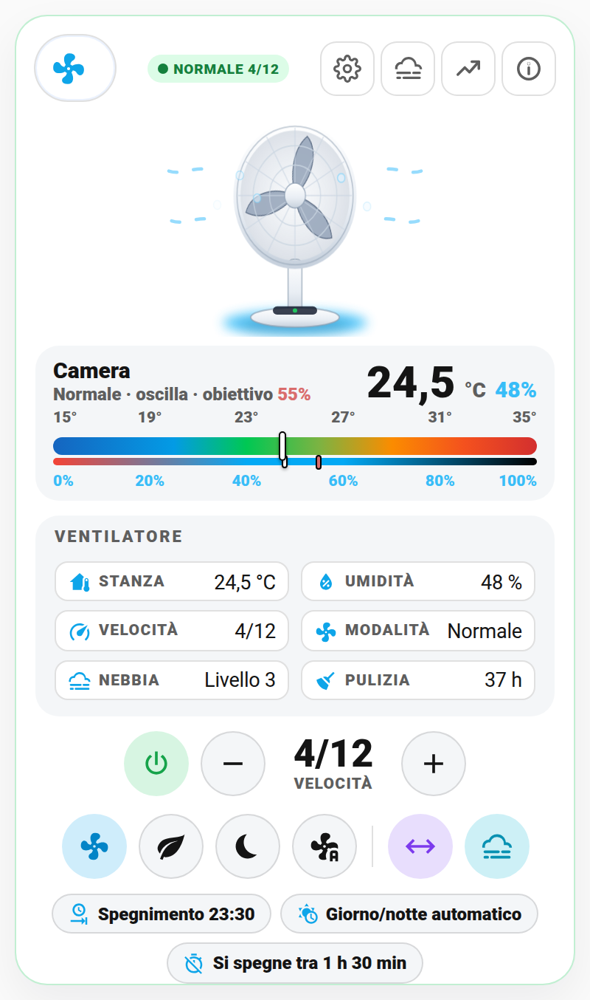
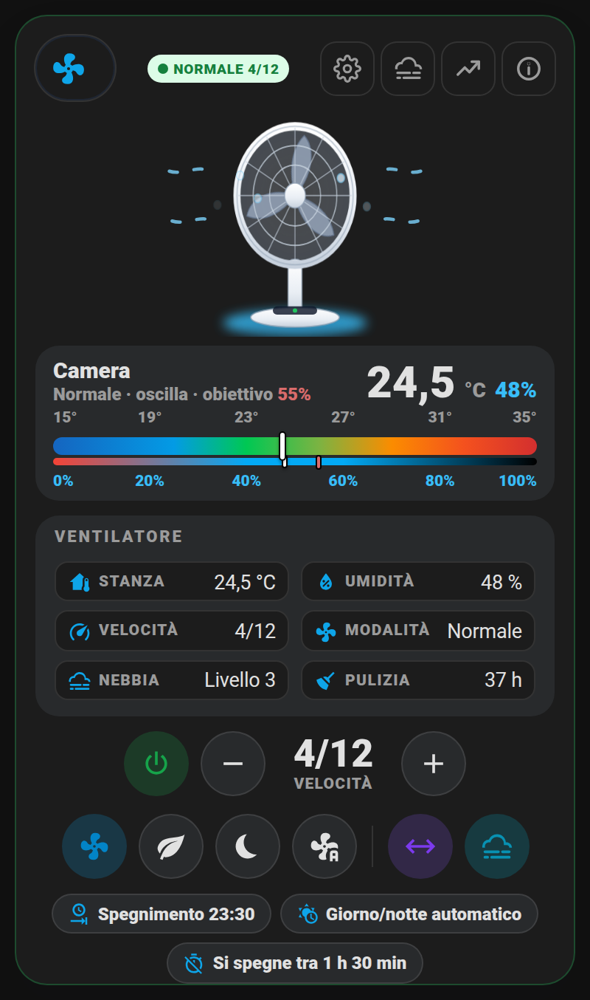
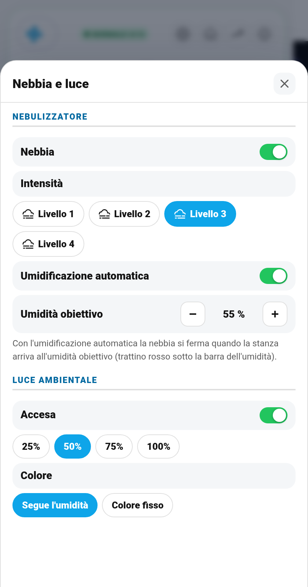
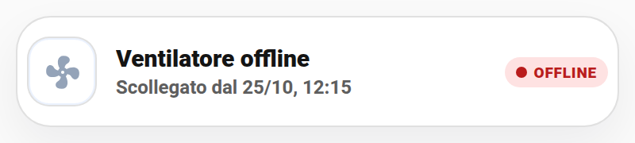

# 🌀 Card Ventilatore (`shc-fan-card`)

Il ventilatore in una card sola, nello stesso stile della [card Climatizzatore](clima.md): in alto il **ventilatore animato** (le pale girano più veloci quando alzi la velocità, la testa oscilla, esce la nebbia e la base si illumina del colore della luce), sotto la **gauge dritta** con temperatura e umidità della stanza, poi i dati e i comandi diretti. Parte già nel **layout centrato**.

| Chiaro | Scuro |
|---|---|
|  |  |

> **Esempio reale**: io la uso con un **Dreo DR-HEC005S**, ventilatore con nebulizzatore, luce ambientale e sensori di temperatura e umidità, integrato con l'integrazione [Dreo](https://github.com/jeffsteinbok/hass-dreo) di HACS. La card però funziona con **qualsiasi ventilatore** che in Home Assistant sia un'entità `fan.`: velocità, modalità (preset) e oscillazione le legge dall'entità stessa. Nebbia, luce, serbatoio e pulizia sono facoltativi: se il tuo ventilatore non li ha, quelle righe e quei pulsanti non compaiono.

## Cosa mostra

- **Ventilatore animato**: pale ferme da spento, sempre più veloci con la velocità; testa che oscilla se l'oscillazione è attiva; particelle di nebbia se il nebulizzatore è acceso; luce colorata alla base.
- **Gauge dritta**: temperatura e umidità della stanza. Se l'umidificazione automatica è attiva, un **trattino rosso** sotto la barra dell'umidità segna l'umidità obiettivo.
- **Riquadro Ventilatore**: stanza, umidità, velocità (es. 4/12), modalità, nebbia e ore dall'ultima pulizia (rosse oltre la soglia).
- **Comandi**: accendi/spegni, − e + per la velocità (un passo alla volta, accende anche se è spento), un pulsante per ogni modalità (Normale, Naturale, Notte, Auto…), oscillazione e nebbia.
- **Pillole programmazione**: accensione/spegnimento programmati, setup giorno/notte e "si spegne tra 1 h 30 min" (timer del ventilatore).
- **Riga di avviso**: ventilatore non raggiungibile, serbatoio dell'acqua vuoto, pulizia da fare.

## I pulsanti in alto

- **⚙️ Programmazione**: accensione e spegnimento programmati una tantum (orario), setup automatico giorno/notte e timer del ventilatore con scelte rapide (30 min, 1 h, 2 h…).
- **🌫️ Nebbia e luce**: nebulizzatore, livello della nebbia, umidificazione automatica, umidità obiettivo, luce ambientale (luminosità e modalità colore).
- **📈 Grafici**: temperatura e umidità, potenza se hai una presa smart.
- **ℹ️ Stato e manutenzione**: stato, serbatoio, ore dall'ultima pulizia, interruttori (suono, blocco bambini, display) e **Nascondi se scollegata**.

| Nebbia e luce | Striscia offline |
|---|---|
|  |  |

## 🚀 Metodo veloce: usa il mio package originale

Il package [`packages/ventilatore.yaml`](../packages/ventilatore.yaml) contiene:

- accensione e spegnimento programmati **una tantum** (si disattivano da soli dopo essere scattati);
- **setup automatico all'accensione**: di giorno modalità Normale, velocità media, nebbia e luce; di notte modalità Notte, velocità minima, nebbia bassa e luce spenta;
- avviso quando il **serbatoio è vuoto** e luce spenta in modalità notte;
- **promemoria pulizia** ogni 100 ore di utilizzo.

Cosa fare:

1. Copialo in `/config/packages/`.
2. Cerca e sostituisci `ventilatore` con il nome delle tue entità, e `mobile_app_il_tuo_telefono` / `mobile_app_del_partner` con i tuoi servizi di notifica.
3. Con un'altra marca controlla i nomi delle modalità (`normal`, `sleep`…) e togli le parti che il tuo ventilatore non ha.
4. Riavvia Home Assistant.

I nomi degli helper sono già quelli predefiniti della card (opzione `schedule`).

## Configurazione

Minima:

```yaml
type: custom:shc-fan-card
entity: fan.ventilatore
```

Quella che uso io:

```yaml
type: custom:shc-fan-card
name: Ventilatore
room_name: Camera
entity: fan.ventilatore
temperature_entity: sensor.ventilatore_temperatura
humidity_entity: sensor.ventilatore_umidita
mist_entity: switch.ventilatore_nebulizzatore
mist_level_entity: number.ventilatore_livello_nebbia
humidify_entity: switch.ventilatore_umidificazione
humidity_target_entity: number.ventilatore_umidita_target
light_entity: light.ventilatore_luce_ambientale
light_mode_entity: select.ventilatore_modalita_luce_ambientale
water_entity: binary_sensor.ventilatore_livello_acqua
cleaning_entity: sensor.ventilatore_utilizzo_dalla_pulizia
timer_off_entity: number.ventilatore_timer_spegnimento
switches:
  - entity: switch.ventilatore_suono_pannello
    name: Suono pannello
  - entity: switch.ventilatore_blocco_bambini
    name: Blocco bambini
  - entity: switch.ventilatore_illuminazione_display
    name: Display
```

| Opzione | Default | Cosa fa |
|---|---|---|
| `entity` | — | Il ventilatore (`fan.`), obbligatorio |
| `name` / `room_name` | Ventilatore / nome | Titolo della card / della gauge |
| `temperature_entity`, `humidity_entity` | — | Sensori della stanza |
| `mist_entity`, `mist_level_entity` | — | Nebulizzatore e suo livello |
| `humidify_entity`, `humidity_target_entity` | — | Umidificazione automatica e umidità obiettivo |
| `light_entity`, `light_mode_entity` | — | Luce ambientale e sua modalità |
| `water_entity` | — | `binary_sensor` acceso quando il serbatoio è vuoto |
| `cleaning_entity`, `cleaning_hours` | —, 100 | Ore dall'ultima pulizia e soglia dell'avviso |
| `timer_off_entity` | — | Timer di spegnimento del ventilatore (minuti) |
| `schedule` | helper del package | `on_enabled`, `on_time`, `off_enabled`, `off_time`, `auto_day` |
| `power_entity` | — | Potenza (W) della presa, per il grafico |
| `switches` | — | Interruttori nel popup Stato (`entity`, `name`) |
| `min`, `max` | 15, 35 | Scala della gauge |
| `show_levels` | `true` | Velocità come "4/12"; `false` per la percentuale |
| `hide_when_offline` | `false` | Nascondi se scollegato, vedi sotto |
| `layout_entity` | — | Menu layout classico/centrato, vedi [layout.md](layout.md) |

## 🙈 Nascondi se scollegato

D'inverno il ventilatore va in cantina. Con **Nascondi se scollegata** (casella nell'editor, oppure interruttore nel popup ℹ️) la card, quando non riceve dati, diventa una striscia bassa: "Ventilatore offline", da quando, bollino OFFLINE. Toccandola si apre un popup per rivedere la card completa o togliere l'opzione. Quando torna online la card completa ricompare da sola. La scelta fatta dal popup viene salvata nella dashboard (serve un utente amministratore, altrimenti resta solo su quel dispositivo).

## 💡 Idee d'uso

- **Notte tranquilla**: con il setup giorno/notte, accendendolo dopo le 23:30 parte già in modalità Notte, piano e con la luce spenta.
- **Spegnimento a tempo**: dal popup ⚙️ scegli "2 h" e ti addormenti senza pensarci.
- **Aria secca d'estate**: attiva l'umidificazione automatica con obiettivo 55%: il trattino rosso ti mostra quanto manca.
