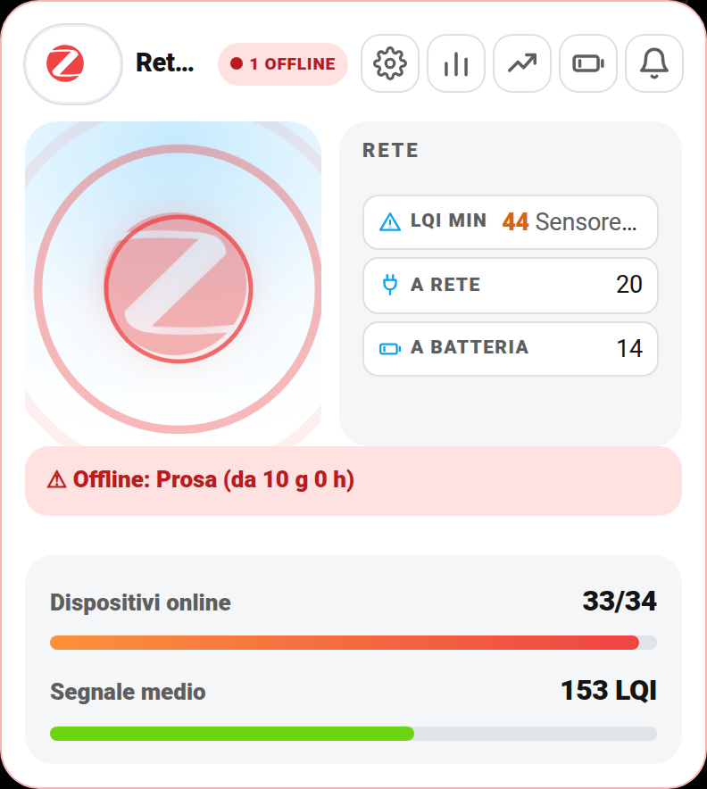
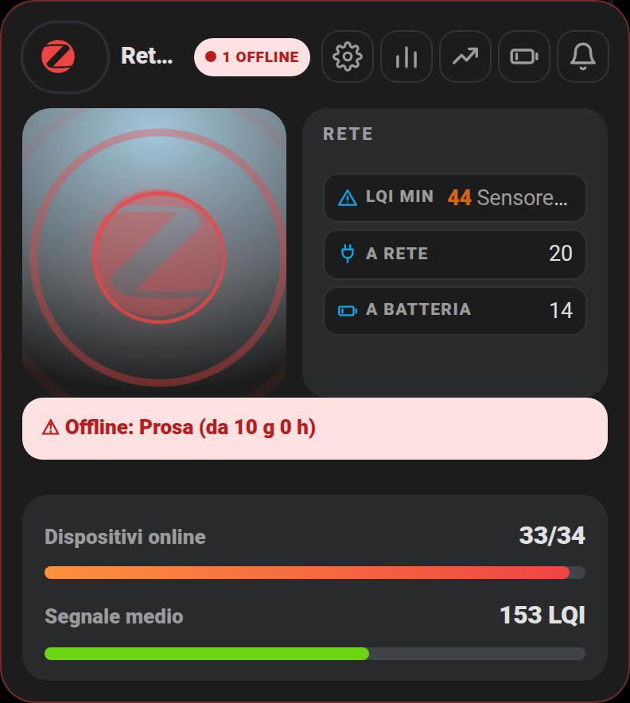
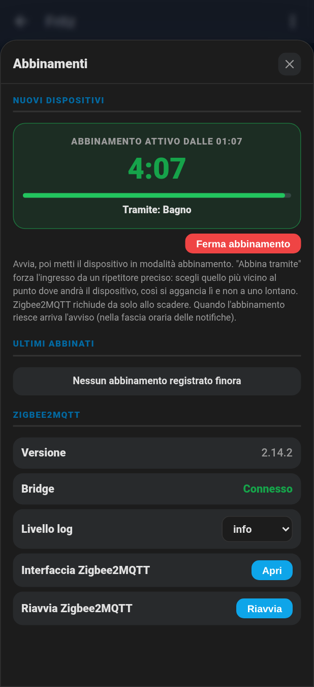
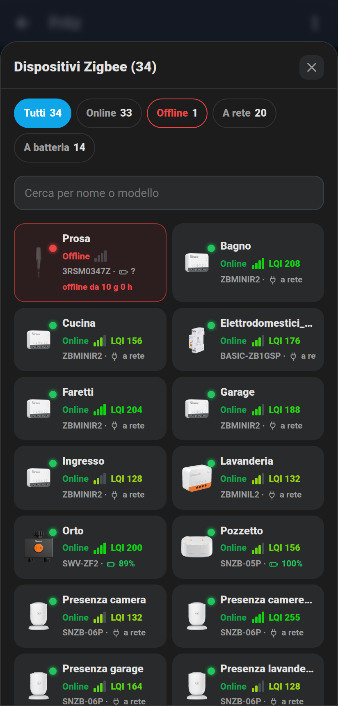
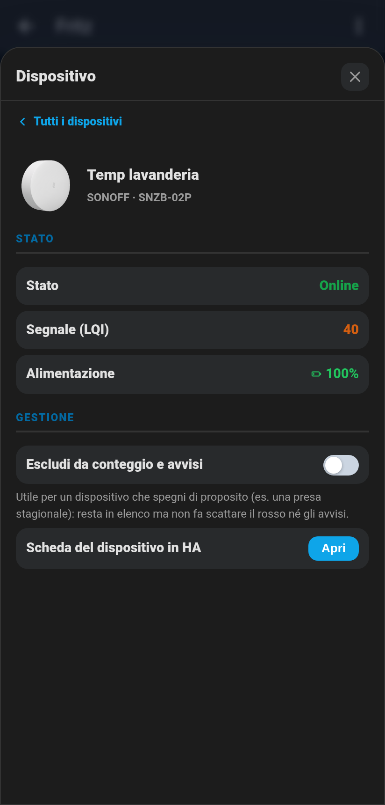
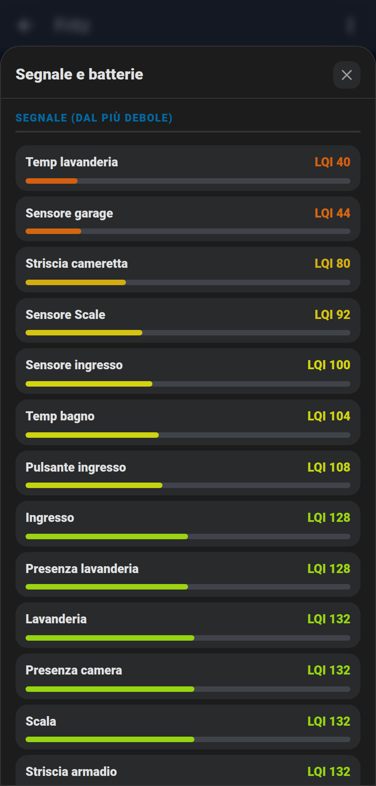
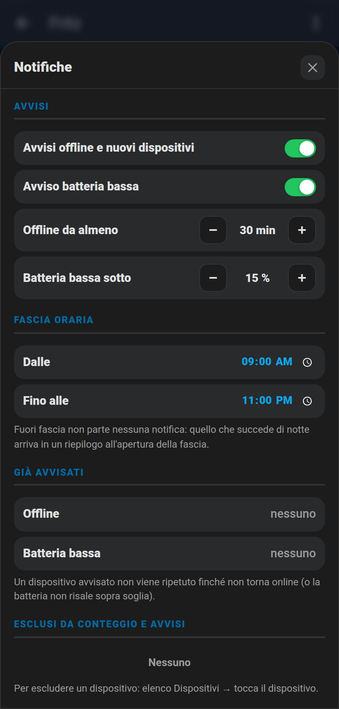
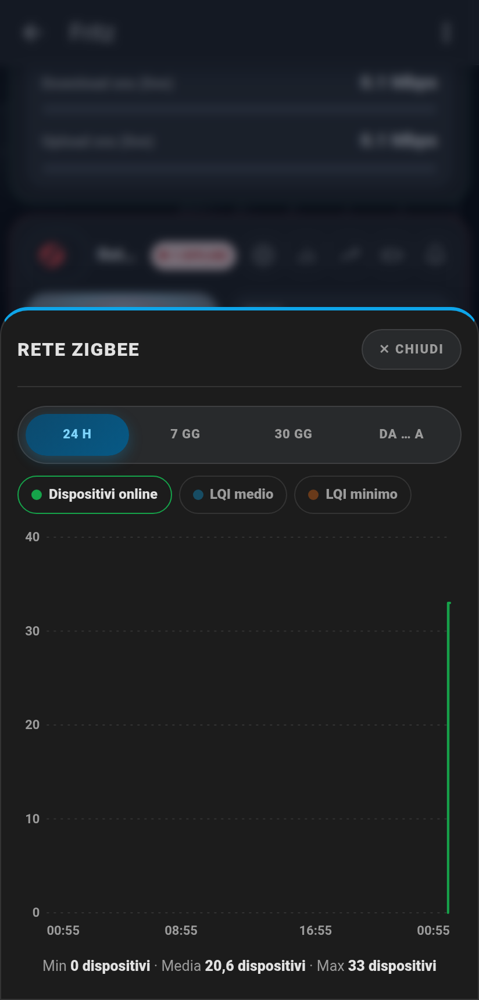

# 📡 Card Rete Zigbee (`shc-zigbee-card`)

Tutta la rete **Zigbee2MQTT** in una card: quanti dispositivi sono online, chi è offline e da quanto, segnale (LQI) medio e minimo, dispositivi a rete e a batteria, batterie scariche. Dai pulsanti in alto si apre l'elenco completo con le foto, si abbinano nuovi dispositivi e si regolano le notifiche.

| Chiaro | Scuro |
|---|---|
|  |  |

- **Simbolo Zigbee animato**: verde che gira con le onde radio quando tutto è online; rosso che trema, con onde veloci e bordo rosso, se anche un solo dispositivo è offline.
- **A destra**: LQI minimo (con il nome del dispositivo più debole), quanti dispositivi sono a rete e quanti a batteria. La riga **Batt. bassa** compare solo quando almeno un dispositivo scende sotto la soglia (15% di default).
- **Riga rossa** con i dispositivi offline e da quanto tempo: toccandola si apre l'elenco già filtrato sugli offline.
- **Barre**: dispositivi online e segnale medio. Toccandole si apre il grafico storico.

## Cosa ti serve prima di iniziare

- **Zigbee2MQTT** collegato a Home Assistant via MQTT, con la discovery attiva (è l'impostazione normale).
- In Zigbee2MQTT la **disponibilità** deve essere attiva (Impostazioni → Disponibilità, oppure `availability: enabled: true` nel suo `configuration.yaml`). Senza, nessun dispositivo risulta mai offline.
- Per vedere il **segnale (LQI)**: Zigbee2MQTT crea le entità `sensor.*_linkquality` **disabilitate**. Abilitale (Impostazioni → Entità → cerca "linkquality" → seleziona tutte → Abilita). Il package le esclude già dal recorder, così non riempiono il database.
- I dispositivi **a batteria** vengono dichiarati offline da Zigbee2MQTT solo dopo 25 ore senza messaggi (è un'impostazione di Zigbee2MQTT, non della card).

## 🚀 Metodo veloce: usa il mio package originale

Il package [`packages/centro_controllo_zigbee.yaml`](../packages/centro_controllo_zigbee.yaml) crea il sensore riepilogo che la card legge, gli helper delle notifiche e le automazioni. Con quello la card funziona **senza configurare nient'altro**: tutti i nomi delle entità del package sono già i valori predefiniti della card.

1. Copialo in `/config/packages/` (servono i [Packages](https://www.home-assistant.io/docs/configuration/packages/) attivi).
2. Cerca `mobile_app_il_tuo_telefono` (3 punti) e mettici il tuo `notify.mobile_app_xxx`.
3. Se il tuo Zigbee2MQTT usa un `base_topic` diverso da `zigbee2mqtt`, cambia i topic `zigbee2mqtt/...` nel file e metti `base_topic` nella card.
4. Riavvia Home Assistant.
5. Imposta una volta gli helper, dalla card stessa (🔔 Notifiche): soglia offline (es. 30 min), soglia batteria (es. 15%), fascia oraria (es. 9:00 – 23:00), avvisi accesi. Gli helper non hanno `initial:` apposta, così i valori scelti restano dopo ogni riavvio.
6. (Facoltativo) Foto dei dispositivi: la card cerca prima `/local/zigbee_img/<modello>.png`, poi la scarica da sola dal sito di Zigbee2MQTT. Metti in `/config/www/zigbee_img/` solo le foto che vuoi diverse da quelle ufficiali.

## Configurazione minima

```yaml
type: custom:shc-zigbee-card
entity: sensor.zigbee_dispositivi_offline
```

Configurazione che uso io (aggiunge lo stato del bridge e il pulsante per aprire Zigbee2MQTT):

```yaml
type: custom:shc-zigbee-card
name: Rete Zigbee
entity: sensor.zigbee_dispositivi_offline
bridge_entity: binary_sensor.zigbee2mqtt_bridge_connection_state
frontend_url: /45df7312_zigbee2mqtt
```

`frontend_url` è il percorso del pannello Zigbee2MQTT: lo vedi nella barra degli indirizzi quando apri Zigbee2MQTT dal menu laterale di Home Assistant (dalla 2026.x è `/<slug>`, es. `/45df7312_zigbee2mqtt`; il vecchio `/hassio/ingress/...` non esiste più e porta alla dashboard principale). Va bene anche un indirizzo `http://...` completo, che si apre in una nuova scheda.

## 🖊️ Editor visuale (senza YAML)

"Aggiungi card" → cerca **"Rete Zigbee"** → compila i campi. Con il mio package basta il primo campo (sensore riepilogo): tutti gli altri hanno già il valore giusto. Non ci sono elenchi `settings_sections` da incollare a mano: i popup di questa card si riempiono da soli.

## I pulsanti in alto

### ⚙️ Abbinamenti

**Avvia abbinamento (4 min)** apre la rete ai nuovi dispositivi. Durante l'abbinamento compare un **conto alla rovescia** grande con la barra del tempo che resta, e anche il badge della card mostra "ABBINAMENTO 3:42". **Ferma abbinamento** chiude subito.

**Abbina tramite** forza l'ingresso da un punto preciso della rete: tutta la rete, solo il coordinatore (la chiavetta) oppure un ripetitore scelto dall'elenco (i dispositivi alimentati a rete e online). Scegli il ripetitore più vicino al punto dove andrà il dispositivo: si aggancia lì e non a uno lontano.

Sotto: elenco degli **ultimi abbinati** con data e ora, versione di Zigbee2MQTT, stato del bridge, livello di log, pulsanti **Apri** (interfaccia di Zigbee2MQTT) e **Riavvia** (con conferma).

Il conto alla rovescia legge `sensor.zigbee_abbinamento_fine` del package (Zigbee2MQTT pubblica l'ora di chiusura in `bridge/info`). Senza il package la card stima 4 minuti dall'accensione dell'interruttore `permit join`.

### 📊 Dispositivi

Tutti i dispositivi con foto, stato, tacche e valore del segnale, modello e batteria (o "a rete"). Prima gli offline (bordo rosso e da quanto tempo sono offline), poi tutti gli altri in ordine alfabetico. Filtri **Tutti / Online / Offline / A rete / A batteria** e ricerca per nome o modello. Si apre anche toccando il simbolo Zigbee.

Toccando un dispositivo si apre la sua **scheda**: produttore e modello, stato, segnale, batteria, il pulsante per aprire la pagina del dispositivo in Home Assistant e l'interruttore **Escludi da conteggio e avvisi**. Serve per un dispositivo che spegni di proposito (es. una presa usata solo d'inverno): resta in elenco, ma non fa diventare rossa la card e non manda avvisi.

### 📈 Grafici

Storico di dispositivi online, LQI medio e LQI minimo (24 h / 7 gg / 30 gg / da … a). Vedi [grafici.md](grafici.md).

### 🔋 Segnale e batterie

Due classifiche: segnale dal più debole e batterie dalla più scarica, con barre colorate. Un dispositivo in fondo al segnale (sotto 50) ha bisogno di un ripetitore più vicino (qualsiasi dispositivo Zigbee alimentato a rete).

### 🔔 Notifiche

Tutto quello che riguarda gli avvisi:

- **Avvisi offline e nuovi dispositivi** e **Avviso batteria bassa**, accesi o spenti.
- **Offline da almeno** (minuti) e **Batteria bassa sotto** (%), con i pulsanti − e +.
- **Fascia oraria**: fuori fascia non parte nessuna notifica. Quello che succede di notte arriva in un **riepilogo** all'apertura della fascia.
- **Già avvisati**: un dispositivo avvisato non viene ripetuto finché non torna online (o la batteria non risale sopra soglia). Quando torna online arriva l'avviso "di nuovo online".
- **Esclusi**: i dispositivi esclusi dalla loro scheda, con la × per rimetterli nel conteggio.
- **Invia una notifica di prova**.

Se più di metà della rete va offline insieme arriva un solo avviso, "Rete Zigbee probabilmente ferma", invece di un elenco infinito. Un dispositivo nuovo appena abbinato manda una notifica e (se usi browser_mod) un popup su tutti i browser e tablet aperti.

## Campo per campo

| Campo | Obbligatorio | Predefinito | Descrizione |
|---|---|---|---|
| `entity` | **Sì** | — | Il sensore riepilogo del package, `sensor.zigbee_dispositivi_offline` |
| `name` | No | `Rete Zigbee` | Titolo della card |
| `bridge_entity` | No | — | `binary_sensor` di connessione del bridge Zigbee2MQTT: se va offline la card mostra "BRIDGE OFFLINE" |
| `permit_join_entity` | No | `switch.zigbee2mqtt_bridge_permit_join` | Interruttore abbinamento |
| `restart_entity` | No | `button.zigbee2mqtt_bridge_restart` | Pulsante di riavvio |
| `version_entity` | No | `sensor.zigbee2mqtt_bridge_version` | Versione di Zigbee2MQTT |
| `log_level_entity` | No | `select.zigbee2mqtt_bridge_log_level` | Livello di log |
| `pairing_end_entity` | No | `sensor.zigbee_abbinamento_fine` | Fine dell'abbinamento in corso, per il conto alla rovescia |
| `base_topic` | No | `zigbee2mqtt` | Topic base MQTT di Zigbee2MQTT (avvio/stop abbinamento) |
| `frontend_url` | No | — | Percorso o indirizzo dell'interfaccia Zigbee2MQTT (senza, il pulsante Apri non compare) |
| `image_path` | No | `/local/zigbee_img/` | Cartella delle foto dei dispositivi |
| `history_entity` | No | `input_text.zigbee_ultimi_abbinati` | Ultimi abbinamenti |
| `excluded_entity` | No | `input_text.zigbee_esclusi` | Elenco dei dispositivi esclusi |
| `notify` | No | helper del package | `enabled`, `battery_enabled`, `offline_minutes`, `battery_threshold`, `from`, `to`, `notified`, `battery_notified`, `pending`, `test_script` |
| `graph` | No | sensori del package | `online`, `lqi_avg`, `lqi_min` |
| `layout_entity` / `layout` | No | — | Layout classico/centrato, vedi [layout.md](layout.md) |

## 🖼️ Tutte le schermate

| Abbinamenti | Dispositivi | Scheda dispositivo |
|---|---|---|
|  |  |  |

| Segnale e batterie | Notifiche | Grafici |
|---|---|---|
|  |  |  |

## Come funziona il package

- Il sensore `sensor.zigbee_dispositivi_offline` si ricalcola a ogni messaggio di disponibilità di Zigbee2MQTT e comunque ogni minuto. Un dispositivo è **offline** quando tutte le sue entità sono non disponibili. L'elenco completo (nome, modello, produttore, online, LQI, batteria, offline da) sta negli attributi.
- L'ora di stacco ("offline da") e l'elenco dei già avvisati sono salvati in `input_text`: restano giusti anche dopo un riavvio di Home Assistant o un ricaricamento dei template, senza avvisi doppi.
- Gli avvisi si calcolano dallo **stato** (chi è offline oltre soglia e non è ancora stato avvisato), non dagli eventi: per questo funzionano anche con la fascia oraria e dopo un riavvio.
- I sensori `sensor.zigbee_segnale_medio`, `sensor.zigbee_segnale_minimo` e `sensor.zigbee_dispositivi_online` sono numeri semplici con storico, per i grafici.

Grazie all'amico che ha fatto la prima card "Rete Zigbee" (foto dei dispositivi, filtri, tacche del segnale): questa card ne riprende l'idea.
